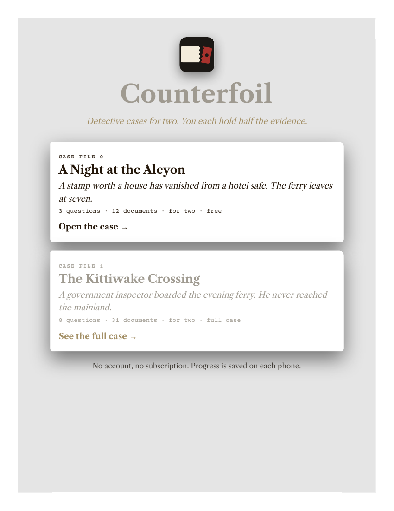
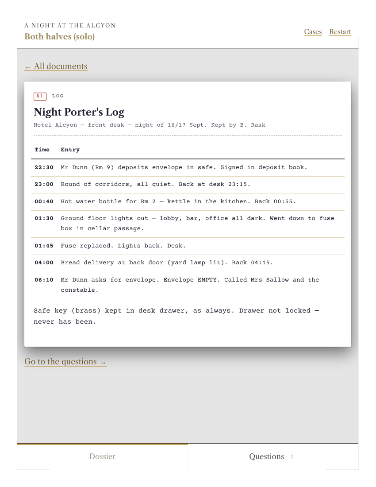
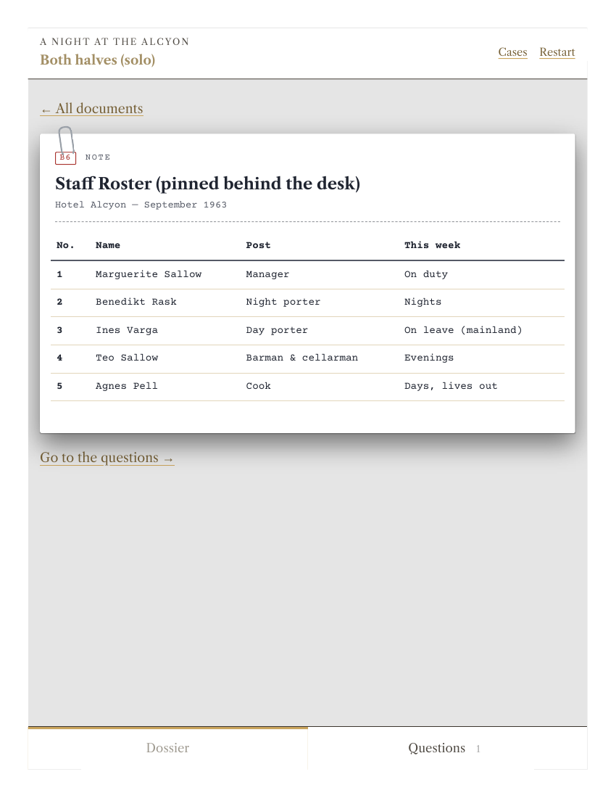
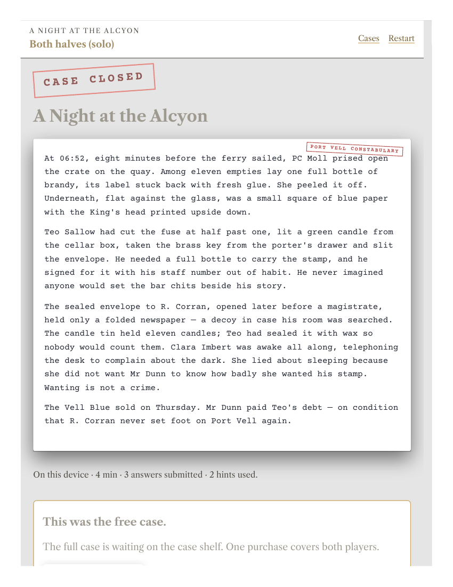

# Counterfoil: "A Night at the Alcyon" — Agent Session Record (2026-11-24)

**AGENT session, not a human session.** Played by one assistant operator via the agent browser. **It is not gate evidence and enters no release denominator.**

## Identity, preparation and actual timing

- Protocol ID / registration: none — agent session, 2026-11-24, unregistered
- Source: free demo case at https://lantern-vale-studio.itch.io/counterfoil-demo (narrative-deduction, two-player shared-story; Archive vs Field halves, codeword-gated evidence, solo mode); browser task 42da457b-5588-585d-ab16-178937b20aac, ran 18:16–18:22 PST
- Actual UTC date: 2026-11-25, 02:16–02:22 UTC
- Participant pseudonym: none — no account
- Human observer: none — agent operator, self-observed
- Device: agent browser (cloud), print captures as full-page PDFs

## Actual player journey

| Observation | Stage / action | Visible response / consequence | Help, confusion, pause |
|---|---|---|---|
| 1 | Title shelf | "Counterfoil", "Detective cases for two. You each hold half the evidence.", CASE FILE 0 "A Night at the Alcyon" ("3 questions · 12 documents · for two · free"), CASE FILE 1 "The Kittiwake Crossing" (greyed, full case), "No account, no subscription. Progress is saved on each phone." | — |
| 2 | Document A1 | "Night Porter's Log" — entries 22:30–06:10 (envelope deposited; 01:30 lights out, fuse box; 06:10 envelope EMPTY) | — |
| 3 | Document B6 | "Staff Roster (pinned behind the desk)" — five staff, No. 4 Teo Sallow (Barman & cellarman, Evenings) | — |
| 4 | Case closed | "CASE CLOSED" stamp, "On this device · 4 min · 3 answers submitted · 2 hints used.", "This was the free case." | The resolution itself is not retold in this record (copyright discipline) |

## Outcome and assistance evidence

| Field | Agent value | Reason |
|---|---|---|
| `case_completed` | true (agent) | Free case solved start to finish in ~4 min; CASE CLOSED frame captured [REAL] |
| `solo_mode` | true | "Both halves (solo)" header on the document frames [REAL] |
| `two_player` | not tested | Solo mode only; the two-player shared-story halves were not played with two people |

- The task's two-hints detail is NOT visible on page 1 (not claimed).
- Release date 15 Nov 2026 and the rejected MysteryUs alternative are [SECONDARY] (task's search).

## Shareable record check

- [x] Contains only agent observations; no personal text. No case content retold beyond the title shelf and document headers.
- [x] Outcomes reflect this attempt; assistance and failures remain visible.
- [ ] Saved into the private study folder — this record lives in the play dir, not Git, until Sakura confirms it (confirmation gate).

## Evidence gallery

Title shelf [REAL] — "Counterfoil", "Detective cases for two. You each hold half the evidence.", "A Night at the Alcyon" ("3 questions · 12 documents · for two · free"), "No account, no subscription."

Document A1 "Night Porter's Log" [REAL] — entries 22:30–06:10 (01:30 lights out, fuse box; 06:10 envelope EMPTY).

Document B6 "Staff Roster" [REAL] — five staff, No. 4 Teo Sallow (Barman & cellarman, Evenings).

"CASE CLOSED" [REAL] — "On this device · 4 min · 3 answers submitted · 2 hints used.", "This was the free case."
