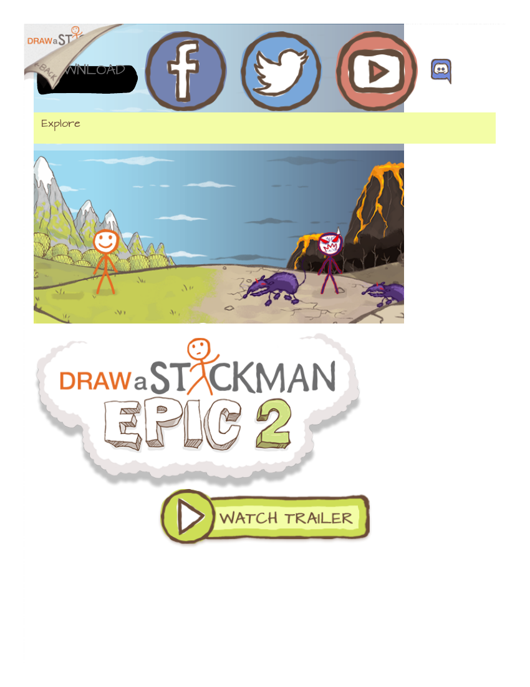
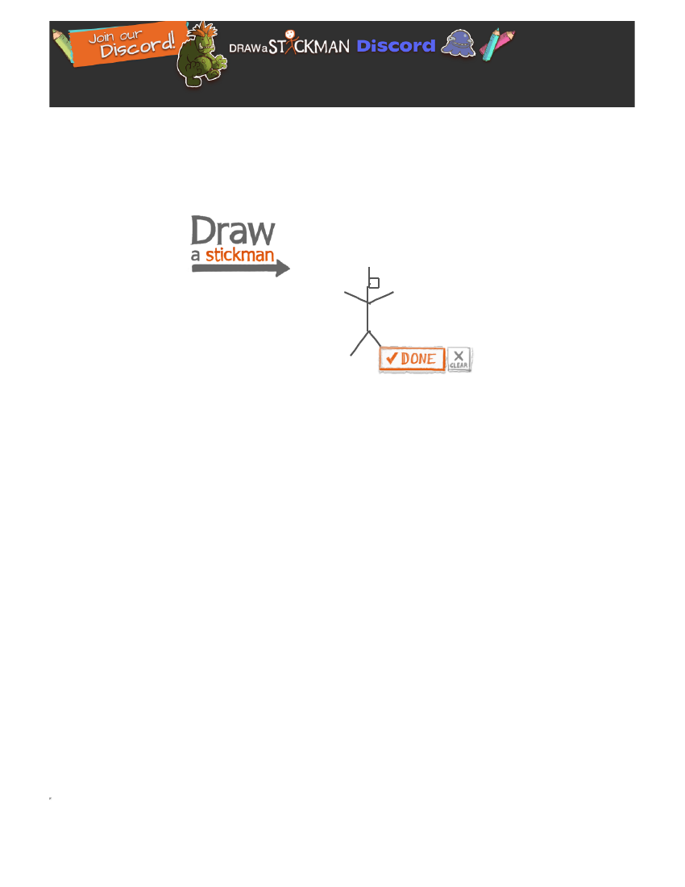
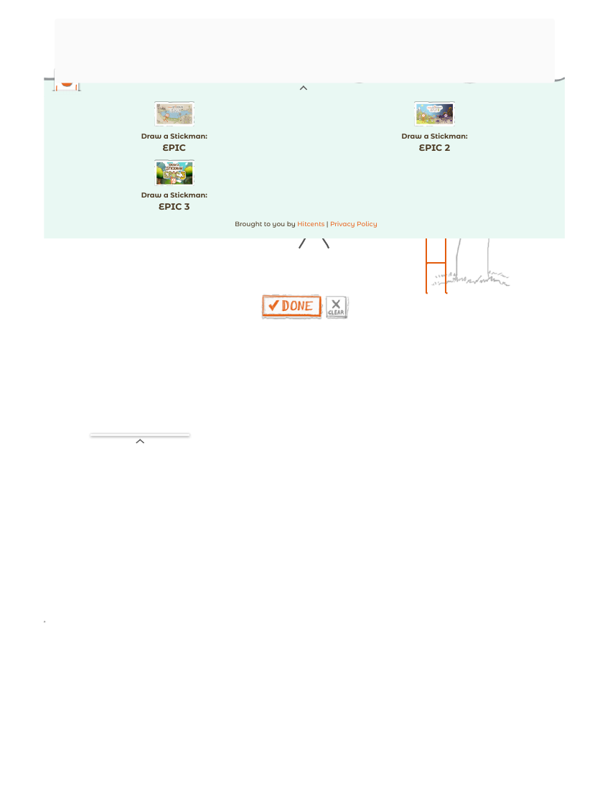
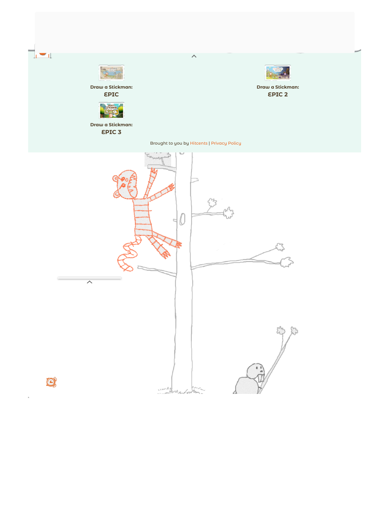
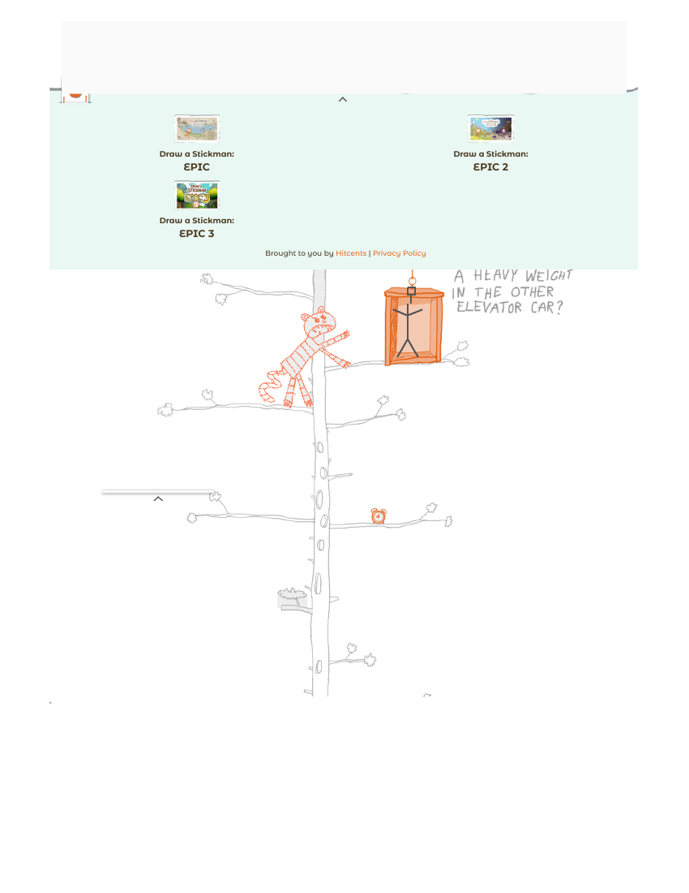
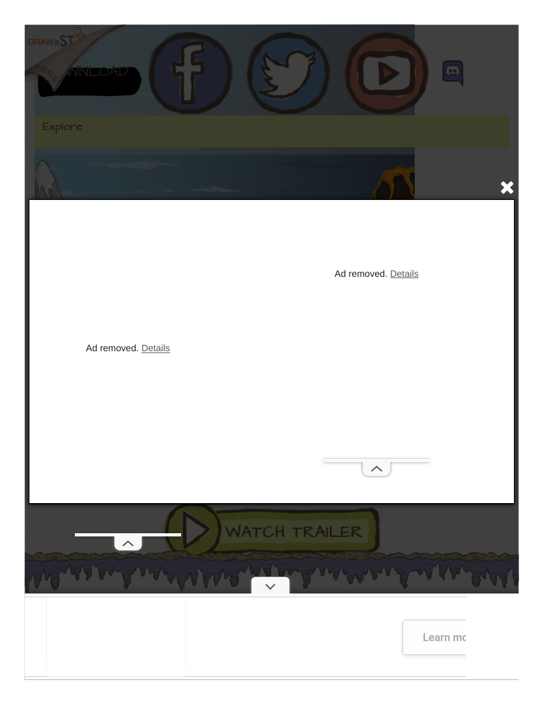
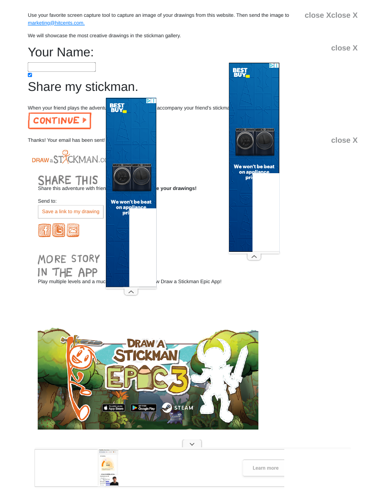

# Draw a Stickman — Agent Session Record (2026-11-24)

**AGENT session, not a human session.** Played by one assistant operator via the agent browser. **It is not gate evidence and enters no release denominator.**

## Identity, preparation and actual timing

- Protocol ID / registration: none — agent session, 2026-11-24, unregistered
- Source: https://drawastickman.com (Episode 2, free web game) and the EPIC 2 page; browser task 6cd34b44-d0b3-5f0d-b754-5949e2801a25, ran 18:16–18:53 PST
- Actual UTC date: 2026-11-25, 02:16–02:53 UTC
- Participant pseudonym: none — no account
- Human observer: none — agent operator, self-observed
- Device: agent browser (cloud), print captures as full-page PDFs (2 pages each; the game canvas is on page 2, with a Hitcents promo strip overlapping the top of the game on page 2)

## Actual player journey

| Observation | Stage / action | Visible response / consequence | Help, confusion, pause |
|---|---|---|---|
| 1 | Homepage | Discord banner; EPIC / EPIC 2 / EPIC 3 tiles | — |
| 2 | EPIC 2 page | DOWNLOAD + WATCH TRAILER, hero art, no Play button, no embedded game | EPIC 2 NOT played — playing needs a download/install; slot stays [OPEN] |
| 3 | Episode 2, stickman drawn | Square head, DONE / CLEAR | Slow held strokes drew on the SVG/Raphaël surface (contrast with 2026-11-17, when the canvas could not be captured and no mouse input worked) |
| 4 | Ladder prompt | Orange ladder drawn (lower rungs visible at the right edge; the prompt and the stickman are cut by the promo strip) | Partial frame — see gallery |
| 5 | Tiger prompt | Scene matches tree + ladder; tiger / prompt not legible | Partial frame |
| 6 | Costume | Stickman in orange tiger stripes climbing the tree | — |
| 7 | Pulley reveal | Costumed stickman climbing toward an orange elevator car (stick figure inside), handwritten prompt "A HEAVY WEIGHT IN THE OTHER ELEVATOR CAR?", small orange alarm clock on a branch | — |
| 8 | Ending / share | "Share my stickman.", "MORE STORY IN THE APP", EPIC 3 promo | Episode 2 played start to finish |
| 9 | Trailer attempt | Trailer lightbox: player area white/empty ("Ad removed. Details"), no video playing | The task's "Unable to play media" error text is NOT legible on the frame [SECONDARY] |

## Outcome and assistance evidence

| Field | Agent value | Reason |
|---|---|---|
| `episode2_completed` | true (agent) | Played start to finish; ending/share page captured [REAL] |
| `epic2_played` | false | No Play button; download/install required [OPEN] |
| `drawings_verified` | partial | Stickman, ladder (partial), tiger costume, pulley verified [REAL]; bucket, weight, wings NOT capture-verified — f9/f11/f13 page-2 renders are pixel-identical to f8/f10/f12, so those three drawings are [SECONDARY] (task prose only) |

- Market record [SECONDARY]: Google Play listing (3.7 stars, 1.42M reviews, 10M+ downloads, IAP $0.99–$5.99). Per the paywalled-competitor rule: storefront snapshot + trailer attempt + market record + Episode 2 substitute are on file.
- Episode 2 was also played in the Nov-15 round per a past-conversation note — this is a fresh replay, not a reuse.

## Shareable record check

- [x] Contains only agent observations; no personal text.
- [x] Outcomes reflect this attempt; assistance and failures remain visible (EPIC 2 unplayed, three drawings unverified, trailer empty).
- [x] Filed to the remote as PR #34 (branch competitor-plays-2026-11-24 → main), pending merge.

## Evidence gallery

EPIC 2 page [REAL] — hero art, "DRAW a STICKMAN EPIC 2", "WATCH TRAILER", DOWNLOAD. No Play button, no embedded game.

Stickman drawn [REAL] — square head, DONE / CLEAR buttons.

Ladder beat, page 2 [REAL, partial] — the promo strip covers the scene's top; below it, the orange ladder's lower rungs at the right edge and DONE / CLEAR. The prompt and the stickman are cut off.

Tiger costume [REAL] — the stickman in orange tiger stripes climbing the tree.

Pulley reveal [REAL] — costumed stickman climbing toward an orange elevator car (stick figure inside), "A HEAVY WEIGHT IN THE OTHER ELEVATOR CAR?", small orange alarm clock on a branch.

Trailer attempt [REAL] — the lightbox is white and empty ("Ad removed. Details"), no video playing.

Ending / share [REAL] — "Share my stickman.", "MORE STORY IN THE APP", EPIC 3 promo.
