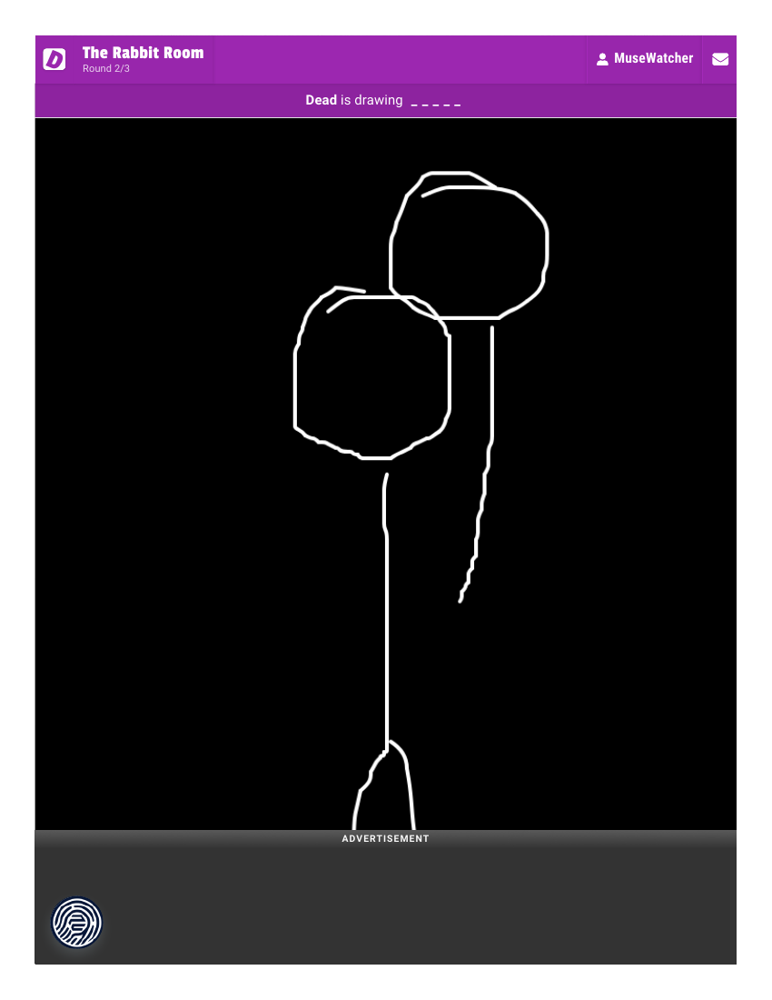
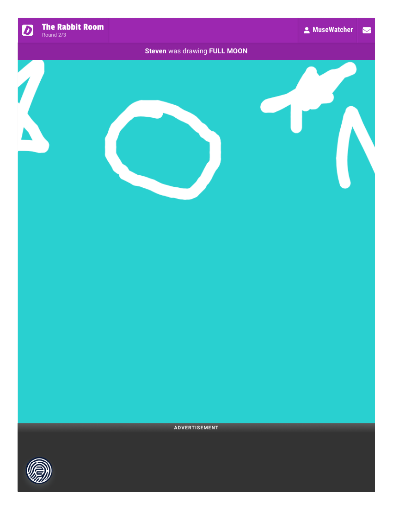
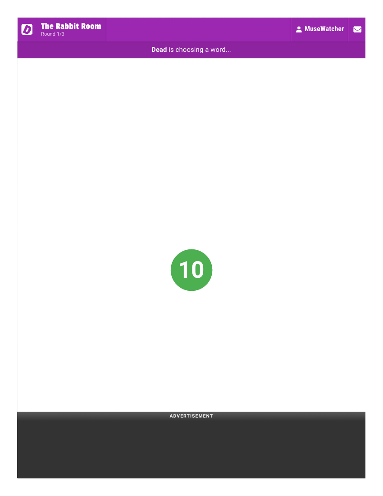
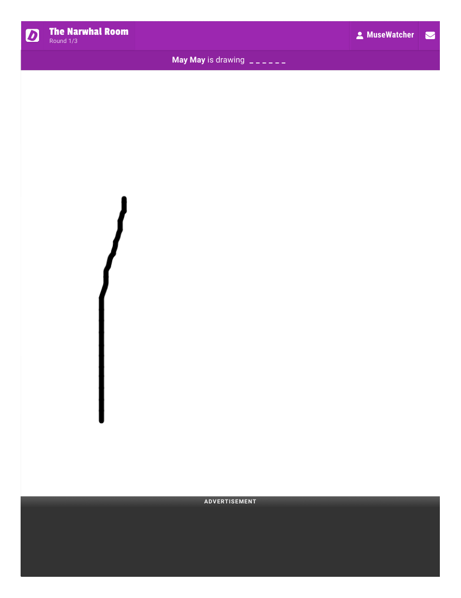
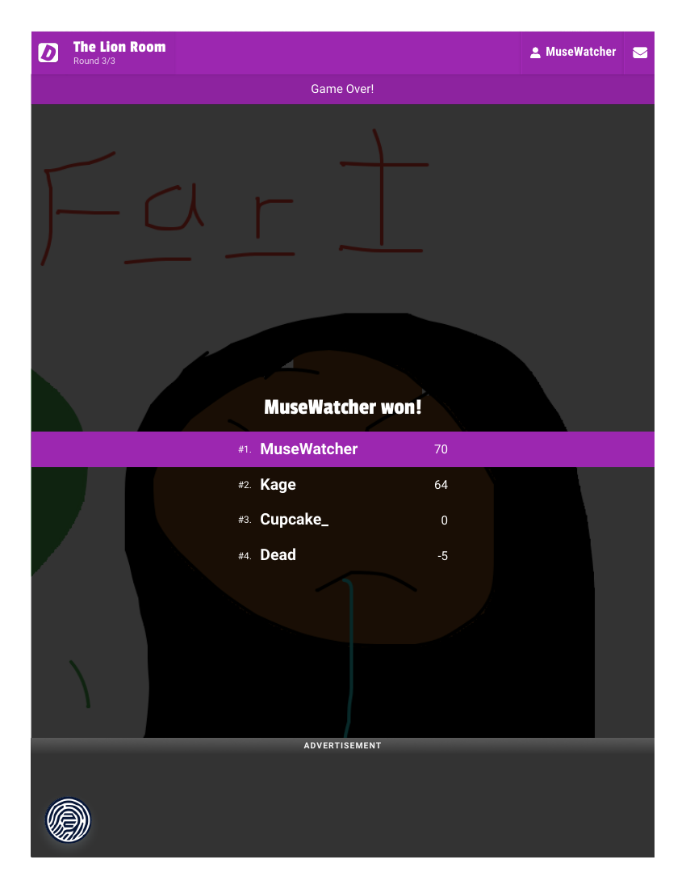

# Drawasaurus (refresh) — Agent Session Record (2026-11-24)

**AGENT session, not a human session.** Played by one assistant operator via the agent browser. The session is a refresh of the 2026-10-28 Drawasaurus study; no Oct-28 screenshots were available to the task, so no change-vs-Oct-28 is claimed. **It is not gate evidence and enters no release denominator.**

## Identity, preparation and actual timing

- Protocol ID / registration: none — agent session, 2026-11-24, unregistered
- Source: https://drawasaurus.org, free, no account; browser task 5030747e-f046-57ba-8458-d29b93b62639, ran 18:18–19:13 PST
- Actual UTC date: 2026-11-25, 02:18–03:13 UTC
- Participant pseudonym: MuseWatcher (auto-assigned guest)
- Human observer: none — agent operator, self-observed
- Device: agent browser (cloud), print captures as full-page PDFs

## Actual player journey

| Observation | Stage / action | Visible response / consequence | Help, confusion, pause |
|---|---|---|---|
| 1 | Rabbit Room, guessing | "Dead is drawing _ _ _ _ _", Round 2/3, black canvas, white line drawing | Guesses per task prose [SECONDARY] |
| 2 | Rabbit Room, reveal | "Steven was drawing FULL MOON", teal canvas, white circle + star/arrow marks | Corroborates the correct "full moon" guess (+50 per task) |
| 3 | Rabbit Room, new game | "Dead is choosing a word...", green countdown showing 10 | The 15-second word-choice window, corroborated on frame |
| 4 | Narwhal Room | "May May is drawing _ _ _ _ _ _", Round 1/3, one black stroke (drawing just started) | The room ceased to exist after May May left ("Room doesn't exist!") |
| 5 | Monkey Room | The creator Sharath banned the operator shortly after joining ("MuseWatcher was banned by Sharath") | The room's chat had "pvt" — the group wanted a private game; not played there |
| 6 | Lion Room, Game Over | "MuseWatcher won! / #1. MuseWatcher 70 / #2. Kage 64 / #3. Cupcake_ 0 / #4. Dead -5" | The operator won the game |
| 7 | Drawing turn | Reached the word-choice screen five times and failed each time (15s window vs 5–20s browser round trips); "Swing" was chosen but the turn was cut by an AFK kick before any drawing could be verified; 3 drag strokes unverified | [OPEN] — no drawing-turn capture exists |

## Outcome and assistance evidence

| Field | Agent value | Reason |
|---|---|---|
| `game_won` | true (agent) | "MuseWatcher won!" with exact standings captured [REAL] |
| `drew` | false | No drawing turn completed; the site worked — the blocker is this browser's latency against the game's 15-second window and AFK timer |
| `afk_kicks` | 4 (task prose) | Twice while PDF saves ran long, once during a 55-second wait, once when the "Still playing?" prompt expired [SECONDARY] |

- Mechanics observed first-hand (task prose [SECONDARY] except where the frames corroborate): 3 rounds per game; 90-second drawing turns; 15-second word-choice window offering 3 words; hint letters during a turn; first correct guesser +50, second +20; drawer +14 when someone guesses; -5 when nobody guesses; "Still playing?" check after ~2.5–3 minutes without a click, ~15-second countdown, then kick; room creators can ban; empty rooms are deleted; players who miss the choice window are skipped.
- Change-vs-Oct-28: NOT made [OPEN] — the task correctly refused (no study copy given).

## Shareable record check

- [x] Contains only agent observations; no personal text.
- [x] Outcomes reflect this attempt; assistance and failures remain visible (ban, AFK kicks, drawing turn open).
- [x] Filed to the remote as PR #34 (branch competitor-plays-2026-11-24 → main), pending merge.

## Evidence gallery

Guessing [REAL] — "The Rabbit Room, Round 2/3, Dead is drawing _ _ _ _ _", black canvas, white line drawing.

Round-end reveal [REAL] — "Steven was drawing FULL MOON", teal canvas. Not an AFK screen (the task's uncertainty, resolved by verification).

Game start [REAL] — "Dead is choosing a word...", green countdown showing 10.

Narwhal Room [REAL] — "May May is drawing _ _ _ _ _ _", one black stroke.

Game Over, win [REAL] — "MuseWatcher won! / #1. MuseWatcher 70 / #2. Kage 64 / #3. Cupcake_ 0 / #4. Dead -5".
