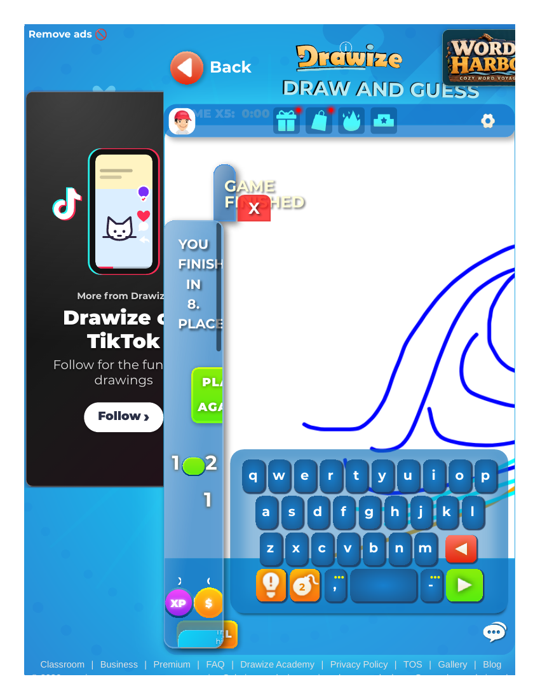
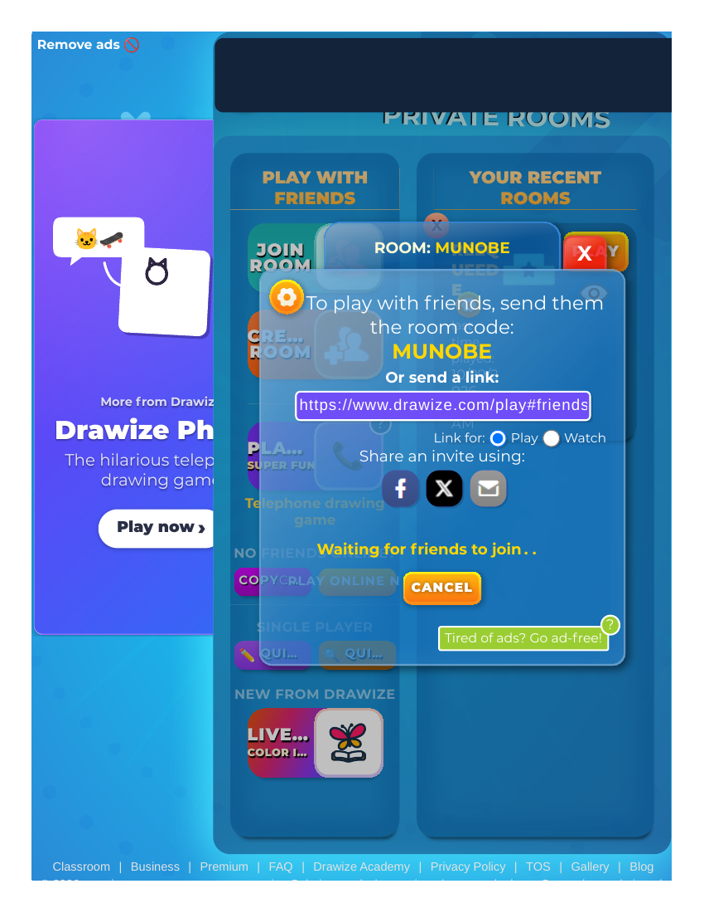
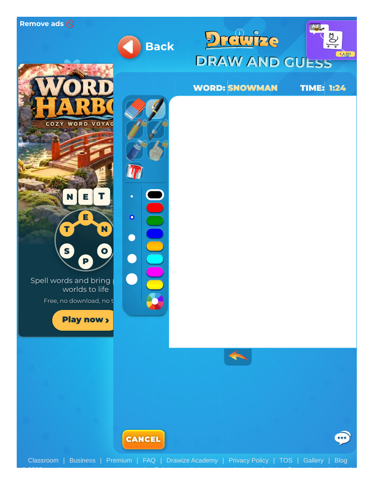
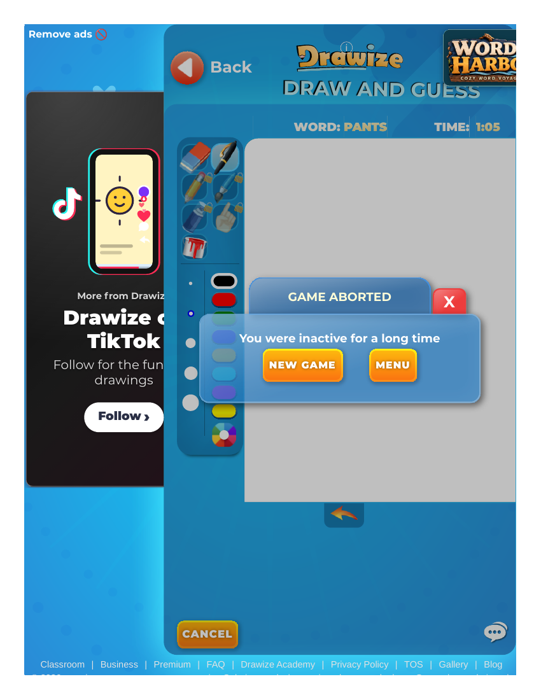
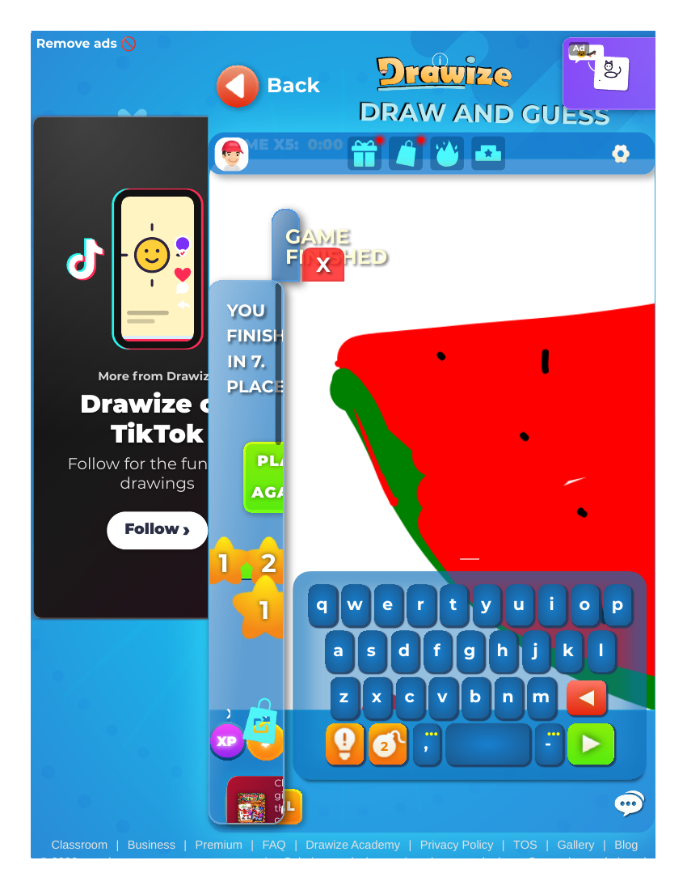

# Drawize (refresh) — Agent Session Record (2026-11-24)

**AGENT session, not a human session.** Played by one assistant operator via the agent browser. The session is a refresh of the 2026-10-28 Drawize study; no Oct-28 screenshots were available to the task, so no change-vs-Oct-28 is claimed. **It is not gate evidence and enters no release denominator.**

## Identity, preparation and actual timing

- Protocol ID / registration: none — agent session, 2026-11-24, unregistered
- Source: https://drawize.com, free, logged out; browser task a2bc2f20-00dd-578e-9a7c-b89cdfdb6f34, ran 18:18–19:12 PST
- Actual UTC date: 2026-11-25, 02:18–03:12 UTC
- Participant pseudonym: Merry Capybara (auto-assigned guest)
- Human observer: none — agent operator, self-observed
- Device: agent browser (cloud), print captures as full-page PDFs (the game panel is CUT OFF at the right edge in every frame — the canvas extends past the print width)

## Actual player journey

| Observation | Stage / action | Visible response / consequence | Help, confusion, pause |
|---|---|---|---|
| 1 | Game 1, guessing | "DRAW AND GUESS", TIME 1:20, a face being drawn on the canvas | The drawing sits at the right edge, partly off-frame |
| 2 | Game 1, aborted | "GAME ABORTED / You were inactive for a long time", "Trying to reconnect... Please check your internet connection.", NEW GAME / MENU, TIME 0:35 | Inactivity abort fired in games 1, 4, 5, 6 per task prose [SECONDARY] |
| 3 | Game 2, results | "GAME FINISHED / YOU FINISHED IN 8. PLACE!", TIME X5: 0:00, blue wave drawing behind the modal | XP numbers cut off on the frame [SECONDARY] |
| 4 | Game 3 | Guessing in progress, TIME 1:21, a black+orange curve at the right edge | The task left this capture unverified; verification resolves it as a guessing turn, NOT a lobby |
| 5 | Private room | "ROOM: MUNOBE", "send them the room code: MUNOBE", invite link, "Waiting for friends to join.." | "STILL NO FRIENDS ONLINE" after ~1 min per task prose [SECONDARY] |
| 6 | Matchmaking wait | "PLEASE WAIT / Looking for other players; please wait", countdown 88, over PRIVATE ROOMS; Recent Rooms: MUNOBE (last played 11/24/2026) and a second room (last played 10/29/2026, 12:41:01 AM) | The task left this capture unverified; verification resolves it as the matchmaking wait modal, NOT a lobby |
| 7 | Game 5, drawing turn start | "WORD: SNOWMAN", TIME 1:24, blank canvas, tools + colors | Turn aborted by inactivity per task prose [SECONDARY] |
| 8 | Game 6, drawing turn aborted | "WORD: PANTS", TIME 1:05, grey canvas, "GAME ABORTED / You were inactive for a long time" | The 4-stroke PANTS drawing is not on the frame |
| 9 | Game 7, drawing turn | "WORD: DIAMOND", TIME 1:00, BLANK white canvas | Discrepancy: the task claims the diamond with facet lines and two sparkles at TIME 0:54, but the frame shows a blank canvas at TIME 1:00. The diamond is [SECONDARY] (task prose); it may exist off-frame past the right-edge cut — undeterminable from this PDF |
| 10 | Game 7, results | "GAME FINISHED / YOU FINISHED IN 7. PLACE!", TIME X5: 0:00, KHAN's watermelon behind the modal | XP numbers cut off on the frame [SECONDARY] |

## Outcome and assistance evidence

| Field | Agent value | Reason |
|---|---|---|
| `quick_play_games` | 7 (task prose) | Games 2 and 7 completed all 7 rounds; 8th place (game 2) and 7th place (game 7) captured [REAL] |
| `correct_guesses` | 2 (task prose) | BOX (16 pts), ELBOW (5 pts) — [SECONDARY], not on the frames |
| `drawing_turn_completed` | not verified | The DIAMOND drawing is not on its frame; SNOWMAN and PANTS turns were aborted |
| `quick_play_lobby` | not captured | No lobby frame exists in the 12 PDFs; the two captures the task left unverified are a guessing turn and a matchmaking wait modal |

- Guest profile 50 XP/10 coins at start → 190 XP/10 coins at end is [SECONDARY].
- Change-vs-Oct-28: NOT made [OPEN] — the task correctly refused (no study copy given).

## Shareable record check

- [x] Contains only agent observations; no personal text.
- [x] Outcomes reflect this attempt; assistance and failures remain visible (inactivity aborts, blank DIAMOND frame, no lobby capture).
- [x] Filed to the remote as PR #34 (branch competitor-plays-2026-11-24 → main), pending merge.

## Evidence gallery

Game 2 results [REAL] — "YOU FINISHED IN 8. PLACE!", blue wave drawing behind the modal.

Private room [REAL] — "ROOM: MUNOBE", "Waiting for friends to join..".

Drawing turn start [REAL] — "WORD: SNOWMAN", TIME 1:24, blank canvas.

Drawing turn aborted [REAL] — "WORD: PANTS", TIME 1:05, grey canvas, "GAME ABORTED / You were inactive for a long time".

Game 7 results [REAL] — "YOU FINISHED IN 7. PLACE!", KHAN's watermelon behind the modal.
