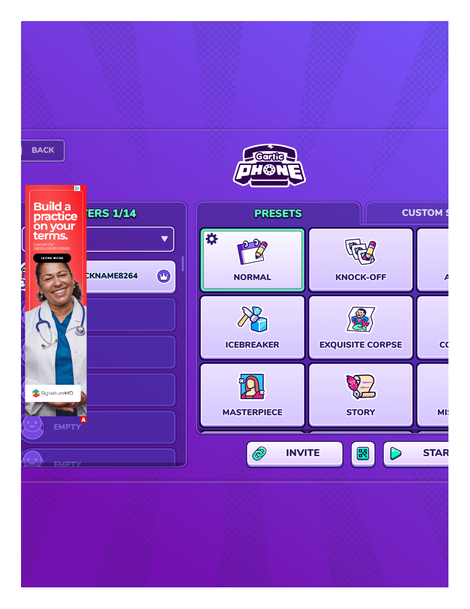
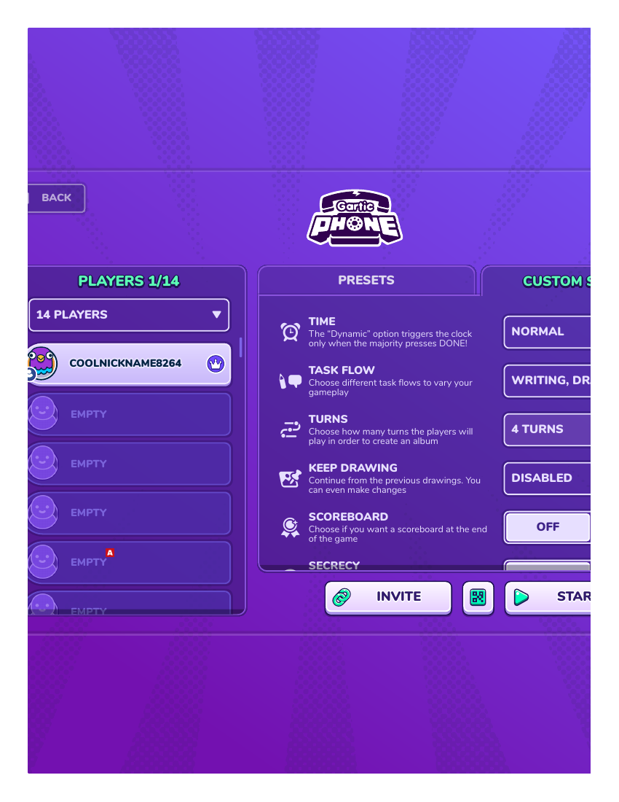

# Gartic Phone (refresh) — Agent Session Record (2026-11-24)

**AGENT session, not a human session.** Played by one assistant operator via the agent browser, because the agent browser is the only live-browser route in this environment. The session is a refresh of the 2026-10-28 Gartic Phone study; no Oct-28 screenshots were available to the task, so no change-vs-Oct-28 is claimed. **It is not gate evidence and enters no release denominator.**

## Identity, preparation and actual timing

- Protocol ID / registration: none — agent session, 2026-11-24, unregistered
- Source: https://garticphone.com, free, no account; browser task 08fb14cd-d0a2-58e2-ae65-e4e0a8152913, ran 18:16–18:33 PST
- Actual UTC date: 2026-11-25, 02:16–02:33 UTC
- Participant pseudonym: COOLNICKNAME8264 (auto-assigned)
- Human observer: none — agent operator, self-observed
- Device: agent browser (cloud), print captures as full-page PDFs

## Actual player journey

| Observation | Stage / action | Visible response / consequence | Help, confusion, pause |
|---|---|---|---|
| 1 | First load | Cloudflare blocked the first load; cleared once via a fresh-browser route move | The block recurred on every additional invite tab, so multiplayer was impossible |
| 2 | Lobby | "PLAYERS 1/14", COOLNICKNAME8264, PRESETS grid with NORMAL selected, INVITE / START | Only the operator in the room; 13 EMPTY slots |
| 3 | Custom settings | TIME NORMAL, TASK FLOW WRITING/DRAWING, TURNS 4 TURNS, KEEP DRAWING DISABLED, SCOREBOARD OFF | — |
| 4 | Write turn | The write turn and its sentence are task prose only [SECONDARY]; no drawing PDF was saved | The partial bicycle drawing is not in any capture |
| 5 | Drawing / description / album | Turns 3–4 auto-submitted by the game timer while the tab was unreadable ~15 min; the album was reached but never revealed | [OPEN] — drawing, description, and album beats unrecorded |

## Outcome and assistance evidence

| Field | Agent value | Reason |
|---|---|---|
| `reached_lobby` | true (agent) | Lobby + custom settings captured [REAL] |
| `reached_album` | partial | Album reached per task prose [SECONDARY]; never revealed, no capture |
| `multiplayer_played` | false | Cloudflare blocked every invite tab; the room held 1/14 throughout |

- Change-vs-Oct-28: NOT established — the task had no Oct-28 screenshots to compare. Record as a baseline hold (live draw-guess, free, no account, no paywall).
- Issues: the unreadable-tab failure (~15 min) is unexplained; the same approach risks the same wall. No retry now.

## Shareable record check

- [x] Contains only agent observations; no personal text.
- [x] Outcomes reflect this attempt; assistance and failures remain visible (Cloudflare block, unreadable tab, unrevealed album).
- [ ] Saved into the private study folder — this record lives in the play dir, not Git, until Sakura confirms it (confirmation gate).

## Evidence gallery

Lobby [REAL] — "PLAYERS 1/14", COOLNICKNAME8264, PRESETS grid with NORMAL selected, INVITE / START, sidebar ad. Frame cut at the right edge.

Custom settings [REAL] — TIME NORMAL, TASK FLOW WRITING/DRAWING, TURNS 4 TURNS, KEEP DRAWING DISABLED, SCOREBOARD OFF. Frame cut at the right edge.
