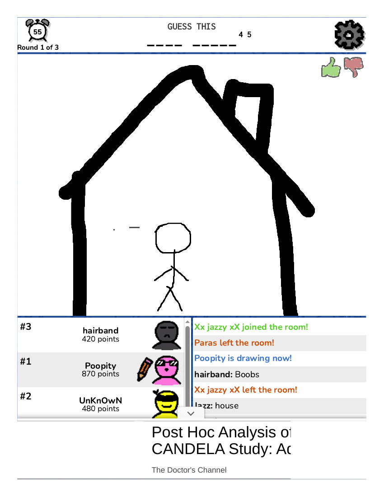
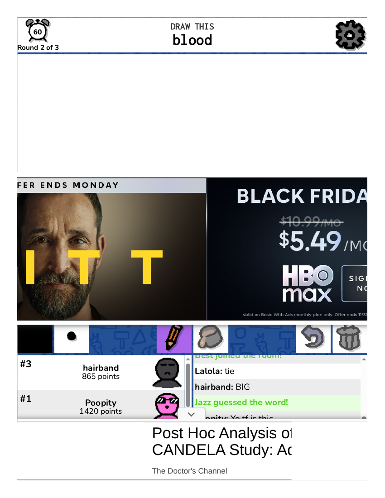
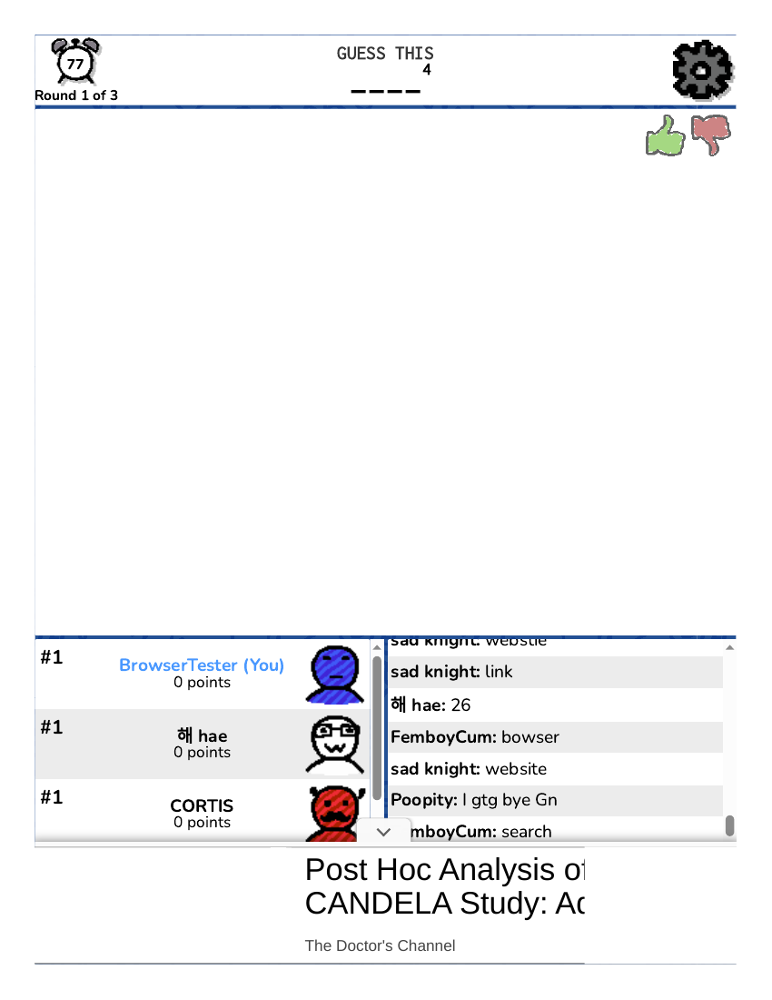
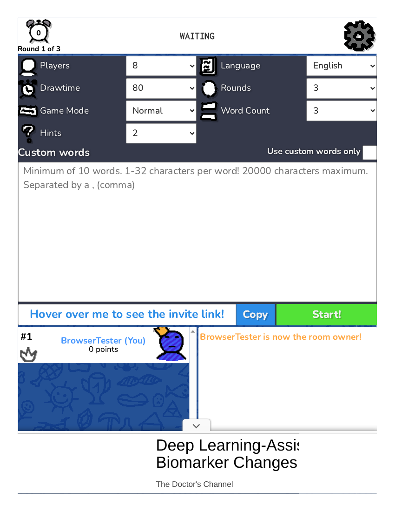

# skribbl.io (refresh) — Agent Session Record (2026-11-24)

**AGENT session, not a human session.** Played by one assistant operator via the agent browser. The session is a refresh of the 2026-10-28 skribbl.io study; no Oct-28 screenshots were available to the task, so no change-vs-Oct-28 is claimed. **It is not gate evidence and enters no release denominator.**

## Identity, preparation and actual timing

- Protocol ID / registration: none — agent session, 2026-11-24, unregistered
- Source: https://skribbl.io, free, no account; browser task 778081d6-776d-5a57-b52b-880b63005979, ran 18:16–18:42 PST
- Actual UTC date: 2026-11-25, 02:16–02:42 UTC
- Participant pseudonym: BrowserTester
- Human observer: none — agent operator, self-observed
- Device: agent browser (cloud), print captures as full-page PDFs

## Actual player journey

| Observation | Stage / action | Visible response / consequence | Help, confusion, pause |
|---|---|---|---|
| 1 | Round 1, guessing | "GUESS THIS", 4+5 hints, 55s; Poopity drawing a house | Poopity 870 / UnKnOwN 480 / hairband 420 |
| 2 | Round 2, drawing turn | "DRAW THIS / blood", 60s | BLANK white canvas — zero strokes placed; canvas targeting failed on screenshot errors ("browser_error" / "failed at image_readiness") |
| 3 | Final standings | Game completed; final ranking captured in the task report [SECONDARY] | #1 sad knight 2250, #2 해 hae 1690, #3 FemboyCum 1090, #4 CORTIS 665, #5 BrowserTester 635, #6 ShE 0, #6 HiiRosiehere 0 |
| 4 | New game, guessing | "GUESS THIS", 4-letter word, Round 1 of 3, 77s, blank canvas, all players at 0 | The task labeled this frame a waiting beat; the frame shows a guessing turn — relabeled in verification |
| 5 | Private room | "WAITING", Players 8, Language English, Drawtime 80, Rounds 3, Game Mode Normal, Word Count 3, Hints 2, invite link + Copy + Start!, "BrowserTester is now the room owner!" | — |

## Outcome and assistance evidence

| Field | Agent value | Reason |
|---|---|---|
| `completed_game` | true (agent) | Full public game; finished #5 with 635 points [SECONDARY for the standings; the game states are [REAL]] |
| `drew` | false | Two drawer turns, zero strokes placed — the same canvas-targeting failure class as Draw a Stickman on 2026-11-17 |
| `multiplayer_lobby` | [OPEN] | ENTER GAME reloaded the homepage twice per the task; no capture filed — a reported failure, not capture-verified |

- Caveat: the f2 chat shows "Jazz guessed the word!" in green; the task claims the blood turn had no correct guesses. The line's turn cannot be determined from the frame (chat history persists) — ambiguous, not a refutation.
- Per-guess score increments (+100/+125/+90) are [SECONDARY].
- Change-vs-Oct-28: "no visible change" is the task's judgement, not a diff (no Oct-28 screenshots). Record as a baseline hold (live draw-guess, free, no account, no paywall), ads prominent but not gating.

## Shareable record check

- [x] Contains only agent observations; no personal text.
- [x] Outcomes reflect this attempt; assistance and failures remain visible (zero strokes, multiplayer lobby failure).
- [ ] Saved into the private study folder — this record lives in the play dir, not Git, until Sakura confirms it (confirmation gate).

## Evidence gallery

Round 1 guessing [REAL] — "GUESS THIS", 4+5 hints, 55s, Poopity drawing a house, Poopity 870 / UnKnOwN 480 / hairband 420.

Drawing turn "blood" [REAL] — "DRAW THIS / blood", 60s, BLANK white canvas, HBO Max ad across the middle. Zero strokes placed.

New-game guessing [REAL] — "GUESS THIS", 4-letter word, Round 1 of 3, 77s, blank canvas, all players at 0. Not a waiting beat.

Private-room lobby [REAL] — "WAITING", Players 8, Drawtime 80, Rounds 3, Game Mode Normal, Word Count 3, Hints 2, invite link + Copy + Start!, "BrowserTester is now the room owner!".
