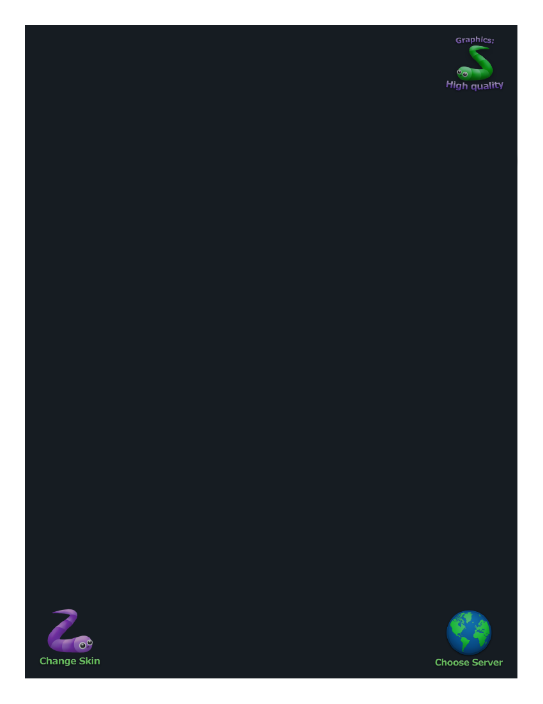

# Slither.io — Agent Session Record (2026-11-24)

**AGENT session, not a human session.** Played by one assistant operator via the agent browser. **It is not gate evidence and enters no release denominator.**

## Identity, preparation and actual timing

- Protocol ID / registration: none — agent session, 2026-11-24, unregistered
- Source: https://slither.io (redirected to slither.com/io); browser task d0a386f6-2d67-5c17-9147-e14e28f06c87, ran 18:41–18:56 PST
- Actual UTC date: 2026-11-25, 02:41–02:56 UTC
- Participant pseudonym: Muse (per task prose — never reached the nickname field)
- Human observer: none — agent operator, self-observed
- Device: agent browser (cloud), print captures as full-page PDFs

## Actual player journey

| Observation | Stage / action | Visible response / consequence | Help, confusion, pause |
|---|---|---|---|
| 1 | Start screen | All three page-1 renders are BYTE-IDENTICAL: dark canvas, blank center; corners only — "Graphics: High quality" (green snake, top right), "Change Skin" (purple snake, bottom left), "Choose Server" (globe, bottom right) | The canvas-rendered menu (logo, Nickname field, Play button, rotating tips) and the loading spinner did not print — canvas-print failure, same class as Slope / TETR.IO |
| 2 | Server connection | Five servers tried (8908, 3619, 4369, 7771, 4371) with ping times; the connection never completed; endless green/purple spinner [SECONDARY] | Bot-challenge route move (specialist: recovery_attempted, context replaced) |
| 3 | HTTPS warning + redirect | slither.io redirected to slither.com/io [SECONDARY] | — |

## Outcome and assistance evidence

| Field | Agent value | Reason |
|---|---|---|
| `run_started` | false | No run started — no length, score, death, or leaderboard. Slot [OPEN]. |
| `blocker` | game-server connection never completing | Across 5 servers, 2 browsers/routes (task's account [SECONDARY]); retry needs a normal network where the connection completes or a person driving the browser |

- Nothing the user could supply (no account/payment/code requested) would clear it.

## Shareable record check

- [x] Contains only agent observations; no personal text.
- [x] Outcomes reflect this attempt; assistance and failures remain visible (no run, identical blank captures, server block).
- [x] Filed to the remote as PR #34 (branch competitor-plays-2026-11-24 → main), pending merge.

## Evidence gallery

Start screen [PRINT FAILURE] — dark canvas, blank center; corners only ("Graphics: High quality", "Change Skin", "Choose Server"). One of three byte-identical renders. The captures do NOT show three distinct states.
