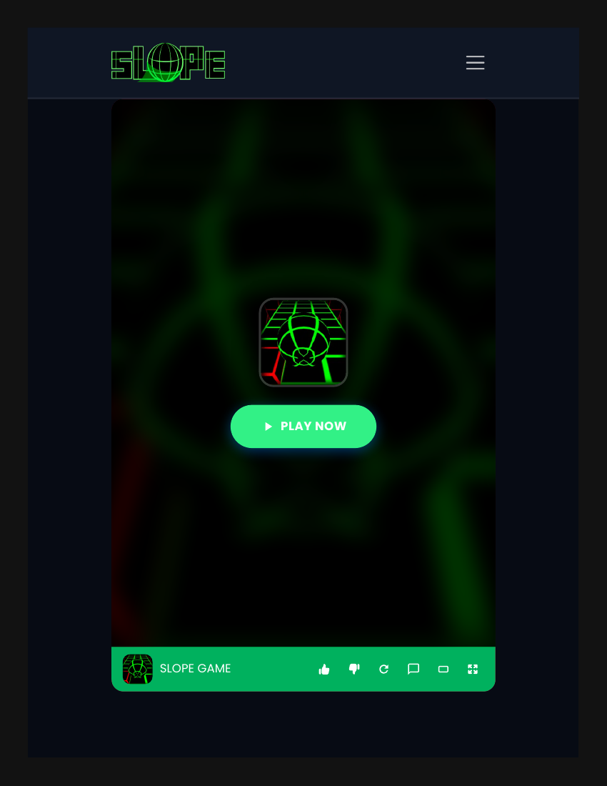
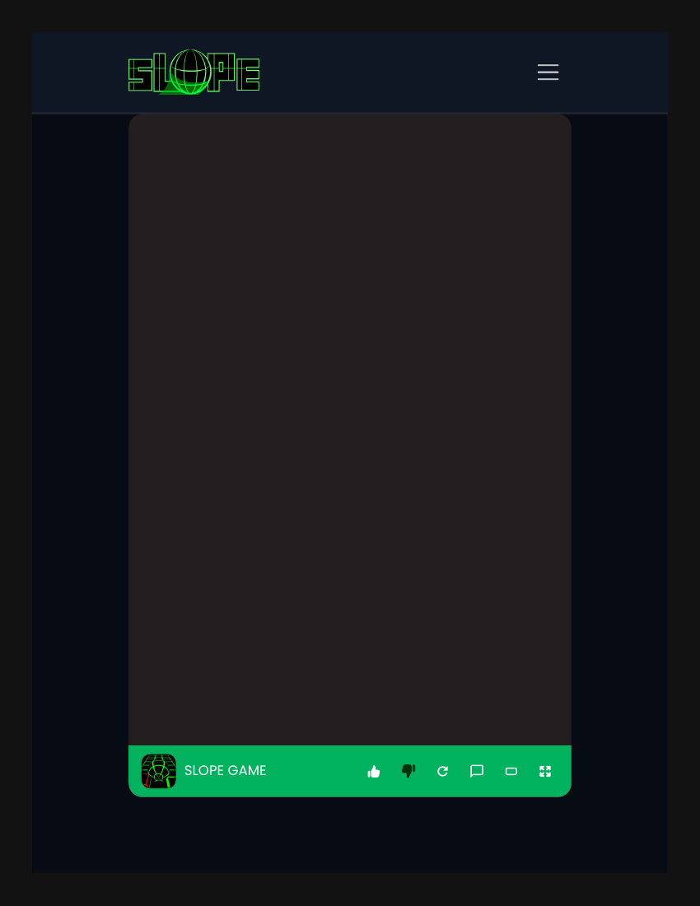
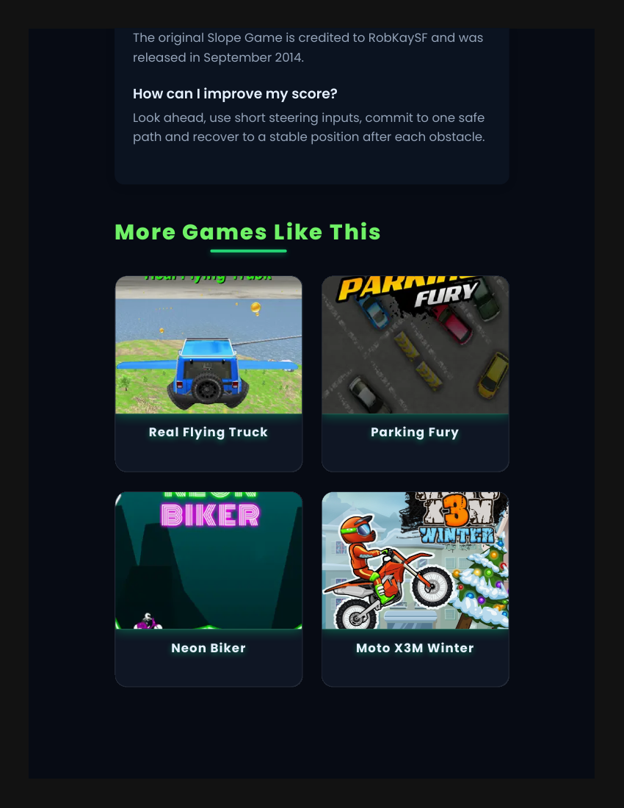

# Slope — Agent Session Record (2026-11-24)

**AGENT session, not a human session.** Played by one assistant operator via the agent browser. **It is not gate evidence and enters no release denominator.**

## Identity, preparation and actual timing

- Protocol ID / registration: none — agent session, 2026-11-24, unregistered
- Source: https://slopegamefree.org (Unity/Y8 version; no single official site); browser task 16ca431b-9e77-5010-a1da-8a8accb4ad44, ran 18:18–18:38 PST
- Actual UTC date: 2026-11-25, 02:18–02:38 UTC
- Participant pseudonym: none — no account
- Human observer: none — agent operator, self-observed
- Device: agent browser (cloud), print captures as full-page PDFs (10 pages each; f2–f5 pixel-identical on all 10 pages — the same capture four times)

## Actual player journey

| Observation | Stage / action | Visible response / consequence | Help, confusion, pause |
|---|---|---|---|
| 1 | Portal start | SLOPE logo, game icon, green PLAY NOW, "SLOPE GAME" bar | — |
| 2 | Game frame | BLANK dark rectangle (the Unity/WebGL canvas did not paint in the print) | Distinction from TETR.IO: there the board never rendered even live; here the task reports the game played live and the failure is in the PRINT path — play is live-observed [SECONDARY], capture failed; a re-attempt in this browser prints the same blank frame |
| 3 | Portal text | "The original Slope Game is credited to RobKaySF and was released in September 2014", "How can I improve my score? Look ahead, use short steering inputs, commit to one safe path and recover to a stable position after each obstacle.", "More Games Like This" | — |

## Outcome and assistance evidence

| Field | Agent value | Reason |
|---|---|---|
| `run_capture_verified` | false | No visible score in any capture — [OPEN]: a capture-verified Slope run with a visible score (needs WebGL-capable capture or a person driving the browser) |
| `gameplay` | [SECONDARY] | Task prose only: 3 runs, best score 1, crash into red block, tunnel run, wedged ball, Play going unresponsive, leaderboard popup "Recent score: 1", score-loop mechanics. Never present f3 as a crash frame or f4 as a tunnel frame. |

## Shareable record check

- [x] Contains only agent observations; no personal text.
- [x] Outcomes reflect this attempt; assistance and failures remain visible (blank game frame, unverified runs).
- [x] Filed to the remote as PR #34 (branch competitor-plays-2026-11-24 → main), pending merge.

## Evidence gallery

Portal start [REAL] — SLOPE logo, game icon, green PLAY NOW, "SLOPE GAME" bar.

Game frame [PRINT FAILURE] — a BLANK dark rectangle (Unity/WebGL canvas did not paint). One of four pixel-identical captures.

Portal text [REAL] — "The original Slope Game is credited to RobKaySF and was released in September 2014", "How can I improve my score? Look ahead, use short steering inputs…".
