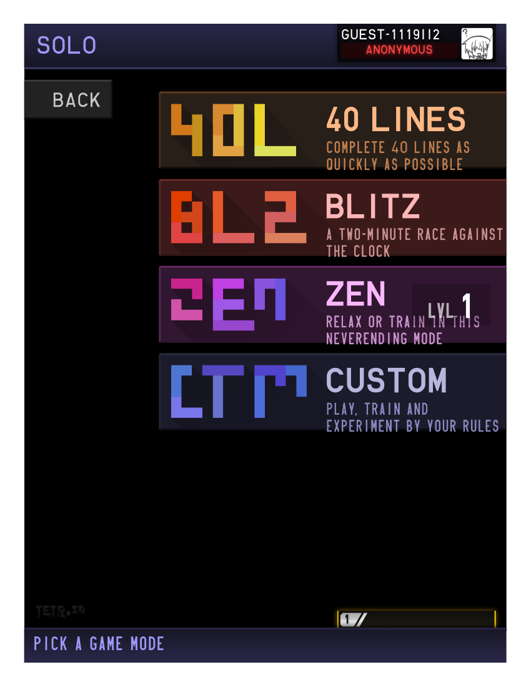
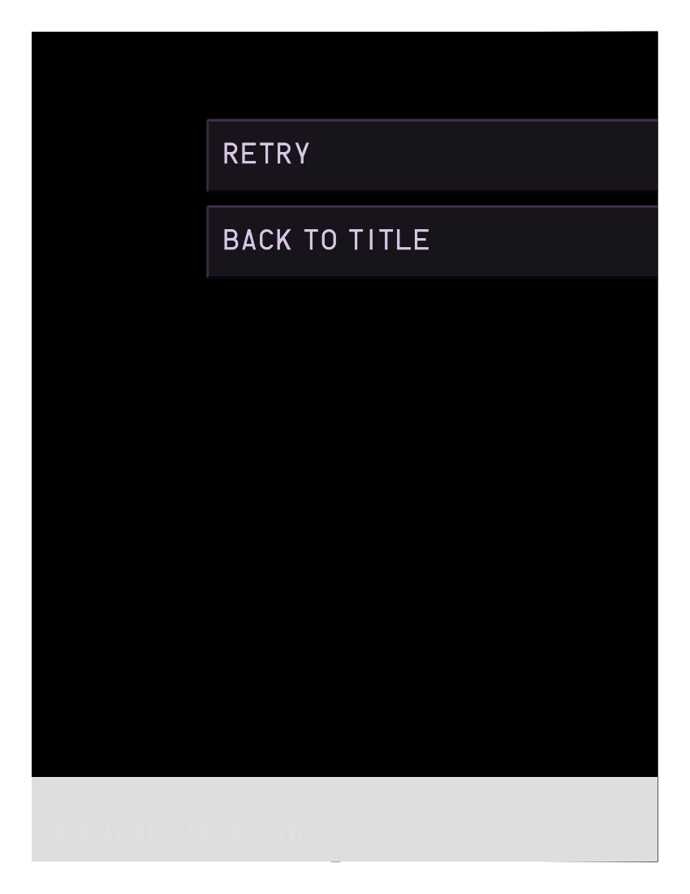

# TETR.IO — Agent Session Record (2026-11-24)

**AGENT session, not a human session.** Played by one assistant operator via the agent browser. **It is not gate evidence and enters no release denominator.**

## Identity, preparation and actual timing

- Protocol ID / registration: none — agent session, 2026-11-24, unregistered
- Source: https://tetr.io, free, guest login; browser task 25ee8add-e830-51f0-99c4-241c2589fd80, ran 18:18–18:28 PST
- Actual UTC date: 2026-11-25, 02:18–02:28 UTC
- Participant pseudonym: GUEST-1119II2 (ANONYMOUS)
- Human observer: none — agent operator, self-observed
- Device: agent browser (cloud), print captures as full-page PDFs

## Actual player journey

| Observation | Stage / action | Visible response / consequence | Help, confusion, pause |
|---|---|---|---|
| 1 | SOLO picker | "GUEST-1119II2 / ANONYMOUS", 40 LINES ("COMPLETE 40 LINES AS QUICKLY AS POSSIBLE"), BLITZ ("A TWO-MINUTE RACE AGAINST THE CLOCK"), ZEN LVL 1 ("RELAX OR TRAIN IN THIS NEVERENDING MODE"), CUSTOM ("PLAY, TRAIN AND EXPERIMENT BY YOUR RULES"), "PICK A GAME MODE" | WebGL disabled in this browser — the page's own warning confirms; same failure class as Townscaper |
| 2 | Gameplay | BLACK shell; the only legible text is "REPLAY WILL NOT BE SAVED" | The board never rendered even live. All gameplay detail (pieces, 1 line cleared, HUD values) is [SECONDARY] — never present this frame as gameplay |
| 3 | End menus | "RETRY" / "BACK TO TITLE" with no results numbers | f4's page-1 render is byte-identical to f3 (same sha256) despite the task claiming a snowy-mountain background |

## Outcome and assistance evidence

| Field | Agent value | Reason |
|---|---|---|
| `40_lines_completed` | false | [OPEN]: 40-line completion, results screen, leaderboard chase, hold via C |
| `results_screen` | false | Both end menus show only RETRY / BACK TO TITLE, no results numbers [REAL] |
| `retry` | no | Same wall (WebGL disabled) — a retry in this browser hits the same failure |

- 40 LINES chases time, not points ("score doesn't matter here, just go for the world record!" — on the DOM picker frame's text layer [REAL]).

## Shareable record check

- [x] Contains only agent observations; no personal text.
- [x] Outcomes reflect this attempt; assistance and failures remain visible (black gameplay shell, no results).
- [ ] Saved into the private study folder — this record lives in the play dir, not Git, until Sakura confirms it (confirmation gate).

## Evidence gallery

SOLO picker [REAL] — "GUEST-1119II2 / ANONYMOUS", 40 LINES / BLITZ / ZEN LVL 1 / CUSTOM with taglines.

Gameplay [PRINT FAILURE] — a BLACK shell; only "REPLAY WILL NOT BE SAVED" is legible. Never present as a gameplay frame.

End menu [REAL] — "RETRY" / "BACK TO TITLE", no results numbers.
