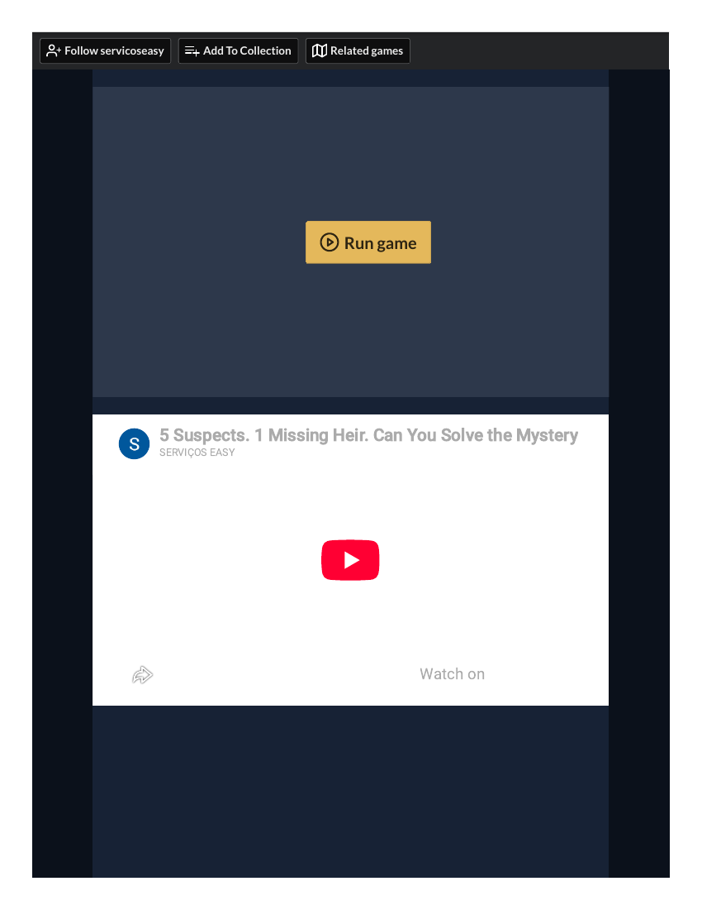
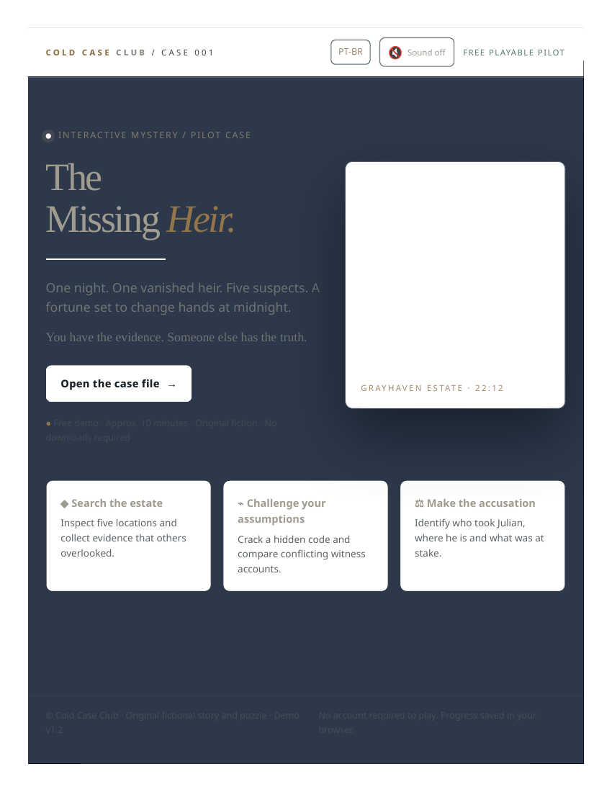
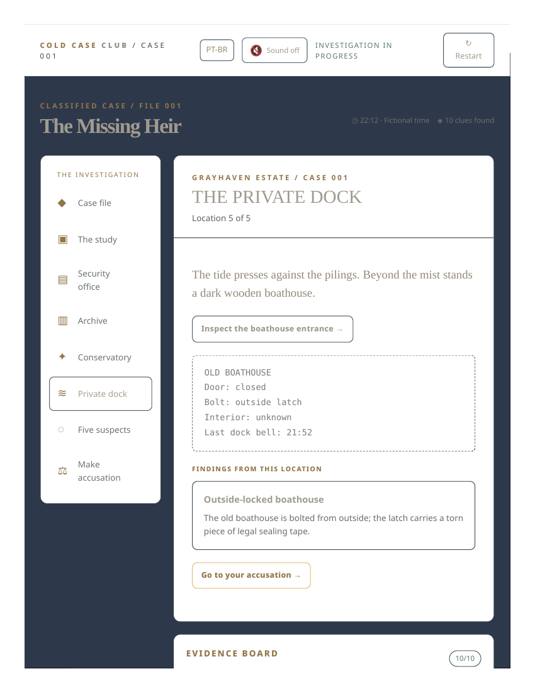
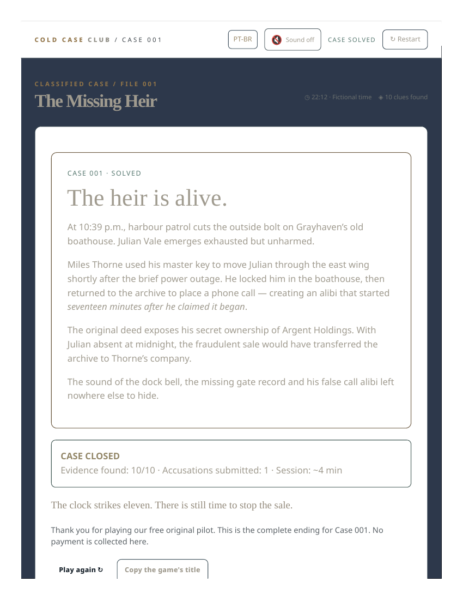

# The Missing Heir — Agent Session Record (2026-11-24)

**AGENT session, not a human session.** Played by one assistant operator via the agent browser. **It is not gate evidence and enters no release denominator.**

## Identity, preparation and actual timing

- Protocol ID / registration: none — agent session, 2026-11-24, unregistered
- Source: Cold Case Club Case 001 by servicoseasy, free demo at https://servicoseasy.itch.io/the-missing-heir; browser task 8bebc44d-7534-50ef-8eb7-0a0a1697d0b7, ran 18:34–18:52 PST
- Actual UTC date: 2026-11-25, 02:34–02:52 UTC
- Participant pseudonym: none — no account
- Human observer: none — agent operator, self-observed
- Device: agent browser (cloud), print captures as full-page PDFs

## Actual player journey

| Observation | Stage / action | Visible response / consequence | Help, confusion, pause |
|---|---|---|---|
| 1 | itch landing | "Run game", "5 Suspects. 1 Missing Heir. Can You Solve the Mystery" | — |
| 2 | Start screen | "COLD CASE CLUB / CASE 001", "The Missing Heir.", "One night. One vanished heir. Five suspects. A fortune set to change hands at midnight.", "Open the case file →", "GRAYHAVEN ESTATE · 22:12", three pillars (Search the estate / Challenge your assumptions / Make the accusation), "Free demo · Approx. 10 minutes · Original fiction · No downloads required", "Demo v1.2", "No account required to play", PT-BR toggle | — |
| 3 | Private dock | Location 5 of 5, "10 clues found", boathouse (Door: closed, Bolt: outside latch, Last dock bell: 21:52), finding "Outside-locked boathouse", "EVIDENCE BOARD 10/10" | — |
| 4 | Ending | "CASE SOLVED — The heir is alive.", "CASE CLOSED — Evidence found: 10/10 · Accusations submitted: 1 · Session: ~4 min", "No payment is collected here" | The deduction chain is deliberately NOT recorded (copyright discipline — summarize, never retell the case); it sits in the task's report as [SECONDARY] |

## Outcome and assistance evidence

| Field | Agent value | Reason |
|---|---|---|
| `case_completed` | true (agent) | Complete play start to finish in ~4 min, first-attempt solve, free, no account [REAL] |
| `clues_found` | 10/10 | Evidence board 10/10 captured [REAL] |
| `accusations` | 1 | Accusations submitted: 1 captured [REAL] |

- [SECONDARY]: published 26 Oct 2026, updated 29 Oct 2026, "In development", genre/tags, AI-assisted disclosure, Detective Grimoire checked on Armor Games but not playable (Flash/Ruffle).
- Coverage note: same family as Counterfoil (narrative-deduction) — it does NOT by itself fill the "second deep family" requirement (needs a deep play from a DIFFERENT family).

## Shareable record check

- [x] Contains only agent observations; no personal text. No case content retold beyond the start screen and location headers.
- [x] Outcomes reflect this attempt; assistance and failures remain visible.
- [ ] Saved into the private study folder — this record lives in the play dir, not Git, until Sakura confirms it (confirmation gate).

## Evidence gallery

itch landing [REAL] — "Run game", "5 Suspects. 1 Missing Heir. Can You Solve the Mystery".

Start screen [REAL] — "COLD CASE CLUB / CASE 001", "The Missing Heir.", "GRAYHAVEN ESTATE · 22:12", "Free demo · Approx. 10 minutes · No downloads required", "Demo v1.2", "No account required to play".

Private dock [REAL] — Location 5 of 5, "10 clues found", boathouse (Door: closed, Bolt: outside latch, Last dock bell: 21:52), "EVIDENCE BOARD 10/10".

Ending [REAL] — "CASE SOLVED — The heir is alive.", "CASE CLOSED — Evidence found: 10/10 · Accusations submitted: 1 · Session: ~4 min", "No payment is collected here".
