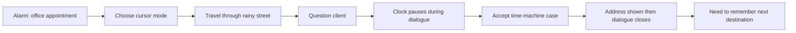
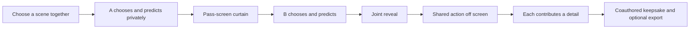
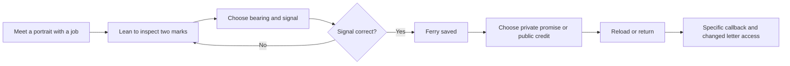
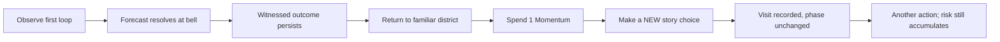
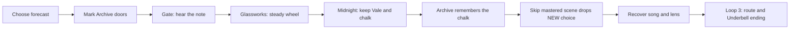

# GameJam fieldbook · 5 October 2026

**Working thesis: let players choose what survives.** Memorable Moments preserves something two people authored together; Vivid remembers a decision and changes an encounter; Bell turns remembered events into another opportunity to act. These are distinct, testable promises, not a claim of unprecedented invention.

The starting repository contained research for Memorable Moments and Vivid, and a playable Bell. We preserved those starting commits and built one bounded experiment per game, on the existing game branches. Website play comes first; device expansion follows observed needs.

## What counts as evidence here

- **Played:** an agent performed browser inputs, read the responses and inspected screenshots. This establishes the behavior of the tested path/build, not human enjoyment.
- **Source checked:** a current product page, platform specification or pinned GitHub file was read. Marketing claims remain attributed claims.
- **Critic reported:** another person's published play experience, with the reviewed version identified.
- **Hypothesis:** a proposed player desire or competitive advantage. No recruited human participants, retention study, sales experiment or willingness-to-pay test has occurred in this jam.

Source-informed regression runs are marked separately from exploration. Browser emulation does not constitute real phone testing. Automated elapsed time is not human reading time. Screenshots and traces describe sampled paths, not exhaustive game coverage.

## Why might someone choose these games?

| Game and initial audience | Desire to test | Observable moment that could satisfy it | What would falsify it? |
|---|---|---|---|
| Memorable Moments: two willing friends or partners already together | Curiosity about the other person's perspective, a low-pressure shared activity, authorship | Secret choices lead to an action performed together; two personal details form one keepsake | One person does all the work, the reveal feels like form filling, neither wants to keep or retell the moment |
| Vivid: people who enjoy character mysteries | A character noticing a specific decision; curiosity with a purpose | Changing viewing angle reveals evidence; a later greeting or permission recalls the player's own choice | Players notice only motion, cannot connect the callback to their action, or expect unsupported free conversation |
| Bell: short-session deduction and time-loop players | Competence through understanding, a useful consequence of learning | An earned forecast memory informs a later prediction; Momentum buys one more action while risk remains | Players guess predictions, repeat without a theory, or perceive midnight as lost progress |

These are audience propositions, not universal explanations of why people play. The actual human test is whether people spontaneously describe, repeat or share the signature moment.

## Competition changes the promise

**Memorable Moments:** Paired currently advertises answer unlocking, Secret Missions, shared photos and a Timeline. “Reveal + missions + memories” is therefore too broad a novelty claim. Our testable distinction is a complete, one-device, two-person act of creation in one sitting. Drawful is also a precedent for content authored by players. [Paired FAQ](https://www.paired.com/frequently-asked-questions), [Jackbox custom episodes](https://www.jackboxgames.com/blog/about-custom-episodes-in-quiplash-2-drawful-2).

**Vivid:** Event[0] and Suck Up! already make conversation instrumental to a goal. Depth/parallax, AI chat or remembered choices alone do not establish uniqueness. The proposed signature is a visible chain: **my decision → this character remembers it → their permission changes → I can test the difference.** The jam uses authored choices and original illustrated layers; it does not test photo reconstruction, unrestricted AI dialogue, voice latency or model operating costs. [Event[0]](https://store.steampowered.com/app/470260/Event0/), [Suck Up!](https://store.steampowered.com/app/2726370/Suck_Up/).

**Bell:** curiosity and knowledge-led exploration are established approaches. Our narrower experiment connects a forecast to a scarce action budget: understanding the town changes what the player can do today. A journal is support for that experience, not the differentiator by itself. [Mobius developer interview](https://www.mobiusdigitalgames.com/news/alex-the-nomai).

## Criticism: what to borrow, what to test

| Critic and reviewed version | Their interpretation | Concrete consequence for our jam |
|---|---|---|
| Dom Reseigh-Lincoln, Drawful 2, Switch (2018) | Simple browser joining still depends on gathering enough people and devices | Name the actual social situation: two players, one device. Test the second person's willingness, not just the organizer's enthusiasm. |
| Nic Rowen, Event[0], PC (2016) | Rapport with Kaizen coexists with contextual response failures; a slow opening delays freedom | Give the portrait a clear job quickly. Promise authored dialogue accurately. Make a memory callback specific and consequential. |
| Tom Sykes, Roottrees commercial remake/expansion (2025) | Information-handling shortcuts improve deduction; attachment to the people is a separate achievement | Remove repeated clerical work, but test whether the player cares about a particular person too. These interface observations are about the remake, not the browser original. |

Read: [Nintendo Life](https://www.nintendolife.com/reviews/switch-eshop/drawful_2), [Destructoid](https://www.destructoid.com/reviews/review-event0/), [PC Gamer](https://www.pcgamer.com/games/puzzle/the-roottrees-are-dead-review/). One critic's account is not a population-level demand result.

## Released games: actual browser play, not just store research

### We Become What We Behold — Nicky Case

Tested the [live itch.io release](https://ncase.itch.io/wbwwb), hosted build `300364`, through the first conflict arc. Photographing a hat wearer produced a headline, then six onlookers adopted hats. Photographing an affectionate couple produced a mocking caption; the couple blushed and left. A mistimed outburst photograph was rejected; a correctly timed one generated an attack headline followed by an anxious onlooker. We did **not** complete the ending or assess audio.

```mermaid
flowchart LR
  A[Play and discover camera] --> B[Choose hat wearer]
  B --> C[TV headline]
  C --> D[Onlookers adopt hats]
  D --> E[Choose affectionate couple]
  E --> F[Authored mocking caption]
  F --> G[Couple blushes and leaves]
  G --> H[Time an outburst photo]
  H --> I[Headline and visible fear]
```

**Transfer:** make the consequence of attention visible. A collection counter would not demonstrate what the photograph did to the world. **New hypothesis:** let the player's generous or quiet interpretation also change an outcome, rather than forcing one editorial attitude. Our existing Moments slice tests joint authorship; a two-witness reinterpretation mechanic is a future experiment, not a feature already delivered.

[JayIsGames](https://jayisgames.com/review/we-become-what-we-behold.php) contains a review/comment disagreement about forced sensationalism. [Flash Forward Reviews](https://flash-forward-reviews.github.io/day-284) criticizes rejection of peaceful photographs and limited editorial control. Our couple-photo test reproduces imposed framing; it does **not** reproduce every later progression complaint. These are critical interpretations, not retention statistics.

Later moving-target inputs used read-only scene coordinates/animation phase to compensate tool latency, followed by real mouse clicks. They are mechanic evidence, not an unaided usability benchmark. Network requests used the supplied proxy and validated CA trust through Playwright's request client; the hosted game source/outcomes were not modified. Consumer loading time cannot be inferred from this setup.

### Detective: Again! — KiCodes

Tested the [live released browser game](https://kicodes.itch.io/detective-again), Unity version 1.0, through accepting its first case. We examined the alarm, traveled from the apartment to the detective office, questioned the client and learned the destination **Building 42, Apartment C**. The dialogue then closed; no persistent location note was visible in the opening inventory. The clock held at 09:50 during the observed dialogue and resumed afterward. The complete case, reset and ending were **not** reached.

**Transfer:** preserve a discovered next step without solving the mystery for the player. Bell now retains witnessed forecast outcomes; its current game still needs fresh-player testing of whether the next intended action is clear. A future objective pin should say what was learned and where, not automatically point to the right answer.

The initial iframe had a storage/loading problem; navigating the unchanged deployed game URL as a top-level page made it playable. Software rendering and input latency affected this setup, so a mistaken repeated door click does not establish ordinary player error rates.

Andrew Plotkin's [critique of the original browser Roottrees](https://blog.zarfhome.com/2024/02/spring-narrative-games) separately highlights repeated information handling and an image/clue mismatch. This is critic-sourced evidence; Roottrees itself was **not** played in this run. It motivated checking that Vivid's visible marks and solution actually agree.

## Our new journeys, observed independently

### Small Hours / Memorable Moments

Root-agent rehearsal used two synthetic details, followed both handoffs, saw the reveal and downloaded an SVG retaining both contributions. No actual pair performed the off-screen activity. Independent review caught a contradictory “look away” instruction on the joint reveal curtain; it was corrected to invite both people back. The open empathy question is whether the quieter participant feels invited to contribute or handed another task.

### The Keeper's Frame / Vivid

Root-agent play verified premature submission was blocked, a wrong signal was recoverable, and the correct one reached the privacy choice. After choosing privacy and genuinely reloading, Iona recalled that decision and offered a previously private letter. Review caught readable evidence before leaning, compressed heading spacing and doubled quotation marks; these were fixed. The human question is whether the callback feels earned and changes how the player treats her.

### Bell / GameJam Contrast

Root-agent replay verified loop-2 visits increased from 3 to 4 while Dawn and the forecast stayed unchanged; Momentum fell from 3 to 2. New scene text and choices remained. Separate behavioral checks cover duplicate reward prevention and Fracture overriding extra time. Root review also added a direct opening-dialog route into Contrast. The human question is whether the extra action feels like learned capability rather than another rule to memorize.

## Our baseline journey: Bell

The root agent completed Original mode at starting commit `369f0da82696caab98f8f68ede78f49da286d590`: three loops, eight visits. This was source-informed, and its displayed 1:33 duration must not be used as a human completion estimate.

Observed: the loop-2 Archive explicitly referenced our prior chalk action. That is a legible cause and effect. However, “Skip mastered scene” also appeared before we had played that changed scene. Clicking it spent Momentum and the encounter without awarding its route discovery. Carrying a bond/object gave no preview of its effect. One forecast said North Gate closing was wrong, while the subsequent encounter described a sealed gate; the distinction between an event and a state was not explicit.

The revised Contrast experiment should therefore make acquired knowledge usable while preserving new choices. Original remains available as the baseline. The per-game report documents the final implementation and regression checks.

## Platform decision: itch.io first, then test distribution fit

Recommend **itch.io browser builds** for the jam: it supports the current HTML/CSS/JS delivery, lets each experiment state its player count and expected session, and permits a small complete experience before a larger product decision. This recommendation is about delivery fit, not evidence that itch will supply an audience. [Official HTML5 guide](https://itch.io/docs/creators/html5).

The store pitch should show an actual consequence in a short clip: two contributions becoming one keepsake; a portrait remembering a decision; or an earned extra action changing a day. Ask viewers what they expect to do after watching. A pretty image is insufficient evidence of comprehension or intent to play.

CrazyGames is a later candidate for shorter, immediately legible solo loops. Its documentation distinguishes Basic Launch from Full Launch, SDK requirements and monetization; it also requires readable responsive layouts. Our code being small is not proof of platform acceptance. Check the then-current requirements before submission. [Requirements](https://docs.crazygames.com/requirements/intro/), [gameplay requirements](https://docs.crazygames.com/requirements/gameplay/).

Device sequence: complete desktop browser loop → compact iframe and touch-layout checks → real mobile Safari/Chrome, touch, save/export tests → decide whether native capability solves an observed problem. No native release or store publication is claimed.

## GitHub lessons applied to cooperative development

We inspected actual source boundaries, not repository popularity:

- **A Dark Room** centralizes state changes and separates event collections. Adopt stable scene IDs and one state/persistence owner. Do not inherit its legacy global/eval coupling. [Pinned state manager](https://github.com/doublespeakgames/adarkroom/blob/1fada4620b6c66bd07bf15a3f1eb8223df8bc1d7/script/state_manager.js), [event collection](https://github.com/doublespeakgames/adarkroom/blob/1fada4620b6c66bd07bf15a3f1eb8223df8bc1d7/script/events/room.js).
- **Hextris** separates input, update and render files. Adopt input adapters that call the same rules on keyboard and touch; file splitting alone does not eliminate shared state. [Pinned input](https://github.com/Hextris/hextris/blob/3f4847dc8fd7dab3d1c87e6324b9159d92fbd396/js/input.js), [update](https://github.com/Hextris/hextris/blob/3f4847dc8fd7dab3d1c87e6324b9159d92fbd396/js/update.js).
- **inkjs** supplies a narrative runtime/browser template that separates story content, choices and presentation. Adopt an explicit action/state contract and a documented build/test gate. It is a runtime example, not a separate commercial game. [Pinned template](https://github.com/y-lohse/inkjs/blob/6b1153410ab1c4bcfd9ef04eb2f0107f36be7778/templates/browser_serverless/main.js).

No code, prose or art from these projects was copied into our games. The inspected projects use MPL-2.0, GPL-3.0-or-later and MIT respectively; detailed source/license references are in `market-research.json`.

Each game has its own branch and working directory. Within a game, content, rules and rendering have explicit owners; game-specific handoff documents describe actual modules. Contributors report their commit, files, commands, evidence and unresolved concerns. Generated outputs are rebuilt, not hand-edited. Shared modules are integrated by one owner.

## Finish the one-day jam with people

This is a proposed remaining schedule, not time already spent or an autonomous timer:

| Time box | Action | Decision artifact |
|---|---|---|
| 45 min | Recruit willing testers; give only the normal launch instructions | Fresh-session recordings/notes with permission, no invented participants |
| 90 min | Six pairs for Moments, six solo sessions each for Vivid and Bell if recruitment permits | Completed rows in `human-playtest.csv`; report actual N if fewer |
| 45 min | Compare failures and spontaneous descriptions, not just completion | Choose one lead game; document why the other two wait |
| 2 h | Fix the highest observed obstacle in the lead game | One changed hypothesis, one focused implementation |
| 45 min | Re-test with fresh people and real phones | New observations, explicit remaining limitations |
| 30 min | Package the lead build, record signature clip, commit and sync | Reviewable browser package and matching remote branch |

For a small jam, use **diagnostic gates**, not statistical claims: can at least 4 of 6 sessions reach the signature consequence without facilitator help, explain why it happened, and make a voluntary decision about another round? For Moments, count pairs rather than pretending each click is independent. Record declines and confusion. A failed gate means simplify/reconsider; a passed gate only earns a larger test.

Counterbalance a plain prompt card against Moments; compare Vivid with/without contextual callback while keeping the puzzle fixed; compare Bell's Original/Contrast with order tracked. These controlled variants are a **next experiment**, not all implemented conditions in the delivered prototypes. Learning carryover limits within-person comparisons, so use fresh participants where feasible. Ten-minute retelling can fit today; 24-hour recall cannot be claimed from a same-session run.

**Decision rule:** prioritize the game people can describe through a specific consequence they caused and voluntarily choose to repeat. Do not select based on visual polish alone, a critic's score, or agent completion speed.

## Verification and deliverables

| Build | Completed checks | Important boundary |
|---|---|---|
| Small Hours | 33 browser checks: complete rehearsal, handoffs, export, reset, simulated touch layout and actual iframe interaction | No actual two-person social session |
| Keeper's Frame | 8 rule tests; 13 recorded browser scenarios, including both endings, reload, keyboard/reduced motion and blocked storage | Original illustration/authored dialogue; no photo inference or real-device claim |
| Bell | Existing build/static/HTTP smoke checks; 3 time-rule tests; 19-step browser journey; 3 opening-path checks | Original baseline retained; Contrast is the experiment |
| Portable package | Real UI checks on all three bundled files, including export, reload memory and first Contrast consequence | Local browser package; not submitted or published on a game platform |

Each branch contains this shared fieldbook and its own detailed journey/testing report. The source checkpoints were pushed and their exact remote refs checked. A pre-jam Git bundle protects the starting repository; a final local bundle and portable ZIP accompany delivery. Raw large competitor traces remain in the local backup; selected screenshots and reports are committed with attribution. No other chat, issue tracker or public review site was posted to.

The blank human sheet is deliberately blank. The next evidence milestone is real people's behavior, not additional confident prose.
