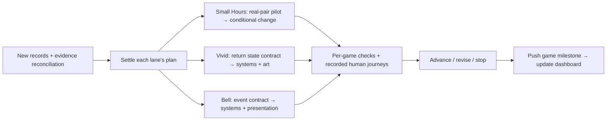

# Game agent team — development dashboard

**Review snapshot: 20 October 2026. Next iteration: proposed; gameplay implementation has not started.**

The three demo branches are playable and their current automated checks pass. The newer research adds useful observations, but the playable source still matches the previously recorded October 5 builds. The next decision is which player experience to test, rather than how much content to add.

**Incoming evidence:** the project lead will notify us when new Small Hours and Thirteenth Bell research records are uploaded. Their plans below are provisional. Reconcile that upload before settling those lanes or starting implementation. This dashboard is a versioned GitHub planning document, not a live issue board; role owners are proposed assignments.

| Demo / plan | Reviewed branch tip | Next decision | First task | Current gate |
|---|---|---|---|---|
| [Small Hours / Memorable Moments](memorable-next.md) | [`822366ad`](https://github.com/PaperStrange/IndiaGames/tree/822366ad3eb309f7009bb7a05e26cddfb466422f) | Does the existing shared action feel authored by both people? Observe real pairs before selecting a change. | Research intake, then MM-01 | **Provisional: incoming records; no real-pair evidence** |
| [The Keeper’s Frame / Vivid](vivid-next.md) | [`0b35e3fb`](https://github.com/PaperStrange/IndiaGames/tree/0b35e3fb23bef222f3f3cae72d2b78f6ab72d18b) | Does a remembered choice that enables a distinct return action create a meaningful reason to return? | VV-01 state/story contract | **Proposed: plan settlement; coverage and human validation open** |
| [The Thirteenth Bell](bell-next.md) | [`1be02bc9`](https://github.com/PaperStrange/IndiaGames/tree/1be02bc9fc0b846e4c24cb1ceb67ddd69ebfe590) | Can witnessing a town event help the player plan an intervention that changes an outcome? | Research intake, then BL-01 | **Provisional: incoming records; forecast/scene mismatch** |

Read the [evidence audit](evidence-audit.md), [fresh verification record](verification.md), [agent handoff](HANDOFF.md), and [machine-readable task board](tasks.json). Each demo plan contains source citations, system and art priorities, task estimates, dependencies, acceptance criteria and a stop/revise decision. [Source manifest](source-manifest.json) pins what was reviewed.

## Answers to the three product questions

These are **testable propositions**, not demonstrated audience demand or claims that no competitor offers them.

| Demo | Why might someone want to play? | What difference should the browser pitch make clear? | Distinctive experience to test |
|---|---|---|---|
| Small Hours | A short, low-pressure excuse to notice and make something with a person they already know. | Two people share one device, take private turns, perform an activity away from the screen, and can keep a small artifact. Compare the value of that shared moment with party scoring, coordination challenges and creative toys. | “Only the two of us could have made this.” Test whether the current activity and keepsake already support that feeling; change the prompts or artifact only when observation identifies the missing connection. |
| Keeper’s Frame | Looking closely helps a particular character, who later acknowledges what the player chose. | A short authored encounter with a visible purpose, recoverable mistakes and browser-local memory. Its proposed return action must demonstrate the promise in the game. | Proposed experiment: a private promise leads to placing a letter in a sheltered recess; a public dedication leads to placing it toward the harbour. Both are legitimate acts of care, with visible persistent results. |
| Thirteenth Bell | Learning the town makes a later plan possible, and scarce time gives the plan stakes. | A compact text-led mystery in which witnessed evidence, forecasts and action costs can be checked before commitment. | “I saw what would happen; this time I arrived with a plan.” One consistent Bell Square event, a learned intervention and a changed Mina outcome should make the existing borrowed minute useful and explainable. |

The initial delivery target remains **browser play**. No specific storefront has been selected by evidence. On a future itch.io/Poki/CrazyGames or other platform decision, separately verify current submission requirements, audience fit and actual entry friction. A browser listing, critic opinion or market card is not a played session. Do not add accounts, monetization, backend services or native ports to these experiments.

## Evidence and confidence

The agreed [six-competitors-per-demo matrix](../competitor-matrix-2026-10-06.md) remains the coverage contract: six distinct titles per demo, at least four broad families, at least two outside narrative/deduction, at most two in one family and at most one occasion-only comparator.

| Lane | Required assignments | Titles with core gameplay evidence | Other supplied evidence | Coverage gate |
|---|---:|---:|---|---|
| Small Hours | 6 | 0 | Make it Meme lobby only; five source-only/unplayed slots | Open |
| Keeper’s Frame | 6 | 2 partial | Four source/critic-only slots | Open |
| Thirteenth Bell | 6 | 2 | Four source-only slots; Detective’s earlier solve has incomplete raw provenance | Open |

These are **evidence-presence counts, not completion rates**. Across the required matrix: four gameplay assignments, one lobby-only and thirteen source-only/unplayed, covering seventeen unique titles. The broader thirteen-slot replay pool and the market export do not automatically replace the agreed roster. Every substitution needs a competitive reason, exact edition and a new family count.

The new replay package has 18 raw session/access records plus a reshoot log, 33 unique snapshot files and a revised report with 33 embedded images. The coordinator inspected all 33 snapshots in contact sheets; this does not prove an entire journey or audio experience. The records include useful partials and completed bounded units. Temple of No supports a completed FROG route; PROMPTBOX supports completed loops/outcomes rather than a documented full case. The [audit](evidence-audit.md) records the remaining distinctions.

**Human validation: no populated participant rows in the supplied shared CSV.** Agent-authored emotional prose is not a human quotation, physiological measurement, enjoyment score or retention result. “Validated practices” in the upload means interpretations cross-checked against professional positions, not experimentally validated product effects.

## Work sequence and decision gates

1. **Intake and settle the plan.** Receive the announced records, pin each branch head, reconcile the evidence ledger and update only affected decisions. Resolve scope with the project lead before game implementation. Preserve the six-title/four-family research gate for stronger comparative conclusions; these provisional plans are not a substitute for the missing work.
2. **Prepare contracts in parallel.** Assign one lead per game, one research lead and one integration/QA role. Agree state, content and visual ownership before edits. Small Hours begins with an unchanged-build pair pilot; Vivid and Bell have bounded candidate experiments if their plans are settled.
3. **Build only the selected experiment.** Systems and art can work concurrently after the contract, with one renderer/integration owner. Keep each game’s source on its own branch. The task board records dependencies and conditional changes.
4. **Verify, observe and decide.** Automated checks establish functional behavior. Human sessions establish what participants understood and did. Log assistance, stopping, failure/recovery and actual return choices; apply the per-demo diagnostic gates. Record **advance / revise / stop**, including contradictory observations.
5. **Back up a reviewable milestone.** Commit source with its test record, push the matching game branch, verify the remote SHA, then update this coordination dashboard with the immutable evidence link.

Estimates in the plans are focused **person-hours**, not promises of a one-day finish. Recruitment, incoming evidence, access to competitors and plan decisions add elapsed time. Do not cram the entire coverage program and all three development experiments into one day.

## Shared team tasks

| ID | Proposed owner | Next action and acceptance | Status |
|---|---|---|---|
| TEAM-01 | Research lead + coordinator | When notified, fetch the new Small Hours/Bell records; pin old/new SHAs; list added sessions, endpoints, actor types and contradictions; publish an evidence delta and revise each affected plan. Retain “not supplied” where data is absent. | Waiting for announced upload |
| TEAM-02 | Research lead | Reconcile the eighteen required assignments. Prioritize missing social, exploration, strategy, construction and rhythm evidence; recover Detective’s original solved-session record if available. Do not promote a reserve silently. Plan access and participant needs before further competitor play. | Planned; coverage open |
| TEAM-03 | Playtest lead | Prepare neutral, consented journey records for the selected experiments. Record actual people, device/build, assistance, observed actions and optional verbatim responses; keep agent QA separate. Recruitment and execution follow settled plans. | Planned; no participants assigned |
| TEAM-04 | Integration/QA lead | At each implementation milestone, verify the exact source, run relevant checks, review visuals, update limitations, commit/push the owning game branch and record the matching remote SHA in this dashboard. | Planned |

Detailed game cards and task dependencies are in [tasks.json](tasks.json). Plans and task data are one snapshot; update both when a task changes.

## Current review limits

- Existing suites were rerun on isolated source archives. No game feature was implemented, no new competitor was launched, and no participant session occurred in this review.
- Passing source-informed tests does not establish blind discoverability, fun, retention, accessibility for all users or physical-device compatibility. Bell’s forecast/scene inconsistency survives the current automated checks.
- This branch contains documentation and review evidence. It is based on Vivid to retain the shared research; it does not contain a newly combined three-game release. Use the three pinned branches for their respective demos.
- The original portable-package manifest and its test record remain historical. The combined package was not rebuilt or retested in this review, and old local ZIP/bundle paths are not a fresh delivery guarantee.
