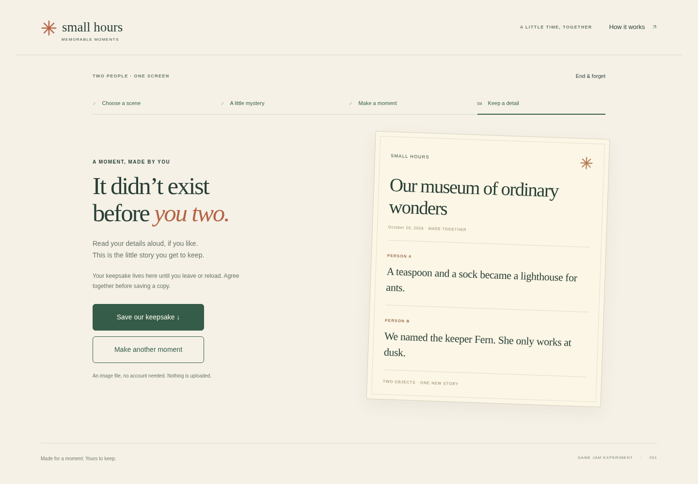
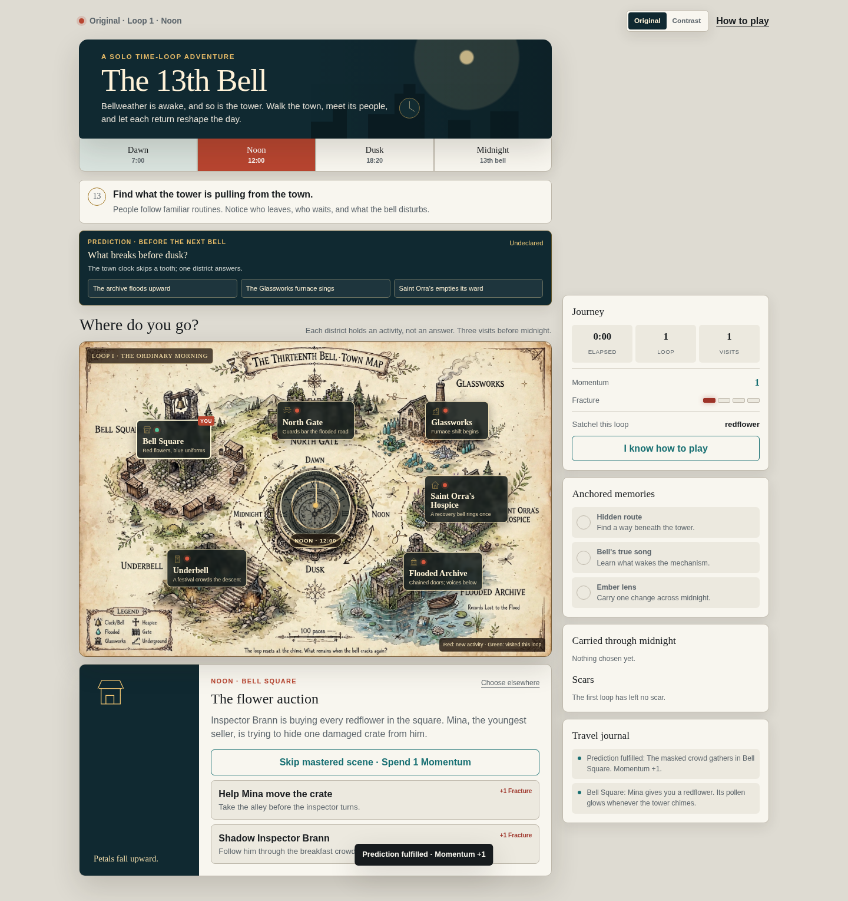

# Review verification — 20 October 2026

These checks ran on source archives exported from the three commits in [source-manifest.json](source-manifest.json). The archive method allowed parallel review without switching the shared checkout. No gameplay implementation was performed. Results below describe automated functional checks and visual inspection, not human experience validation.

| Demo | Fresh checks | Outcome | Preserved evidence |
|---|---|---|---|
| Small Hours | Existing browser suite | 33 assertions passed | [Browser observations](evidence/memorable/browser-observations.json) |
| Keeper’s Frame | Existing Node rules suite; existing Playwright browser suite | 8 rule tests passed; 13 browser observations passed | [Run provenance](evidence/vivid/run-provenance.json), [browser observations](evidence/vivid/browser-observations.json) |
| Thirteenth Bell | Build; Node rules; static checks; HTTP smoke; existing browser journey; additional Original route | Build passed; 3 rule tests, 17 static checks, 19 smoke assertions passed; existing journey passed with 19 trace entries | [Validation summary](evidence/bell/validation-summary.json), [source integrity](evidence/bell/source-integrity.json), [journey result](evidence/bell/journey-result.json), [journey trace](evidence/bell/after-action-trace.json), [Original route](evidence/bell/baseline-review.json) |

Counts use different units. Do not add assertions, observations and trace steps into a “total tests” figure.

## Reproduction

Use each pinned source branch and its committed README/test harness. The review environment used Node `v24.19.0`, Python `3.12.14`, Chromium `151.0.7922.173` and the existing Playwright installation. Local archive paths and ports in raw outputs are run provenance, not public demo URLs.

| Demo | Commands / setup |
|---|---|
| Small Hours | Serve the archive root by HTTP; set `BASE_URL` to its `/memorable-moments-game/` URL (including trailing slash), plus `PLAYWRIGHT_PATH` and `CHROMIUM_PATH`; run `node memorable-moments-game/tests/browser.mjs`. The harness visits both the research page and `play/`. |
| Keeper’s Frame | From `vivid-2.5d-photo-game/play/`, run `node --test test/rules.test.js`; serve that directory by HTTP; run `node test/browser.mjs` with `GAME_URL`, `PLAYWRIGHT_MODULE_PATH` and `CHROMIUM_PATH` set. |
| Thirteenth Bell | From the Bell archive run `node build.mjs`, `node --test tests/echo-time.test.cjs`, `python3 tests/check_static.py`; use the environment’s HTTP smoke helper. Run `tests/browser_journey.cjs` with its configured HTTP base URL and browser/module paths. The preserved [review harness](evidence/bell/browser_journey.cjs) changes evidence-output routing only; the [additional route](evidence/bell/baseline-review.cjs) documents the forecast/scene inconsistency. |

Inspect the actual test file before rerunning: environment variable names differ between games. Keep evidence outside the source checkout or inspect the generated diff before committing. Do not infer a newly built portable package from these source suites; that package was not rebuilt or retested here.

## What the fresh checks leave open

- **Small Hours:** the agent completed both roles with synthetic input. The raw trace’s baseline sentence about a research-only branch is hardcoded historical copy, not current availability. No real pair performed the offscreen activity; no enjoyment or keepsake-value result follows from automated export success.
- **Vivid:** the existing runner hardcodes `date: 2026-10-05` in its generated JSON. The linked observations were freshly regenerated on **2026-10-20**; the separate provenance record records that distinction. Its page-error listener covers the desktop context only. Passing the suite does not establish absence of errors in every context.
- **Bell:** the first HTTP smoke attempt failed to attach to the existing browser profile. A copy of the helper using a unique output/profile directory passed all nineteen assertions. Optional Google Fonts certificate failures remained warnings; fallback fonts rendered. No TLS policy was disabled.
- Bell’s current suite passes while forecasts and encountered scenes can disagree. At Noon, the forecast can announce the masked crowd while Bell Square still presents the flower auction. This is a design consistency finding and a proposed iteration target, not an automated crash.
- Chromium viewport checks cover emulated phone and compact iframe layouts. They are not physical-phone, Safari, screen-reader or universal accessibility checks. Fast scripted completion is not a human timing measurement.

## Selected visual evidence

The lane reviewers inspected fresh captures. These images show interface state, not what a human felt. Synthetic names/text in Small Hours are test input.

| Small Hours ending | Vivid return |
|---|---|
|  |  |

**Bell forecast/scene mismatch:** the journal reports the Noon crowd, while the encounter retains the flower-auction scene. See the [trace](evidence/bell/baseline-review.json) for the actions that produced it.

## Evidence handling

Only selected fresh captures, JSON records and relevant harness copies are included. Browser profiles, caches, cookies and dependency directories are excluded. The historical October 15 competitor records remain unchanged. Their screenshot accounting and completion qualifications are in the [evidence audit](evidence-audit.md).
