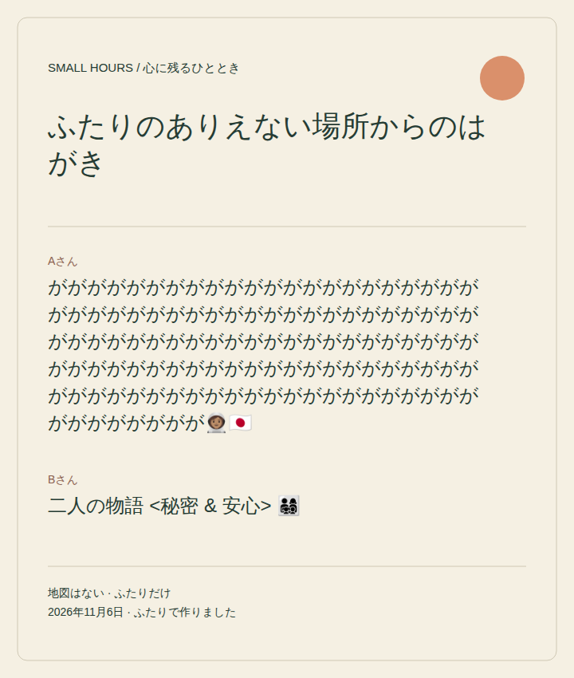
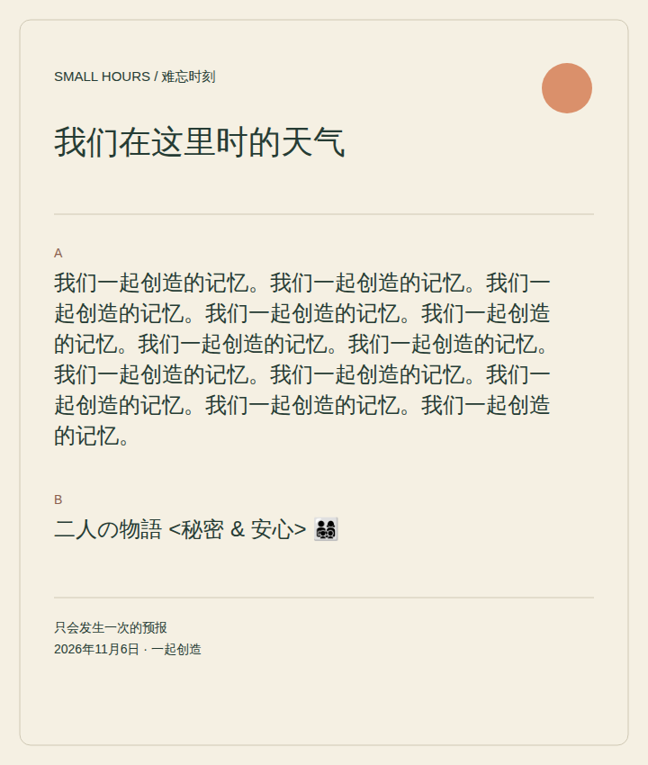

# Small Hours: multilingual development milestone — November 6

English, Japanese and Simplified Chinese now cover the complete pair and solo-rehearsal routes, all three scenes, assistive/page labels, privacy explanations, timer/status feedback and downloaded SVG text. The 183 complete-message keys keep scene/choice IDs unchanged. Japanese and Chinese wording is an agent-authored draft for fluent review; this is engineering preparation, not language approval or a release.

| Contract | Implemented behavior |
|---|---|
| Language selection | Choose English / 日本語 / 简体中文 on the home screen. Explicit choice precedes saved preference, supported browser languages, then English. Traditional Chinese and bare `zh` are not silently mapped to Simplified Chinese. |
| Safe switching | No locale control during a private journey. Returning to the menu requires the existing explicit End & forget confirmation; cancel leaves the current step intact. |
| Privacy | Only `small-hours.locale.v1` is persisted. Private choices, predictions and personal writing remain in memory. No translation service, analytics or upload is added; downloaded SVGs exclude guesses. Storage denial does not block play. |
| Writing | 120 grapheme clusters. Composition is not truncated or submitted while active; committed/cancelled composition updates afterward. No automatic translation of either person's writing. |
| Keepsake | Both optional contributions remain distinct. SVG text is escaped, measured against local font metrics and wrapped; its height grows with long text. Ordinary CJK closing punctuation stays with preceding text; opening punctuation follows its word onto the next line. |
| Fonts | Installed Noto/Hiragino/Yu Gothic/PingFang/Microsoft YaHei and generic fallbacks; no network request or bundled font binary. Container evidence uses WenQuanYi Zen Hei fallback; host diagnostics used Noto CJK. Actual-device glyph coverage, font metrics and native SVG viewers remain to qualify. |
| Package | Twelve deliberately allowlisted playable files, including `messages.js`, `locales.js` and the exact version-1 `locale-catalog.json`. Missing catalogs/messages/placeholders or invalid locale scope fail validation. |
| Preserved baseline | The original eight-file frozen human-study ZIP remains SHA-256 `64ebb3bdfd69b4a643a06817cc023754e94fc114c5a812fae6fb111af1ad2fd2`. The previous nine-file development artifact is historical; this twelve-file build has a separate identity. No candidate is staged. |

The code separates messages (`messages.js`), locale/input helpers (`locales.js`), stable scene definitions (`content.js`), state/export (`state.js`), views (`views.js`) and DOM/timer adaptation (`game.js`). Personal writing is escaped at rendering/export boundaries. Catalogs use whole sentences and named placeholders, including A/B and pair/rehearsal distinctions; label text never decides a game transition.

## Verification and retained failures

The reviewed implementation is pinned to [`1e118acb5ff1c0669d36962bc40b9c0c86edda95`](https://github.com/PaperStrange/IndiaGames/commit/1e118acb5ff1c0669d36962bc40b9c0c86edda95), based on `c9b98b025e0b7ea38254648058146fceddeb9d1a`. The earlier working-snapshot record preserves its base/diff/file hashes separately; the committed export below now verifies that exact implementation. No official release or human approval is implied.

- `npm test` in `memorable-moments-game/`: **21 tests passed**, covering catalog/placeholder parity and negative cases, locale precedence/storage failure, graphemes, stable rule IDs, private handoffs, optional/escaped contributions, long CJK layout, countdown ownership and exporter confinement/failure cases. Full retained log: external `qa/small-hours/unit-attempt-2.log`.
- The previous English behavioral suite passed 33 checks in each completed root attempt; its historical evidence remains unchanged.
- Review attempt 6 passed **236 Chromium locale checks** across three languages × pair/rehearsal at the root mount. Actual synthetic keepsakes were downloaded, parsed and reopened over same-machine HTTP; CJK glyphs and long-text previews were inspected. That attempt stopped before Firefox because creating its evidence directory failed with `ENOSPC`, an infrastructure failure. This partial run does not establish nested or cross-engine success.
- Attempts 1–5 are retained. The first tried a file URL, which managed Chromium blocked. Subsequent standalone XML/SVG screenshot attempts stalled; HTML document replacement and a blank-origin image preview also failed. A minimal same-origin HTTP HTML/image preview succeeded. The final runner inspects saved SVG XML/bounds directly and photographs the exact saved bytes through that same-origin preview. These limitations are not recast as game failures or OS-file-viewer approval.
- **Final review attempt 7 passed**, November 6, 09:29:33–09:32:31 UTC. Two matching twelve-file snapshots (103,624 bytes), 24 root/nested HTTP file comparisons, **1,416 locale assertions** (236 per engine/mount), **66 legacy English checks**, and three timer groups/nine assertions passed. Chromium 141.0.7390.37, Firefox 142.0.1 and WebKit 26.0 were exercised at both mounts. Real timer expiry took **45,068 ms**; synthetic clock/lifecycle checks remain separately labelled. Only the known favicon diagnostics were observed. [Portable results and complete file hashes](verification.json). Inventory SHA-256: `7743c91f718190e4f8328789cc583fea1e390348aba42075783936d6c6bf5ada`. This is the preserved working-tree snapshot; its complete playable inventory matches the committed export below.

- **Committed export passed**, 2026-11-06T09:38:14.539Z–2026-11-06T09:39:39.099Z, on `1e118acb5ff1c0669d36962bc40b9c0c86edda95`. Two exports and all post-run hashes match the same twelve-file inventory above. All 24 HTTP byte comparisons, 66 existing English checks, **472 locale assertions** (236 at each mount in Chromium 141.0.7390.37) and three timer groups/nine assertions passed; real expiry took **45,058 ms**. Executed tooling hashes match that commit. Earlier Firefox/WebKit evidence applies to the identical playable bytes and was not unnecessarily rerun. Known favicon diagnostics remain; other reported errors were zero. [Committed-source results, commands and complete inventory](committed-export.json).

Repeatable checks, with a separately installed Playwright module and new external evidence directory:

```sh
cd memorable-moments-game
npm test
PLAY_URL=http://127.0.0.1:8111/ \
  PLAYWRIGHT_PATH=/path/to/playwright \
  BROWSER_ENGINE=chromium \
  EVIDENCE_DIR=/new/external/locale-run \
  node tests/locales-browser.mjs
node scripts/verify-development-export.mjs \
  --repo /path/to/checkout --commit FULL_40_CHARACTER_COMMIT \
  --output /new/external/committed-verification
```

Use supported Firefox/WebKit installations via `BROWSER_ENGINE`; record actual engine versions and failures. The shared November 6 browser container runs the HTTP server and browser together, with serialized launches to avoid concurrent VFS disk expansion. It is a technical environment, not a physical phone/tablet. The verifier checks every committed file at root and project-style nested HTTP mounts, two matching exports, the existing English suite, all-locale journeys and timer behavior. It retains the known missing-favicon diagnostics.

## Synthetic saved-file previews

These previews render the actual downloaded SVG bytes, with QA-authored stress text; they are not participant memories or testimonials. Both contributions remain separate and CJK punctuation stays with preceding text. Font rendering is observed in the specified container, not guaranteed on unseen hardware.

| Japanese | Simplified Chinese |
|---|---|
|  |  |

## Human handoff remains open

Fluent reviewers should review the entire three-scene catalog, especially kind prediction outcomes, privacy honesty, consent, optional blank writing, role labels and rehearsal wording. Device observers should record actual models/OS/browser/input, Japanese/Chinese composition and cancellation, virtual-keyboard occlusion, rotation/split view, background/history/reload privacy, zoom/readability, actual download and reopening in an available viewer. Synthetic composition events and touch emulation do not fill those fields.

Observe the existing critical journey without explaining the intended emotional payoff: invitation → separate choices/guesses → handoff → reveal → each person's offscreen contribution → both optional details → unprompted save/replay/leave. Preserve the six-pair criteria (5/6 unaided reveal, 4/6 both contributing, 3/6 voluntary save/replay), failed/assisted attempts and independent human approval. Additional per-locale qualification and exact device claims still require the agreed protocol; do not divide the six-pair cohort into two pairs per language. All-three-language November 20 inclusion does not waive the pilot-first Small Hours staging prerequisite.
