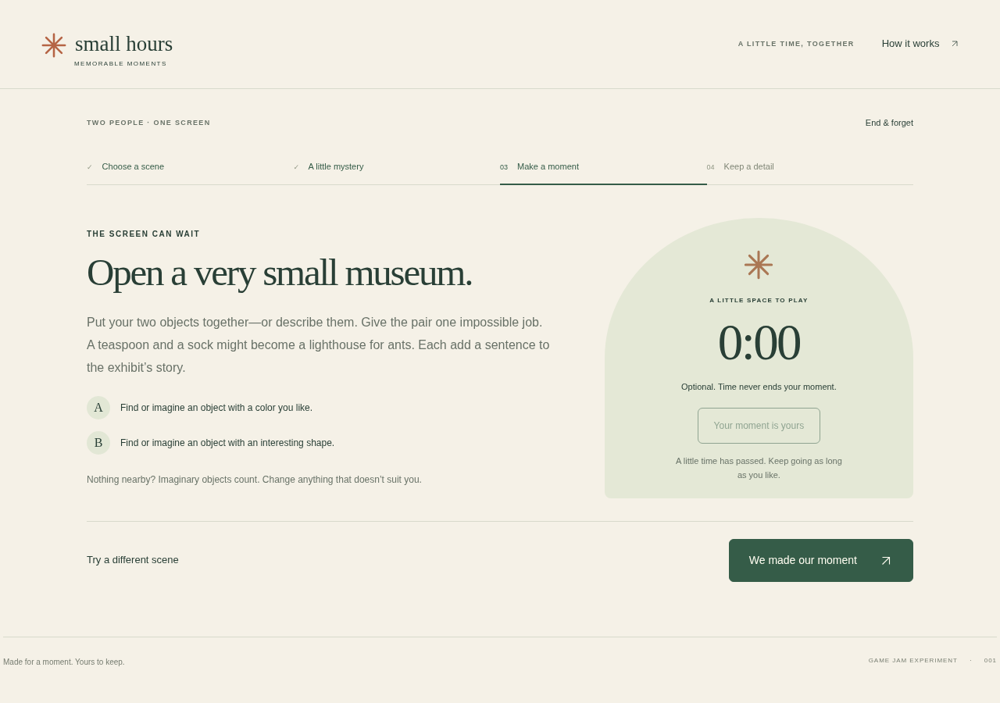

# November 6 verification · Small Hours development cleanup

The checks below used synthetic inputs and an automated browser. They do not add human sessions, physical-device results or release approval. The [portable report](verification.json) binds the development inventory and unchanged frozen-baseline hash.

| Check | Actual result and limits |
|---|---|
| Node countdown lifecycle | **5/5 passed**: single start, wall-clock elapsed time, one-shot expiry, cancellation including handle zero, and rejection of callbacks from an earlier screen |
| Existing browser journey | **33/33 passed** on desktop, 390px emulation and sandboxed iframe: full pair/rehearsal paths, private handoffs, optional timer, SVG parsing/download, replay and forget/reload |
| Focused timer browser journeys | **3/3 groups, 9 checks passed**, root and project-style nested HTTP; zero unexpected page/console/request/HTTP diagnostics |
| Real timer expiry | **45,045 ms** observed; the activity and writing action remained available; no forced navigation |
| Dialog and screen cancellation | Simulated elapsed time: dismissing End retains the active countdown; confirmed End and leaving the activity clear it; a new activity starts from 45 seconds |
| Page lifecycle | Synthetic pagehide/pageshow events clear private DOM and restore a fresh welcome; this tests the handlers, not an actual browser back-forward-cache traversal |
| Evidence-directory protection | Reusing an existing output directory exits with `EEXIST` before browser launch and retains prior output |
| Runner failure path | An intentionally unsupported URL on port 1 produced `ERR_UNSAFE_PORT`, exit 1 and a partial failure report in a new default temporary directory; browser cleanup completed. This deliberate setup failure is not a game defect |
| History preservation | **540 original tracked files unchanged**; only five existing code/tooling/current-document files changed. The frozen ZIP and manifest retain their exact bytes |

The first complete UI run passed before a diagnostic-path-only log improvement. The final UI run also passed through the new package command. Both traces remain local. No passing case replaces a failed human attempt; no human attempts were made.

## Reproduce the maintained checks

From the repository root, serve only the game directory:

```sh
python3 -m http.server 8111 --bind 127.0.0.1 --directory memorable-moments-game
```

In another terminal:

```sh
npm test --prefix memorable-moments-game
BASE_URL=http://127.0.0.1:8111/ \
PLAYWRIGHT_PATH=/path/to/installed/playwright \
CHROMIUM_PATH=/path/to/chromium \
EVIDENCE_DIR=/tmp/new-small-hours-check \
npm run test:browser --prefix memorable-moments-game
```

Use a new evidence directory, not a prior run or committed history. Node 18+ supplies the unit runner; Playwright and Chromium are separately installed development tools. No dependency or server is shipped to players. Stop the owned server after checking. The focused timer trace additionally used real elapsed time, clock simulation and synthetic lifecycle events as explicitly distinguished above; its raw driver and logs remain local.

## Synthetic preview



This is an automated screenshot of the development build, not a person’s observation or a candidate release image.
