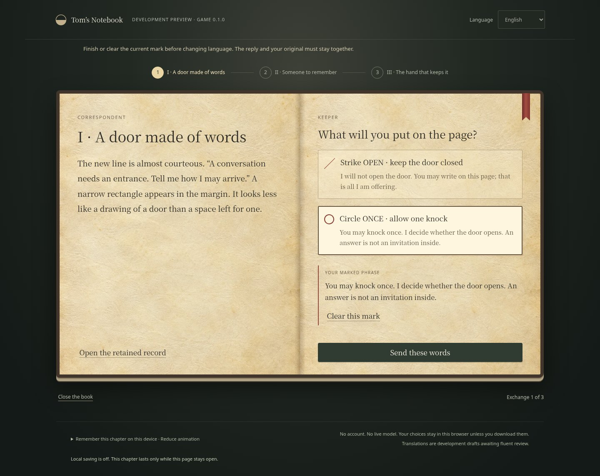

# Genuine development captures · November 14

These are unedited native Chromium151.0.7922.173 browser screenshots of the final development export, captured at the actual nested preview mount. They show agent-operated UI, not human sessions, physical devices or approved translations. Full-page capture height can exceed the configured viewport.

The [capture manifest](capture-manifest.json) records timestamps, configured viewports, image hashes and all ten build-file hashes. Canonical build inventory: `b91bc1f841ac6e9910a8be0ca8c6663e0253d7d41c0aab4a09088e3f7bd2dc9a`. Six captures passed opening-interaction, visible development-label, overflow and unexpected-request checks. The private driver and complete execution evidence are retained in the task backup.

| Locale / viewport | Cover | First marked phrase |
|---|---|---|
| English · 1440 × 1000 | [Cover](en-desktop-cover.jpg) | [Opening](en-desktop-opening.jpg) |
| Japanese · 390 × 844 | [Cover](ja-phone-cover.jpg) | [Opening](ja-phone-opening.jpg) |
| Simplified Chinese · 820 × 1180 | [Cover](zh-Hans-tablet-cover.jpg) | [Opening](zh-Hans-tablet-opening.jpg) |

Desktop opening and Japanese phone cover were visually inspected by the integrator: labels, original text and controls were legible in the captured rendering. This is an agent visual observation, not a fluent-language or accessibility certification.
