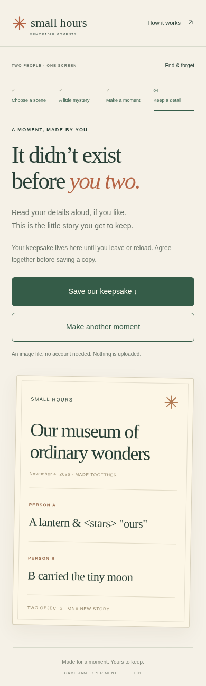

# Small Hours — technical readiness, 4 November 2026

**Result: 8/8 automated HTTP lifecycle cases passed. Human dyad criteria remain pending.**

| Identity / environment | Recorded value |
| --- | --- |
| Frozen study baseline | `SH-BASELINE-2026-10-27`; not a staged release |
| Source | [`ca7fb8e`](https://github.com/PaperStrange/IndiaGames/commit/ca7fb8ea0fa7ceb1a9fd1c8ab238a71a47e9c649) |
| Inventory SHA-256 | `fa4ca1930fc1964d929bca9704c5f0bba89dc9cc46208d34294a1e1ae5c458e3` — 8 files; unchanged after execution |
| UTC execution | 2026-11-04 15:50:03–15:50:17 |
| Browser | Chromium 151.0.7922.173; Playwright 1.56.1; Linux managed cloud |
| Route matrix | Same-host HTTP `/` and `/IndiaGames/pilots/small-hours/`; 1280×900 and 390×900; pair and solo modes |
| Errors | No page errors, failed requests or HTTP error responses |

| Check | Outcome and boundary |
| --- | --- |
| Choice + guess sealing | PASS; sealing stayed disabled until both inputs; handoff concealed prior choices |
| Full lifecycle | PASS; A/B choices → reveal → activity → private A/B details → keepsake |
| Optional timer | PASS for activation and disabled repeat start; timer expiry was not exercised |
| SVG download | PASS; accepted actual browser download, verified both synthetic lines, escaped `& < > "`, correct solo marker and file hash |
| Replay | PASS; next scene selected and previous choice/guess selections cleared |
| End & forget | PASS; cancel retained the active step; confirm returned home and removed detail text |
| Reload / storage | PASS; mid-session reload returned home; local/session storage empty |
| Layout | PASS at tested widths; keepsake page had no horizontal overflow |
| Blank / maximum-length details | NOT RUN in this pass |
| Keyboard-only / focus / screen reader | NOT RUN in this pass |



The screenshot and download contain synthetic QA text. One automated operator completed both sides. This cannot establish social enjoyment, consent quality, voluntary saving, fair contribution, retention or any human study pass.

## Reproduce this execution

The dated `docs/gamejam/milestone-2026-10-27/package-baseline.py` helper exports the pinned source and verifies its inventory. In this retained workspace:

```sh
python3 /workspace/indiagames-milestone-2026-10-27/small-hours/docs/gamejam/milestone-2026-10-27/package-baseline.py --repo /workspace/IndiaGames --output /new/external/small-hours-baseline
node /workspace/indiagames-readiness-2026-11-04/qa/drivers/small-hours-lifecycle.cjs /new/external/small-hours-baseline/build /new/external/small-hours-evidence
```

The local driver and detailed trace are retained outside Git at `qa/drivers/small-hours-lifecycle.cjs` and `qa/small-hours-lifecycle-01/` under `/workspace/indiagames-readiness-2026-11-04/`; these are workspace paths, not public download links. The driver uses installed Playwright, serves the exact export over ephemeral loopback HTTP, uses visible controls, and closes contexts/browser/server in `finally`. It does not inject game state. [Portable result summary](technical-qa.json) is committed with this report. Public installation/setup instructions are in the main-branch iteration runbook; recheck the frozen inventory before comparisons.

No proxy, certificate or browser network restriction was disabled. No `file://` fallback was used. This confirms the tested same-host route only; externally hosted and physical-device playtests remain separate. Frozen baseline bytes and human approval flags were not changed.
