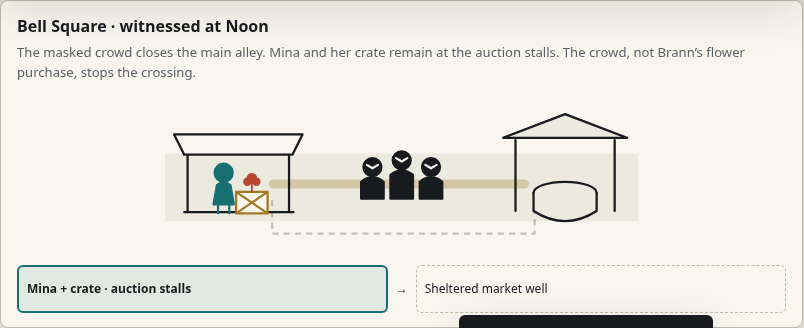

# The Thirteenth Bell — technical readiness, 4 November 2026

**Frozen candidate 0.1.0 passed 33 automated scenario executions: 16 at root/desktop, 16 at nested/390px, and a nested/desktop complete Mina ending and restart. Human comparison criteria remain pending.**

| Identity / environment | Recorded value |
| --- | --- |
| Candidate source | [`700dcea`](https://github.com/PaperStrange/IndiaGames/commit/700dcea61eaedc704ddce5adc98d5a6bd5d42a06) |
| Frozen master packet | `02c78ad9739622fb447850fbecb5f46e7dec8de8`, `release-candidates/thirteenth-bell/0.1.0/` |
| Build inventory SHA-256 | `fa7e9a4f5cc66a9798c6e3cb2c418a240bdbc2a11367d6f54ed2c1989bdfd51e` |
| Portable HTML SHA-256 | `433c9c6706e95ce5da2e541d73c2662322bef8b8c391e72ae451dcd42c80b973`; unchanged after execution |
| Harness source | `tests/square-journey.cjs` at pinned `3d4e205c417272f00b87c76c00532f4456d31e38`, adapted outside Git to serve the frozen packet |
| UTC date | 2026-11-04; per-run timestamps in [technical-qa.json](technical-qa.json) |
| Browser / transport | Chromium 151.0.7922.173; Playwright 1.56.1; same-host HTTP; inherited proxy/TLS unchanged |
| Mounts and dimensions | `/` at 1280×1000; `/IndiaGames/pilots/bell/` at 390×1000 and selected 1280×1000 ending; additional 390×844 touch/text and 821×462 iframe scenarios |

| Gameplay / interaction condition | Observed technical result |
| --- | --- |
| Blank, wrong, correct forecast | Witnessing and ordinary preparation remain possible in all three conditions; blank/wrong do not grant Momentum |
| Eyewitness knowledge | Cancelled or late visits do not manufacture the missing witnessed clue |
| Borrowed preparation | Resource cost applies once; cancelled selection costs nothing; saved time permits an additional expedition action; forecast resolves at the real boundary |
| Fracture 4 | Catastrophe before Noon interrupts the scheduled event/forecast; later catastrophe preserves an already observed outcome |
| Missed window | Preparation becomes unavailable after the window; knowledge remains for a later loop |
| Full Mina route / anchors | Preparation → visible safe outcome → all three anchors → Underbell ending → restart; restart clears run resources and clue |
| Mode / reload isolation | Original and Contrast remain distinct; reload starts a fresh run as intended |
| Keyboard / touch / text / iframe | Existing visible-control scenarios passed; this is emulation and computed text enlargement, not a physical-device or screen-reader audit |
| Original comparison / portable build | Frozen comparison retains both older modes; current single-file candidate retains the causal scene |



[Full screenshot: the borrowed route’s visible outcome](bell-borrowed-preparation.png)

## Error qualification

Candidate page errors and resource failures: **zero**. The immutable historical comparison requested its optional Google Fonts stylesheet and received `net::ERR_CERT_AUTHORITY_INVALID` in the two complete suites. That exact pre-existing request was recorded separately by the existing harness; the comparison rendered with its declared fallback fonts. Its requested web-font appearance is therefore unverified. No certificate bypass or source edit was used to suppress the failure.

The repeated `button.click()` activation in the atomicity scenario is an explicitly labelled race regression; all normal journeys use visible Playwright click/tap or Tab/Enter. It is not counted as a player's observed behavior. Hidden encounter controls were not treated as valid next steps.

## Reproduce the retained execution

The coordinator exported the frozen candidate directly from the pinned master packet and verified the single HTML file's SHA-256 before testing. The external harness serves those exact bytes as both its root and portable distribution, and retains the unchanged historical comparison separately. It does not rebuild the candidate.

```sh
PLAYWRIGHT_MODULE=/workspace/IndiaGames/vivid-2.5d-photo-game/play/node_modules/playwright BELL_EVIDENCE_DIR=/new/external/bell-root node /workspace/indiagames-readiness-2026-11-04/qa/drivers/bell-frozen-journey.cjs
PLAYWRIGHT_MODULE=/workspace/IndiaGames/vivid-2.5d-photo-game/play/node_modules/playwright BELL_NESTED=1 BELL_WIDTH=390 BELL_EVIDENCE_DIR=/new/external/bell-nested node /workspace/indiagames-readiness-2026-11-04/qa/drivers/bell-frozen-journey.cjs
```

These are exact retained-workspace commands, not public hosted runner links. The adapter is based on the committed `tests/square-journey.cjs`; it changes artifact locations, pinned metadata and mount/viewport selection. Detailed JSON, screenshots and the adapter remain under `/workspace/indiagames-readiness-2026-11-04/qa/`. The [compact result ledger](technical-qa.json) is committed with this report. All browsers and servers closed in `finally`.

No human sessions or approvals were created. These executions cannot establish tension, fair prediction, comprehension, spontaneous recall, preference for Original versus Contrast, or a better Mina experience. Candidate and reference bytes remain frozen. This same-host result does not settle the separate managed-browser failure or external deployment issue.
