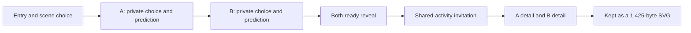

# Small Hours — evidence adjudication, 4 November 2026

**Current decision: preserve the unchanged baseline and prepare a technical
readiness handoff. Human play is pending and will be arranged by the user.**
This review corrects the interpretation of archived observations; it does not
replace their original wording or supply a new play session. See the
[handoff](README.md) for verification status and the human packet.

## What changed, and what did not

Reviewed source: `45042578e549d0aba3ee10702384d0a86c780aa9` on
`memorable-moments-game`. The [one-commit comparison][delta] from `d541931…`
contains 32 research-package files: README, one-page critique, two HTML copies
and 28 raw PDFs. No runtime, original five records, review notes, tests, baseline
inventory or human protocol changed in that comparison. The new files make
old observations easier to inspect; they do not establish more participants.

Review coverage: both Markdown files and both HTML texts; all 28 PDFs through
text extraction across 47 pages, plus visual first-page previews of every PDF.
The HTML contains 23 embedded images in total and no script elements. This is
document inspection, not browser gameplay or complete visual inspection of
every PDF page. Historical task drivers and detailed logs remain local, so the
filed captures do not reproduce every reported action sequence.

## The observed journey belongs to an agent

The [journey][journey] and [agent session][session] describe one operator playing
both sides of Impossible Postcard:

The operator selected an upside-down sea and a midnight garden, then supplied
“a brass key that hums when the tide comes in” and “the smell of rain on the
harbour steps.” A separate Weather for Two rehearsal also reached a keepsake.
These are observed interface routes and authored content. No two-human
offscreen activity, shared delight, willingness to continue, or ordinary
player's creative confidence follows from them. A diagram of the intended
route is not a measured human journey.

## Corrections across five perspectives

| Perspective | Archived claim or observation | Current reading | Next observation; no result implied |
|---|---|---|---|
| Player | Pair flow reaches the reveal and SVG; “needs humans, not fixes.” | The operator completed a route. Reset/replay, HTTP delivery and physical-device readiness require their own evidence; enjoyment and genuine pair participation are unknown. | Verify supported HTTP routes and reset/replay technically. Later observe real pairs' assistance, exits and spontaneous next actions using the canonical protocol. |
| Game designer | Duplicate labels and different A/B submit text are described as friction. | The [A-choice frame][choice] distinguishes large own-choice cards from prediction buttons. “Tuck away my detail” and “Bring our details together” also mark different transitions. Operator selection difficulty is not observed human confusion. | Record expressed intent, chosen control, help and recovery at each handoff. Do not standardize labels before an actual problem is observed. |
| Narrative / art | The polished details and keepsake suggest shared authorship. | They demonstrate what an informed author can write. They do not show that a novice pair invents something together or recognizes both contributions in the ending. | Observe each person's offscreen contribution and neutral debrief about what each added. Avoid asking whether the game “made you feel connected.” |
| Operator | A local-file walkthrough supports readiness; competitor drawing controls “fail.” | `file://` state evidence is not HTTP/module/download coverage. Input and rendering failures may belong to the agent tool, game, print capture or their interaction. The cause remains unisolated. | Record exact served inventory, origin, visible control, input and result. Keep a blocked check blocked rather than silently substituting a route. |
| Research | The keepsake differentiates because it is a file the pair owns; Reign supplies diorama play. | Gartic already exports an album. File ownership/format is not unique. Reign's observed dice, trade and road controls indicate board strategy, not completed freeform diorama creation. | Test the value of one-screen joint invention; retain the missing second deep family and genuine social comparisons as open research. |

## Competitor evidence: retain both successes and limits

| Source moment | Supported conclusion | Limit / correction |
|---|---|---|
| [Gartic Solo album PDF][gartic] and [exported GIF][gif] | Solo animation reaches an album and an export exists. | Not Normal-mode write → draw → guess with humans. This is a direct counterexample to exclusive export/keepsake positioning. |
| [skribbl winner PDF][skribbl] | BrowserTester finishes three rounds first with 1,015 points. | Earlier input trouble and disruptive chat remain part of the record. “Drawing itself fails” overgeneralizes an agent session and ignores the successful later completion. |
| [Drawize practice ending][drawize] | A “Game finished” dialog is visible; the canvas in this print is blank. | Completion of the UI route does not prove a successful drawing or a submitted guess. It cannot establish that human players should avoid drawing. |
| [Drawasaurus AFK PDF][drawasaurus] | The captured session reaches an AFK banner. Earlier captures show other people drawing. | The agent drawing turn remains unfinished. The captures alone do not establish the precise cause of the reported hidden controls. |
| [Reign Round 3 PDF][reign] | Round 3 and trade/road controls are visible; the board does not render in the print. | Partial, setup-assisted play. No road placement or finished game; no completed second deep family for Small Hours. |

The [coverage record][coverage] honestly reports nine attempted titles and an
oversampled draw-and-guess family. Three additional partial attempts do not
turn desk studies into completed games or solve the original breadth target.
Counts, modes, assistance and completion must travel with every positioning
claim. `[REAL]` means a supported state, not a human observation or proof of fun.

## Three product questions, answered as hypotheses

| Question | Defensible direction | What would challenge it |
|---|---|---|
| Why play? | A willing, known pair gets a gentle occasion to invent something together without drawing confidence, scoring or personal disclosure. | The activity feels like work, one person carries it, or either person wants to leave. These are outcomes to observe, not assumed defects in the players. |
| How could it differ on a browser platform? | One screen, private beginnings, a shared offscreen activity and an optional local keepsake. Static HTTP(S) browser delivery is the study route; a participant-facing host is still to be chosen and verified. Platform discovery and demand remain unproven. | Players prefer existing shared activities or exports; the handoffs cost more than the reveal adds. No market-exclusivity claim is justified. |
| What signature experience could it deliver? | **Two private worlds become one impossible place.** The ending could preserve a contribution that would not exist without both people. | Two unrelated answers are merely put side by side, or the keepsake misses what the pair actually made. |

## Decision and bounded next iteration

SH-01/02/15 receive this evidence correction; SH-16 receives the prepared,
unstaffed handoff. SH-12 covers separate technical verification. SH-05/10/18
remain pending human observation, actual devices and independent review.
This document does not advance any human gate or grant a release approval.

After the human baseline, SH-06 selects at most one response: SH-07 for observed
handoff/prediction friction; SH-08 for unequal or disconnected contributions;
SH-09 for an ending that fails to represent a successful activity. No change,
further study and stop remain valid. If SH-08 is selected, first test one prompt
that invites a connection between the two imagined places, preserving spoken,
imagined, gestural and non-writing participation. Do not build all three
responses. SH-11/12/14 would then integrate, verify and observe the selected
variant on its own declared build; never pool baseline and changed bytes.

No new scenes, multiplayer backend, AI partner, relationship score, mandatory
sharing or invented release threshold is justified by this upload. The
[canonical six-pair protocol](../milestone-2026-10-27/protocol.md) remains
authoritative; the November 20 target does not waive missing evidence.

[delta]: https://github.com/PaperStrange/IndiaGames/compare/d541931bf9fd5e0157c94867d211a6c0179b9218...45042578e549d0aba3ee10702384d0a86c780aa9
[journey]: https://github.com/PaperStrange/IndiaGames/blob/45042578e549d0aba3ee10702384d0a86c780aa9/docs/gamejam/competitor-plays-2026-10-28/records/journey--small-hours-2026-10-28.md
[session]: https://github.com/PaperStrange/IndiaGames/blob/45042578e549d0aba3ee10702384d0a86c780aa9/docs/gamejam/competitor-plays-2026-10-28/records/session--small-hours-agent-2026-10-28.md
[choice]: https://github.com/PaperStrange/IndiaGames/blob/45042578e549d0aba3ee10702384d0a86c780aa9/docs/gamejam/competitor-plays-2026-10-28/evidence/moments/35-a-choice.png
[coverage]: https://github.com/PaperStrange/IndiaGames/blob/45042578e549d0aba3ee10702384d0a86c780aa9/docs/gamejam/competitor-plays-2026-10-28/records/coverage--small-hours-2026-10-28.md
[gartic]: https://github.com/PaperStrange/IndiaGames/blob/45042578e549d0aba3ee10702384d0a86c780aa9/docs/gamejam/competitor-plays-2026-10-28/evidence/competitors/gartic-phone/pdf/38db2389-a5d8-564a-8ba7-d5e331b803ed/browser-page-20261029T050532.104613509Z-23.pdf
[gif]: https://github.com/PaperStrange/IndiaGames/blob/45042578e549d0aba3ee10702384d0a86c780aa9/docs/gamejam/competitor-plays-2026-10-28/evidence/competitors/gartic-phone/album-2026-10-28.gif
[skribbl]: https://github.com/PaperStrange/IndiaGames/blob/45042578e549d0aba3ee10702384d0a86c780aa9/docs/gamejam/competitor-plays-2026-10-28/evidence/competitors/skribbl-io/pdf/1ed960b6-d995-543a-a223-29561b85b35a/browser-page-20261029T051225.238180482Z-28.pdf
[drawize]: https://github.com/PaperStrange/IndiaGames/blob/45042578e549d0aba3ee10702384d0a86c780aa9/docs/gamejam/competitor-plays-2026-10-28/evidence/competitors/drawize/pdf/43f3ca00-dd3b-5ece-b5ec-dfff4ad8527e/browser-page-20261029T075753.919821877Z-27.pdf
[drawasaurus]: https://github.com/PaperStrange/IndiaGames/blob/45042578e549d0aba3ee10702384d0a86c780aa9/docs/gamejam/competitor-plays-2026-10-28/evidence/competitors/drawasaurus/pdf/d9268e19-dfd1-57cf-9259-cfbd3dd93f80/browser-page-20261029T083820.870144909Z-23.pdf
[reign]: https://github.com/PaperStrange/IndiaGames/blob/45042578e549d0aba3ee10702384d0a86c780aa9/docs/gamejam/competitor-plays-2026-10-28/evidence/competitors/reign/pdf/a85aab8d-334c-52a5-af4a-6d23ccbda2f0/browser-page-20261029T080925.865936072Z-9.pdf
