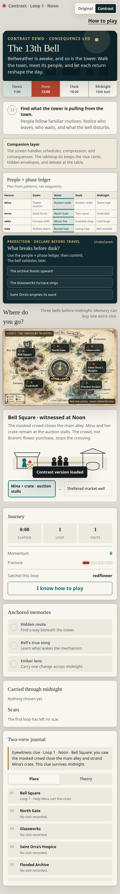
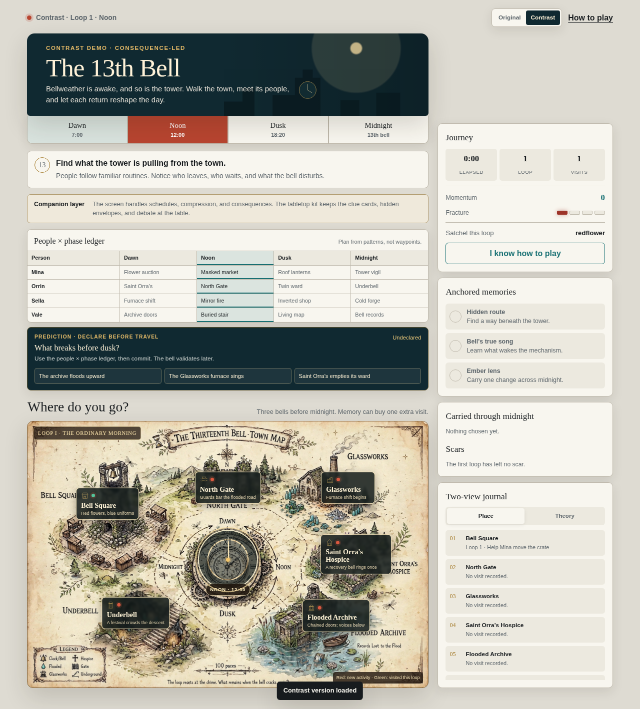

# Bell · November 5 facilitator setup verification

**Result: four of four automated setup journeys passed, with the historical reference's optional-font failures retained.** No runtime or candidate bytes changed. This is a bounded setup/reload smoke test, not a full causal regression rerun, a fresh-player study, physical-phone evidence or release approval.

## Exact artifacts

| Artifact | Source | Build inventory SHA-256 | HTML SHA-256 |
|---|---|---|---|
| Candidate 0.1.0 | `700dcea61eaedc704ddce5adc98d5a6bd5d42a06` | `fa7e9a4f5cc66a9798c6e3cb2c418a240bdbc2a11367d6f54ed2c1989bdfd51e` | `433c9c6706e95ce5da2e541d73c2662322bef8b8c391e72ae451dcd42c80b973` |
| Previous Contrast reference | `252cc55e8515da1438c3e74af2e7dcc58eb13118` | `47793d0ebc1801226a6b1f1e4fc11fb056d632c54919f179b91e14520c54fda8` | `c2facc2a008c7bb232a629c4bd79efcb07cb5e46b73c4ebf6e55ceaa5337f405` |

Candidate bytes were read from the immutable [master packet](https://github.com/PaperStrange/IndiaGames/tree/02c78ad9739622fb447850fbecb5f46e7dec8de8/release-candidates/thirteenth-bell/0.1.0). The reference came from the game branch's [frozen manifest](../milestone-2026-10-27/reference/manifest.json). Both inventories matched before and after testing, and every initial HTML response observed by the browser matched its expected hash.

All **917 existing files** in the source snapshot matched branch base `56eec3e7d96410492ad70bf39b5eb5ae003feec8`; only this new readiness directory is added. The facilitator guide's archive/extraction and inventory-verification commands also passed in a separate private folder. That command check used already fetched immutable Git objects; it is not evidence of setup on a human facilitator's machine.

## Actually exercised

Chromium **151.0.7922.173**, separate local HTTP origins, reduced-motion preference, fresh browser context per run. Narrow dimensions are desktop emulation.

| Build | Viewport | Fresh Contrast → visible choice/resolution → reload/new run | Result |
|---|---|---|---|
| Candidate | 1280×1000 | Verified | Pass |
| Candidate | 390×844 | Verified | Pass |
| Previous Contrast | 1280×1000 | Verified | Pass with fallback-font qualification |
| Previous Contrast | 390×844 | Verified | Pass with fallback-font qualification |

Each run checked six boundaries: actual response hash, Contrast at loop 1/Dawn with zero visits, a visible scene/action/resolution advancing one visit to Noon, the retained candidate/reference structural difference, no horizontal document overflow, and reload returning to a new run with no carried visit/clue. This is four scenario executions containing 24 checks, not 24 distinct player journeys. The scripted first action is a facilitator preflight only; participants receive no route demonstration.

## Diagnostics and limits

- **Zero page exceptions and zero HTTP error responses** were observed. Candidate runs had no console or failed-request errors.
- The reference's optional Google Fonts stylesheet produced **four failed requests and four corresponding console errors** (`net::ERR_CERT_AUTHORITY_INVALID`): initial load and reload at each viewport. The exact requested URL and per-run observations are retained in [technical-qa.json](technical-qa.json). Its fallback-font appearance was exercised; intended remote-font appearance was not verified. No request was intercepted, suppressed or replaced and no TLS bypass was enabled.
- No attempt failed a functional assertion. No retry was needed. Both owned HTTP servers and the browser were closed.
- The full ending, borrowing/Fracture boundaries, keyboard-only journey and 200% text reflow were not rerun here; their previous results retain the [November 4 date and limits](../readiness-2026-11-04/TECHNICAL-QA.md).
- Static inspection confirms the in-game timer displays elapsed run time; it does not enforce the human protocol's 20-minute limit or 120-second neutral break. Facilitators must use their own clock and record actual timestamps. No human-duration, comprehension, recall, preference or enjoyment claim is made.
- Physical phone/browser, screen reader, actual facilitator-machine connectivity and the original separate managed Chromium 152 route remain unverified. These loopback checks establish only this co-located technical route.

Human sessions: **0**. Physical-device passes: **0**. Human critical-bug adjudication and independent approval: **pending**. Use [FACILITATOR-SETUP.md](FACILITATOR-SETUP.md) before any actual study.
