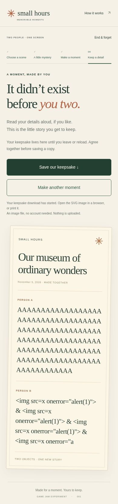
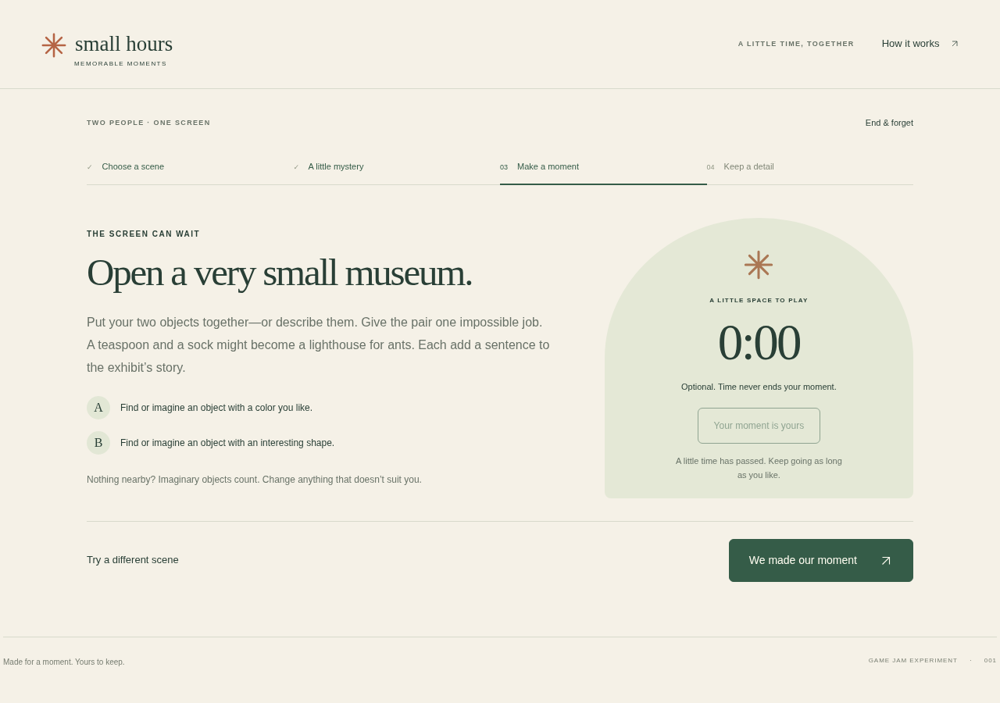

# Small Hours — targeted technical checks, 5 November 2026

**PASS: four scenario groups, 64 assertions, zero observed page/console/network/HTTP errors.** The assertion total includes repeated focus checks; it does not mean 64 independent gameplay scenarios. No failed or corrected attempts preceded this run. The runtime and frozen artifact stayed byte-identical.

| Evidence | Value |
|---|---|
| Run | 2026-11-05 15:58:46–15:59:34 UTC |
| Browser | Chromium 151.0.7922.173; Playwright 1.56.1; headless Linux |
| Actor | One automated operator; synthetic text; no real participants |
| Artifact | `SH-BASELINE-2026-10-27`; source `ca7fb8ea0fa7ceb1a9fd1c8ab238a71a47e9c649` |
| Inventory | `fa4ca1930fc1964d929bca9704c5f0bba89dc9cc46208d34294a1e1ae5c458e3`; eight files / 58,313 bytes |
| Serving | Same-host HTTP, `/` and `/IndiaGames/pilots/small-hours/`; no file-URL fallback |
| Identity check | All eight hashes match the frozen inventory before and after the run |

## Actual coverage

| Scenario group | Actual checks | Result |
|---|---|---|
| Keyboard pair, root, 1280×900 | Tab/Enter only for the complete first-scene pair path, writing, actual SVG download, replay and End & forget; choices retain focus, transitions focus headings, controls have visible focus styling; About and End dialogs return focus after escape/cancel | 53 assertions passed |
| Blank and maximum details, nested, 390×900 | Empty and whitespace details use the declared fallback; typed input stops at 120 UTF-16 code units with the correct counter; literal markup stays text; actual blank/max SVGs parse and preserve contribution text through wrapping; narrow layout and forget/reload checked | 6 assertions passed |
| Real timer, root, 1280×900 | Repeat start disabled; real deadline expired after 45,060 ms, showing 0:00 and the gentle status; activity stayed visible and writing remained available | 3 assertions passed |
| Interrupted timer, nested, 390×900 | Playwright clock advanced 12 seconds to 0:33; leaving the activity cancelled the interval; 45 further simulated seconds produced no removed-element write or page error | 2 assertions passed |

The real timer used `Date.now()` and elapsed wall time, with no clock override. Only the separate interruption regression used Playwright's clock. This distinction matters: the last case tests cancellation efficiently; it is not measured player duration or a second real-time expiry observation.

## Reproduction and retained evidence

Use [FACILITATOR-SETUP.md](FACILITATOR-SETUP.md) to extract and verify the exact public ZIP. The check matrix above can be followed on the served artifact using synthetic text. The keyboard group navigates by real Tab/Enter events, without direct focus injection or game-state edits. Inspect actual downloaded SVG text and XML parsing, not only the download click. The maximum-length case types beyond the limit through the browser, rather than setting an oversized DOM value.

For this retained task workspace, the runner is `targeted-qa.cjs` and the raw run is `qa-01/` beneath the Small Hours November 5 task directory. These are local backup artifacts, not public URLs. [technical-qa.json](technical-qa.json) publishes the driver/report hashes, exact tested inventory, assertions and limits. The runner creates a fresh evidence directory, starts an ephemeral server, and closes browser contexts, browser and server in `finally`; no owned service remains running.

## What remains unverified

This is first-scene pair mode only. November 4's eight lifecycle cases and older scene/solo checks retain their original dates; they were not silently rerun here. Physical iOS/Android behavior, virtual keyboards, screen readers, human privacy comfort, offscreen creative contribution and voluntary replay are pending. Background-tab timer throttling, IME and exhaustive Unicode boundary behavior were not part of this targeted pass. A visible focus ring in Chromium is not a complete accessibility audit.

The six-pair product study, zero-critical-bug human assessment and independent release approval are still pending. No human metric, consent field or approval was filled from these checks. No runtime defect requiring a new build was reproduced in this run.
