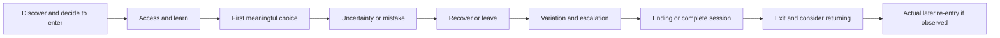

# One More Turn: a player-journey expedition

**Prepared 5 October · revised 6 October 2026 · status: planning, awaiting agreement before play.**

This revision responds to the request for at least six competitors per playable demo and broader genre coverage. No games have been launched, game code changed, purchases made, or participants contacted while preparing it. Play starts after we settle the research plan. Building starts after we review the resulting evidence and choose an experiment.

The ambition is to come back with stories worth designing around: **“I thought this would happen; I tried that; the game surprised me; now I want to…”** A list of attractive features cannot tell us that story.

## The proposal in one minute

- **Six required competitive alternatives for each of the three demos: 18 explicit assignments**, plus two reserves per demo. The [per-demo competitor matrix](competitor-matrix-2026-10-06.md) now governs selection. The [earlier browser roster](candidate-roster-2026-10-06.md) remains an additional source pool. A creator listing is evidence of a release, not proof that it runs in our environment.
- Each demo must cover **at least four broad play families**, with at least two competitors outside narrative/deduction puzzles and no more than two required titles from one family. Shared titles count once in the unique-game total; each assignment needs its own comparison question.
- **Depth first:** two contrasting competitors per demo form the first milestone. Continue until all six assignments per demo have meaningful journey evidence, or report the unmet coverage. Whole-game endings, cases, complete matches, bounded runs and partial campaigns have separate counts.
- Longer games get continuing journals across sessions. Native/commercial competitors need legitimate access and suitable hardware; their placement in the required comparison set does not authorize purchases or make them browser competitors. Reserves must preserve competitive relevance and genre coverage, while explicitly recording any original research question they leave unanswered.
- Each studied title produces a player journey, a system map and an art board. Critics enter after first-pass notes are locked. Human social experience requires actual people.
- The synthesis answers the original three questions **separately for Memorable Moments, Vivid and Bell**, and presents competing creative directions before choosing anything to build.

This is a purposive design study, not a representative market survey. More titles will broaden the comparisons; they will not turn agent observations into facts about human demand.

## What we are correcting

The earlier released-game work covered only an opening route in **We Become What We Behold** and an opening route in **Detective: Again!** Neither ending was reached. The former used scene-coordinate assistance later in its route; the latter encountered rendering and iframe difficulties. These remain useful bounded observations, not complete novice journeys.

The Roottrees Are Dead was read about, **not played**. Critic reports about its original browser edition and commercial remake must stay separate. Existing prototype checks establish that tested interactions work; they do not establish enjoyment, attachment, togetherness or demand. The [historical field report](field-report.md) preserves those records and their limits.

This plan supersedes that report's suggested next-day schedule. Its “let players choose what survives” thesis is now a hypothesis to challenge, not a brief every finding must support. Existing work on Small Hours, The Keeper's Frame and **The Thirteenth Bell** stays frozen during planning. There is no newly modified “Fourteenth Bell.”

## Select for useful differences

| Research lane | Contrasts we need | What it could teach our games |
|---|---|---|
| Shared attention and authorship | Private contribution versus public reveal; one person's authorship versus a group's; performance pressure versus permission to be imperfect | Whether Memorable Moments creates something people could not make alone, and whether both people want to participate |
| Art that does something | Composition as a clue; framing as an action; a character's visible response; sparse graphics versus elaborate imagery | Whether Vivid's depth, image and character actually change decisions, and what makes recognition legible |
| Knowledge, consequence and return | Deduction versus guessing; a useful mistake versus repeated administration; remembered knowledge versus accumulated resources | Whether Bell makes understanding rewarding, and whether another loop offers a new plan |
| Browser context across all lanes | Arrival, trust, loading, controls, interruption, save/re-entry, completion, replay/share invitation | Whether the experience fits a short web visit, beyond whether its central mechanic is interesting |

The matrix adds cooperative platforming, hidden-information card play, geographical exploration, creative construction, rhythm action, turn-based tactics, roguelike runs, management and incremental progression. These comparisons must answer why the same person might choose that experience on the relevant occasion. Genre breadth alone is not a reason to add a game. Include counterexamples to our preferred idea; creator identity, tags, sales and review scores alone do not establish quality.

The per-demo six are required comparison commitments; the older roster is a reserve pool. Each row names its competitive relationship: a close experience substitute, an adjacent alternative serving a similar desire, or a broader alternative for the same leisure occasion. Allow at most one of the last type per demo. A pure art reference does not satisfy the competitor minimum.

A blocked title stays on the access ledger and contributes zero played coverage. A replacement needs a concrete competitive reason; document the original question it preserves or leaves unanswered and keep at least four broad families after substitutions. If that cannot be done, the demo's coverage remains incomplete. A store-only comparison may inform selection but does not satisfy the later six-game firsthand evidence gate. These are planned tests, not a claim that six suitable licenses/devices/groups are available today.

## What “the whole journey” means

The real route can branch, loop or stop. Draw that route from actions and evidence, including dead ends. Never force a tidy arc onto it.

| Game form | Complete boundary | What does not count as complete |
|---|---|---|
| Short narrative or puzzle | Actual ending, aftermath, exit/restart invitation; re-entry tested separately | An attractive opening or a walkthrough summary of the ending |
| Party/social | Joining, explained rules, full agreed match/session, reveals/results, actual rematch-or-leave decision | One agent filling multiple player slots; a lobby alone |
| Long mystery or campaign | Full game only when its ending is reached; otherwise named chapters/cases and continuation plan | One solved deduction standing in for the whole campaign |
| Open-ended or incremental | A predeclared complete activity cycle with return after interruption | Calling a repeatable cycle the ending of the whole game |

Every stage records the player's current intention, expectation, action, alternatives, feedback, consequence and friction. Pair a concise chronological journal with a drawn route; link turning points to captures. Keep active-play time, note-taking, technical setup and breaks separate. The [journey template](journey-observation-template.md) supplies the fields, including explicit blanks for unobserved stages.

Return has two different meanings: a restart we actually perform, and a human voluntarily choosing to come back later. The former does not prove the latter. A next-day recall or return session needs an agreed human follow-up; we do not manufacture it with an agent's memory of its notes.

## First encounter before analysis

1. **Declare prior knowledge.** A first-pass evaluator gets the URL, controls available to an ordinary player, access constraints and research questions, without teammate solutions or critic conclusions. Existing agents who saw source/solutions cannot honestly be called blind. Use a fresh context where possible, and still disclose all prior exposure.
2. **Play through the visible interface.** Mouse coordinates selected from the rendered view are ordinary input; coordinates extracted from hidden game state are assistance. No source-derived solutions, scripted winning routes, save edits, injected state or forced clicks for a novice journey. Tools execute ordinary inputs; they must not solve the route.
3. **Preserve rhythm.** Note a few consequential predictions before acting, when the game allows it. Use sparse timestamps during play and reconstruct the fuller journal afterward from evidence. Label hindsight. Do not turn a quiet scene into a survey every five seconds.
4. **Keep mistakes.** Record uncertainty, abandoned theories, accidental choices and naturally occurring recovery. No invented failure just to fill the sheet; use “not encountered” when appropriate. Native hints and accessibility settings are legitimate options, recorded with their effect on the route.
5. **Lock the first account.** Save and commit notes before reading critics, source or teammate interpretations. For a continuing game, locking a session does **not** lift the spoiler embargo: postpone source/criticism until the intended blind arc ends or we explicitly abandon blind continuation. A second analytical pass can then revisit decisions, supported settings and alternate paths, with assistance clearly labeled. If outside knowledge arrives earlier, later completion is an informed journey, not a blind one.

A ten-minute setup budget is a proposed operational cap, not a judgment of the game's onboarding. If controls, storage, performance, access or capture fail, preserve the blocker and move to an accessible title. Do not describe cloud rendering latency as the ordinary player's experience. If audio cannot actually be heard, label it **not observed**; screenshots, filenames and waveforms are not listening.

## Judge fun through particular moments

We will avoid a single “8/10 fun” number. For each important episode, ask:

| Lens | Evidence to look for | Rival explanation to consider |
|---|---|---|
| Curiosity | A specific unanswered question changes the next chosen action | The evaluator follows a task instruction rather than wanting an answer |
| Agency and expression | A choice has a traceable consequence or produces something personally authored | Decorative options or an inevitable outcome merely appear consequential |
| Competence | A stated theory improves after feedback and enables a new decision | Guessing, remembered solutions or hidden assistance explain success |
| Tension and recovery | A risk is understood; loss changes the next plan without erasing all useful learning | Repetition is clerical work, or the tool makes ordinary input unreliable |
| Connection | A real participant responds to another person's contribution or a character's specific action | Generic dialogue, politeness or the organizer supplies all the meaning |
| Pacing and payoff | Later variation or an ending changes how an earlier action is understood | Novelty carries the opening but the central action stops developing |

The judgment will take this form: **“For this player situation, this observed sequence offers this appeal; this cost or counterexample limits it; this remains unknown.”** An agent can make a reasoned design judgment. It cannot supply invented laughter, boredom, empathy, retention or a population preference.

## Give game art equal attention

Art analysis follows the journey, not a gallery of pretty screenshots. On each complete anchor, make a six-to-eight-beat board: arrival, learned action, consequential choice, confusion/recovery if encountered, escalation, payoff/ending and re-entry if observed. Preserve original frames and mark analytical annotations separately.

The [art template](art-observation-template.md) covers composition and hierarchy; character silhouette and identity; text and scale; visual clue consistency; color/shape cue redundancy; motion and acknowledgment; sound and silence; motifs that change meaning; and the fit between style and the player's action.

Three evidence forms are especially useful:

- **Clue → theory → decision → confirmation:** was the evidence perceptible before we needed it, and did we actually understand it?
- **Before → acknowledgment → consequence:** does the art explain why an action matters? Timing claims require a clip or timestamped live sequence, not three still images.
- **First appearance → later reinterpretation:** does a person, object or place acquire meaning over the whole arc?

Cursor position is not eye tracking. A changed facial expression is not proof of attachment or persistent simulation. Native accessibility probes on a second pass can expose specific problems; they do not certify accessibility for people whose experience we did not study. Sound judgments require a functioning listening path and an evaluator who actually hears it.

## Read critics as conversation partners

After the intended blind arc is finished or explicitly closed and its notes are locked, seek two substantive, differently reasoned accounts for each deep anchor where available. Preserve the embargo between sessions when blind continuation is planned. Name author, site, date, edition and context. Compare a concrete claim to a witnessed scene; do not average review scores or treat a comment thread as a representative sample.

Starting sources already in our records include [Nintendo Life's Drawful 2 review](https://www.nintendolife.com/reviews/switch-eshop/drawful_2), [Destructoid's Event[0] review](https://www.destructoid.com/reviews/review-event0/), [PC Gamer's commercial Roottrees review](https://www.pcgamer.com/games/puzzle/the-roottrees-are-dead-review/), [Andrew Plotkin on the browser Roottrees](https://blog.zarfhome.com/2024/02/spring-narrative-games), and [JayIsGames on We Become What We Behold](https://jayisgames.com/review/we-become-what-we-behold.php). These are examples of attributed perspectives, not a quota or new firsthand observations.

Write a disagreement card: their claim; our observed route; an alternative explanation; the replay that could distinguish them. If no substantial criticism exists for a small game, record that gap. Do not invent consensus or let a review fill an unseen ending. Source and GitHub architecture inspection follows the player pass so implementation knowledge does not quietly solve the game for us.

## Humans and devices: a distinct evidence lane

For an initial qualitative round, propose **four to six willing people**, including some less familiar with these genres. Two pairs can explore the two-person situation; a group of four can support a party session if the selected game's rules allow it. This is a small exploratory sample, not a basis for percentages or demographic claims. Actual attendance, relationships, genre experience and self-selection matter more than a tidy target number.

These sessions depend on people the user chooses to involve; none have been recruited. No invitations or external messages are part of this planning work. If people are unavailable, solo research continues and all social-enjoyment conclusions remain pending. Multiple agent tabs are not substitutes for a group.

Let people play without coaching. For social scenes, observe the interaction rather than constantly interrupting it. Afterward ask what they tried to do, where they considered leaving, what they would tell a friend, and whether they want another round with the option to decline. Distinguish observed behavior, their own words and our interpretation. Only record agreed game content; avoid personal relationship disclosures and unrelated screens.

Start desktop browser work after approval. Then check selected anchors on a **real touch device** if available: readable clues, reachability, keyboard interruption, portrait/landscape layout and returning after backgrounding. Browser emulation stays labeled emulation. Longer desktop games, webcam games and audio-led games remain conditional on actual licenses, equipment and listening capability.

## A realistic rhythm after agreement

This is a staged research effort preceding another one-day build jam. The larger per-demo scope replaces the earlier five-short-endings-plus-one-case schedule. Substantial campaigns and participant-dependent sessions need additional time.

| Stage | Proposed effort budget | Output and decision |
|---|---|---|
| Plan revision/review, 6 October | 20–30 minutes | Settle per-demo competitors, access substitutions, people/devices, time budget and evidence rules; authorize research scope |
| Access check, after agreement | Up to 10 minutes per selected title | Version/input/audio/access ledger; blocked games do not count as played |
| First depth milestone | One lane per demo; two contrasting competitors each; roughly 4–6 research hours per lane including play, notes, art capture and breaks | Complete the declared short game, match or bounded activity where feasible; long games remain partial; first six assignments are not the final coverage target |
| Comparative expansion and continuation | A further 8–12 research hours per lane as an initial allowance; reassess after the first milestone | Four further assignments per demo; at least six meaningful studies and four broad families for each demo; campaigns may need further sessions |
| Real social sessions | Budget 60–90 minutes per selected group/paired game including join, play and debrief; several sessions likely | Complete social journeys for the required social competitors; two sessions alone cannot establish the whole Small Hours comparison set |
| Critics and team cross-review | 2–3 coordinator hours plus one peer audit per lane | Disagreements, counterexamples and corrected causal claims |
| Synthesis and creative workshop | About 2 hours, after coverage review | Three concept briefs and competing experience sketches; decide further study, discard or propose one experiment |

These are **research-time allowances**, not measured game lengths: roughly 12–18 hours per demo lane initially, with shared studies reducing duplicate work and human availability or long campaigns potentially extending the schedule. Reserve several research sessions rather than retaining the old two-day assumption. If capacity is one day, deliver the first milestone and state what remains; the six-per-demo requirement remains open.

Choose the first two within each demo from different broad families, ideally one close/adjacent experience and one contrast that can challenge the current direction. The matrix supplies suggested starting pairs and access fallbacks. Preserve first-person depth; a full campaign is not required to inspect a complete tactical encounter, but that encounter never becomes a full-game review. Shared titles can reuse a base journey only if it contains the events needed for both demos' questions; otherwise add a labeled analytical pass.

Before final synthesis, audit each demo with the [competitor coverage template](competitor-coverage-template.md): six distinct titles, four broad families, actual journey boundaries, two especially deep comparisons from different families, and explicit access/participant gaps. The two deep comparisons must have a full short-game ending, full social match or clearly bounded complete activity; their completion labels remain distinct. Stop adding optional titles when they repeat known observations and required gaps remain.

## Make room for playful thinking

These exercises happen **after** evidence collection. They generate propositions, not retroactive facts.

1. **The museum of almost quitting.** Pin the exact moment where a route stalled or someone considered leaving. Next to it, pin the moment that earned another action. Describe the difference in player terms before proposing a fix. If no human departure intention was reported, call it observed friction, not almost quitting.
2. **One frame, one promise.** Choose a captured frame. Write what it appears to invite, then reveal what an ordinary input actually does. Find the largest useful surprise and the largest broken promise. Art and systems reviewers must both defend their reading.
3. **The impossible souvenir.** Write a six-sentence player story: arrival, curiosity, action, consequence, twist, something worth taking away. Ban technology names and claims of uniqueness. A teammate removes the most expensive feature while preserving the payoff.
4. **Defend the opposite verdict.** The reviewer who finds a moment compelling must argue why a rushed newcomer might leave; the skeptic must identify the audience and context in which it works. Both sides cite the route, not invented personas.
5. **Steal the feeling, change the rule.** Combine two observed design lessons from different genres, without copying art, story or dialogue. Propose three unexpected rule changes, and name the observation that would make each fail.

The output is a small set of exciting player stories with visible causes, costs and failure conditions. Current prototypes receive no preference simply because code already exists.

## Answer the original three questions

Produce a separate two-page brief for **Memorable Moments**, **Vivid 2.5D Photo** and **The Thirteenth Bell**, using the [decision brief template](concept-decision-template.md).

| User's question | What the brief must contain |
|---|---|
| Why would people want to play this kind of game? | A specific player situation and desired experience; observed episodes across at least two comparators; contrary evidence; real participant accounts if available; remaining motivation hypotheses |
| How could it differ on a game platform? | A chosen browser distribution context; at least six studied competitive alternatives from the per-demo matrix across four broad families; their exact competitive roles and platforms; the player's reason to choose us; entry/device/session costs; and the exact difference we can deliver |
| What unusually distinctive experience could we deliver? | Two or three alternative complete player stories, each with a signature action → consequence → payoff; strongest precedent; production cost; likely failure; and a fair test that could reject it |

For platform comparison, start with **itch.io browser releases**, a plausible first publishing context, and compare a portal such as **CrazyGames** as a separate acquisition context. Verify their current submission/technical expectations during authorized research. Do not equate a Steam benchmark with a direct browser competitor or describe creator/store promises as discovered player behavior.

An experience may be distinctive within the compared set. A finite study cannot prove that no game anywhere has done it. “AI,” “2.5D,” “photo,” “memory” and “time loop” are ingredients, not evidence of a reason to play.

We only propose a build when the short journey makes sense from entry to payoff, its art makes the action understandable, a strong substitute is named, and a small test could genuinely reject the idea. “Study more,” “combine differently” and “retire this direction” are valid outcomes. Research approval does not automatically authorize another feature batch.

## Team, evidence and backups

- **Coordinator:** per-demo six-competitor/genre audit, access and coverage ledger, scope, critical comparisons, final briefs and docs-only integration. **One research owner per demo** owns its six assignments. **Systems reviewer:** rules, learning, decisions and recovery. **Art reviewer:** perception, clues, visual rhythm and actually heard sound. **Social reviewer:** handoffs, contributions and group context when humans are present. Roles can share work; agreement between agents is not independent human sample size.
- Keep one accountable first-pass evaluator per title. Give peers the locked record afterward. Cross-review missing stages, unsupported emotion claims, hidden assistance and weak competitor comparisons.
- Later evidence lives under `docs/gamejam/studies/<title>/<session>/` with the edition, capture references, first-pass notes, analytical pass and coverage status. Preserve originals; annotate copies. Keep large captures in a local evidence backup with a manifest; commit concise findings and selected relevant evidence.
- Keep the existing branches: `memorable-moments-game`, `vivid-2.5d-photo-game`, `the-thirteenth-bell`. Do not switch a shared checkout underneath another agent. Each agent owns its assigned files; the coordinator integrates shared conclusions.
- Back up at meaningful boundaries: locked first-pass notes, reviewed lane report, reviewed synthesis. Commit and push documentation with matching remote-ref checks; never force-push. Preserve a local Git bundle as recovery. This planning pass changes documentation only, under the user's existing backup instruction.

Frozen pre-plan branch tips: Memorable `caa031ef723f9d2e016f35465368d9200c247033`; Vivid `d0c96a4831aca9b82f3cd14d6b63830c317b5202`; Bell `b9e114571709ce909f9d6312200232f06691f61d`. Subsequent planning commits must contain documentation only. Existing portable prototypes and game-source files are untouched.

## What we will settle at the review

The proposed default is browser-first, no purchases, six competitors and four broad play families per demo, depth before expansion, and real people for social claims. Paid/native rows remain conditional on existing access or a documented replacement; unresolved rows remain gaps. We need agreement on that scope, the time allowance and available people/devices before play begins. The gate comes directly from the user's instruction: **“Do not start to play or coding before plans settled down.”** The request to revise this plan does not itself start gameplay or coding.

After research, we return with the actual coverage matrix, complete journeys, art boards, system comparisons, critic disagreements and three decision briefs. Then we choose whether a new one-day GameJam should build anything—and which player moment deserves that day.
