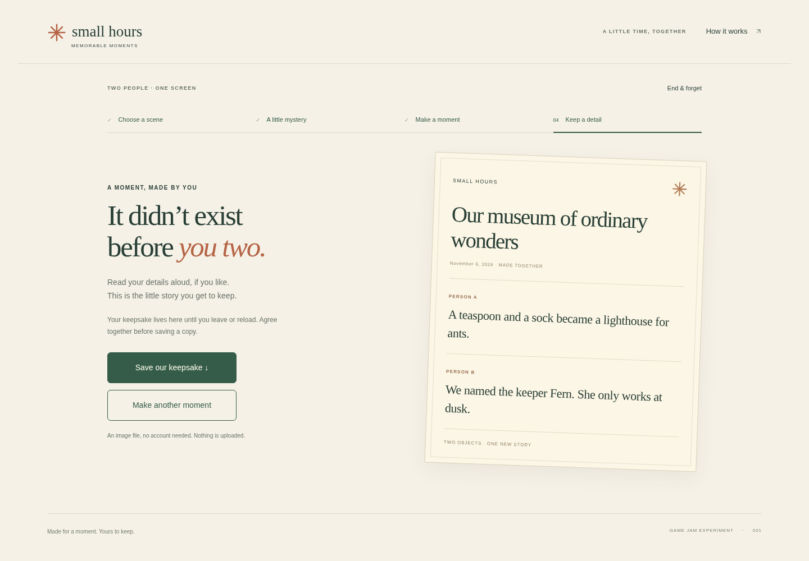

# SH-23 committed development-export verification

**Passed on November 6, 2026, 06:37:55–06:38:55 UTC**, using implementation/source `15d60d225186d655ad926e18ccc153fbe6ae7dfa`. The runner files executed from an isolated archive were checked against all eight committed implementation files; the run also records the exact runner hashes. [verification.json](verification.json) records their hashes, exact tooling identity, full playable inventory and raw-evidence hashes.

| Check | Actual result |
|---|---|
| Unit contracts | 13 pass: five countdown cases and eight exporter cases, including missing/extra entries, committed/output symlinks, dirty checkout isolation, existing evidence preservation and canonical checkout-root confinement |
| Exports | Two separately generated copies contain the same nine files and 60,443 bytes; both remain unchanged after HTTP/browser testing |
| Inventory | `6be6da63685f88eb5b4a12d0be34c56b6774b2fc04e9ed22dc4c0ba0d28ff0cb`; identical to the November 6 development baseline |
| Direct HTTP bytes | All nine files at both root and `/IndiaGames/development/small-hours/`: 18 matching comparisons |
| Existing behavior | 33 checks at each mount, 66 total: private handoff, contribution/reveal, optional timer, SVG downloads, reset, solo rehearsal, 390px/touch emulation and sandboxed iframe |
| Timer coverage | Three groups/nine assertions; actual root expiry **45,051 ms**. Dialog/cancel/navigation use Playwright clock emulation; page lifecycle uses explicit synthetic events |
| Diagnostics | **Four real `/favicon.ico`404 responses and four console events**, retained as the known missing-favicon limitation. No other HTTP, console, page or request errors observed |
| Artifact boundaries | No `play/` byte changed. Frozen eight-file study ZIP, inventory and entire October 27 milestone remain unchanged. No Small Hours candidate staged |

The final command used the normal verifier documented in [README.md](README.md), with the commit argument fixed to `15d60d225186d655ad926e18ccc153fbe6ae7dfa`. Node24.19.0, Git2.52.0, Playwright1.56.1 and Chromium151.0.7922.173 were observed. The service bound to loopback and served only the nine exported files. It was stopped, and browsers closed, when the check completed.

The preliminary complete run also passed, on source4905ae84, and observed five missing-favicon404s. Before the final run, review tightened the output-directory guard for symlink aliases and `--repo` subdirectories, and the report gained tooling/version identity. The updated 13-test suite passed. Both full runs and intermediate test logs remain retained; this summary does not recast the missing icon as a successful HTTP response.

## Synthetic screenshot

The text in this screenshot was supplied by automation. It is no person's memory or testimonial. Neither this run nor the unit suite measures pair enjoyment, voluntary replay, physical-phone behavior, assistive-technology support or human release readiness. The six-pair study, pilot/design/manual staging prerequisites and independent human official-release review remain pending.
