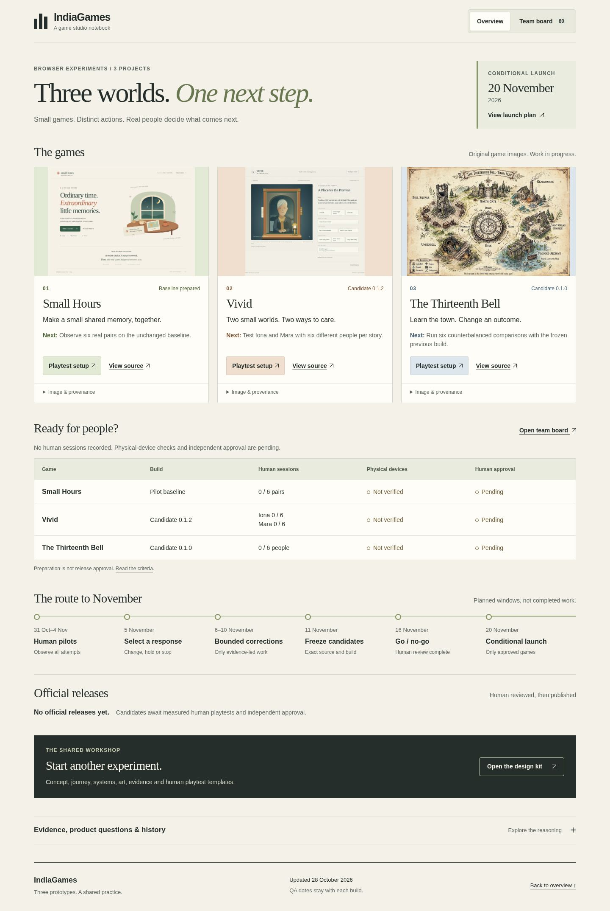

# Hub verification · 28 October 2026

**Local dashboard checks pass. This is not evidence of a new Pages deployment or a human game playtest.** The [final browser report](report.json) binds every tested input to its SHA-256. The [runner and prerequisites](../../../tests/hub/README.md) describe reproduction.

| Check | Observed result |
|---|---|
| Root and `/IndiaGames/`, desktop 1440px and narrow 390px | All four complete dashboard journeys pass. |
| Overview | Three genuine images; 333 desktop / 330 narrow visible words; about 2,147px / 4,243px tall. |
| Task board | All 60 records reachable across five 12-row pages; filters, search, keyboard details, history, late-task and legacy anchors pass. |
| Recovery and reflow | Injected 503 recovers through Retry; tablet and doubled computed font sizes pass without horizontal overflow. This is not browser zoom. |
| Browser errors | No unexpected JavaScript or HTTP errors. |
| Links | 105 rendered destinations classified against local files, anchors and Git objects. A separate [HTTPS audit](remote-links.json) returned 200 for all 88 existing external destinations with TLS verification enabled. The new history page is pending publication. |
| Game and candidate identity | Reviewed branch heads, runtime scopes and staged package hashes remain unchanged. Vivid's later evidence-only files are excluded from its historical runtime comparison. |
| Release validation | 17 release-gate unit tests pass; main validation finds zero official releases. Dashboard generation preserves all 60 task records byte-for-byte. |
| Independent review | Separate read-only review found no blocking UI or policy-boundary defect. Missing test prerequisites were added to the runner documentation. |

[Desktop overview](project-1440-overview.jpg) · [Narrow overview](project-390-overview.jpg) · [Team board](project-1440-board.jpg) · [Enlarged text](project-390-enlarged-text.jpg)

## Iteration record and limits

[Attempt history](attempt-history.json) retains the observed failures rather than replacing them with the final pass. Early runner corrections cover the historical evidence-file scope, Git output buffer, dependency-inclusive search expectation, asynchronous hash navigation, and a network-idle wait on an intentionally failed request. Later captures explicitly scroll and decode lazy images. The final run includes CSS arrows after a missing-font glyph was observed. Earlier full reports and captures remain in the local restart backup.

These are automated Chromium dashboard checks, not physical-device, Safari, screen-reader, human research, game-fun or production-deployment results. All human cohorts and independent game-release approvals remain pending. The supplied legacy candidate URL repair remains paused; it is neither repaired nor reported as passing here. Merge and live asset-identity verification are separate follow-up steps.
