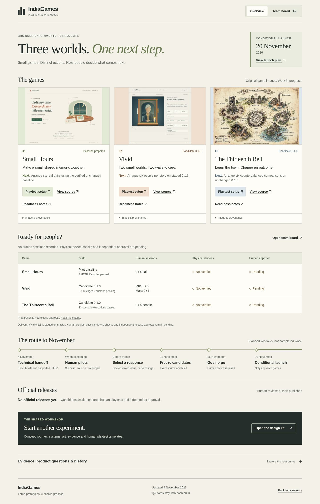

# Dashboard QA — 4 November 2026

**PASS locally: the final 65-task dashboard works at root and GitHub-project mounts, including desktop, narrow, tablet and enlarged text. GitHub Pages deployment is still pending; this is not a live-publication result.**

| Execution identity | Value |
| --- | --- |
| UTC window | 2026-11-04 16:40:01–16:40:14 |
| Tested branch | `hub/readiness-2026-11-04` |
| Ancestry commit | `dad7a709bebf91f7537110940cd6c82960dbebb9` plus the final readiness working-tree changes |
| Exact bytes | Eleven runtime/data/test input SHA-256 values in [dashboard-qa.json](dashboard-qa.json); unchanged throughout the run |
| Browser | Chromium 151.0.7922.173, installed Playwright 1.56.1, Linux managed cloud |
| Transport | Same-host ephemeral HTTP; inherited proxy/TLS unchanged; no `file://` fallback |
| Errors | Zero unexpected page errors, failed requests or HTTP error responses |

The latest pass verifies the staged Vivid 0.1.3 packet, its new source/playtest links and completed staging task. Four checked inputs changed since run02: presentation data, source manifest, generated tasks and Vivid's authored tasks. App, index and stylesheet hashes remain unchanged. Runs01 and02 remain retained. Run03 stopped before any browser launch because the local `master` ref was stale; the coordinator synchronized it to `2be5f3648fed5422eb4459486661385df73c91be`. Run04 then passed the original, unchanged assertions. No assertion was weakened.

The verified Vivid candidate is 0.1.3, source `813f264400bfc01d7e3e5f668de29bb835f5a70d`, inventory `7498c636fee9b42298e4c9cde5ada0c8f688ef7835237e1e4761e269b68d3e00`. Bell 0.1.0 and the zero-human / no-official-release gates remain unchanged.

The ancestry commit alone is not the tested revision. The compact JSON records exact input hashes; the release coordinator should bind the eventual commit to those inputs before publishing. GitHub CI and deployment must still verify that published revision.

| Condition | Result |
| --- | --- |
| `/` at 1440×1000 and 390×844 | PASS |
| `/IndiaGames/` at 1440×1000 and 390×844 | PASS |
| `/IndiaGames/` at 768×1024 | PASS; overview/board reflow and keyboard detail activation |
| 390px with doubled computed text sizes | PASS; no horizontal overflow; detail remains operable; not physical browser zoom |
| Simulated load failure | PASS; one intentional `tasks.json` HTTP 503 produced the visible error; keyboard Retry recovered without reloading |
| Task completeness | All 65 unique authored IDs reached through 12-row pages, with next/previous boundaries; Small Hours 20, Vivid 26, Bell 19 |
| Filtering / search | All three lanes; `blocked_human`; the first authored task's perspective; `SH-17` finds itself and dependent `SH-18`; empty search recovers |
| Task details / navigation | Keyboard Enter opens/closes acceptance and dependency details; back/forward, legacy overview anchors, `#sources`, `#task-TB-17`, malformed hash handled |
| Readiness / release boundaries | Correct zero human denominators, pending devices/approval, empty official-release registry and conditional November 20 timeline |
| Source / candidate identity | Reviewed game heads and verified runtime scopes match; master candidate trees and inventories equal pinned packets; human reports remain empty and unapproved |
| Images | Three real game assets loaded and matched their pinned Git source bytes; 2,041,402 bytes total, below 4 MiB budget |
| Destinations | 124 unique rendered destinations classified; local anchors/files and GitHub blob/tree source targets resolve; external/service destinations were recorded, not remotely fetched |



[View the 390px project-mount overview](dashboard-overview-390.jpg)

The desktop and narrow overview screenshots were visually inspected: all three original game images render, readiness values and candidate labels remain readable, and the timeline/release boundary is visible. The overview contains 373 visible words on desktop and 370 on narrow screens; task detail remains in the separate board. This is a technical/presentation observation, not a human usability study.

## Reproduce

From a checkout containing the final dashboard and its pinned local source refs, with Playwright and Chromium already installed:

```sh
PLAYWRIGHT_MODULE=/workspace/IndiaGames/vivid-2.5d-photo-game/play/node_modules/playwright HUB_EVIDENCE_DIR=/new/external/dashboard-evidence node tests/hub/browser.mjs
```

`PLAYWRIGHT_MODULE` can point to another installed module; `CHROMIUM_PATH` defaults to `/usr/bin/chromium`. The runner starts and stops its own same-host server, validates Git/source inventories before browsing, and records failed attempts rather than changing policy or falling back to another transport. No tracked files were changed by QA. Browser and server were closed in `finally`.

Detailed output and ten screenshots remain at `/workspace/indiagames-readiness-2026-11-04/qa/dashboard-final-04/` (a retained workspace path, not a public link). The compact JSON includes the full external report's hash. No live Pages request, paused candidate-URL repair, game regression, physical-device session or human approval is implied by this dashboard pass. Test coverage includes the specific filter/search/deep-link cases above, not every possible combination or a full screen-reader audit.
