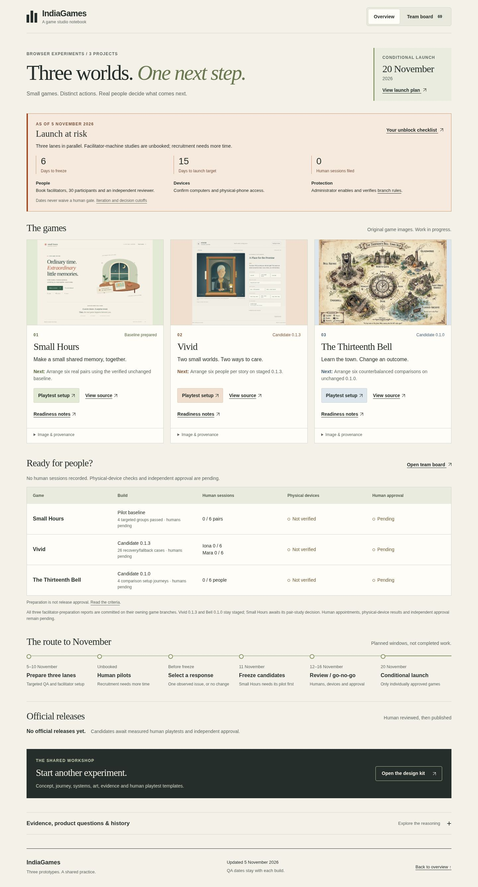

# November 5 dashboard verification

The final local integration run passed on the exact file hashes in [dashboard-qa.json](dashboard-qa.json). This is browser automation on a local server, not physical-device, human-gameplay or live Pages evidence.

| Check | Actual result |
|---|---|
| Root and `/IndiaGames/` mounts | Desktop1440×1000 and narrow390×844: all four groups passed |
| Board | All69 authored task IDs reachable; filters, dependency search, pagination and keyboard details passed |
| Deadline panel | November5 snapshot, six days to freeze,15 to conditional launch, zero human sessions, unbooked studies and owner checklist correct |
| Navigation |134 rendered destinations classified; local anchors/files and pinned GitHub source targets resolve against repository objects |
| Extra scenarios | Tablet viewport, doubled CSS text, browser history/deep links and recovery from one injected503 response passed |
| Browser diagnostics | Zero unexpected page, console, request or HTTP errors |
| Artifact boundaries | Three game branches match reviewed heads; runtime and master candidate bytes unchanged; no human report or official release added |
| Release gate |35 existing unit tests passed; main validator accepts the empty official registry |

The first run passed desktop but failed the narrow image assertion because the new panel put lazy images below the initial viewport. The runner now scrolls to each image and waits for actual content before retaining the original image, alt-text and source assertions. The failed attempt is retained. A full corrected run passed; this final run additionally binds the cleaned-up premerge wording. No broken image is suppressed or replaced by a screenshot.

## Previews

[Desktop overview](root-1440-overview.jpg) · [Narrow overview](root-390-overview.jpg)

Publication still requires the applicable review and actual deployment verification. Earlier November4 live evidence establishes only that earlier deployment.
