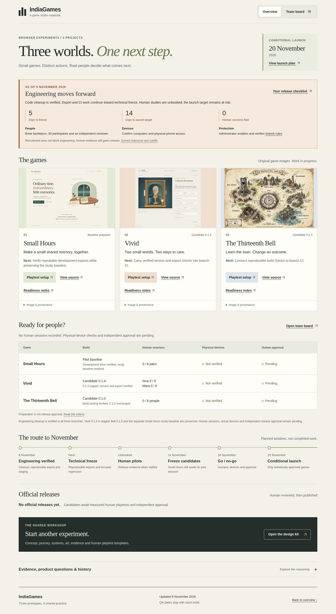

# November 6 dashboard verification

The final local integration passed on the exact input hashes in [dashboard-qa.json](dashboard-qa.json). This is automated browser evidence; it supplies no human gameplay, physical-device or deployed-site result.

| Check | Actual result |
|---|---|
| Mounts and viewports | Root and `/IndiaGames/`, desktop 1440×1000 and narrow 390×844: all four groups passed |
| Team board | All 75 authored cards reachable; 44 completed cards have linked evidence. Filters, search, pagination and keyboard details passed |
| Next engineering work | SH-23, KF-30 and TB-22 are proposed for November 10, with engineering-only dependencies and no implementation claim |
| Deadline and human state | November 6 snapshot; five days to freeze, 14 to conditional launch; zero human sessions and unbooked studies |
| Navigation | 145 rendered destinations classified; local files/anchors and GitHub source targets resolve against repository objects. This is not an HTTP check of every external URL |
| Extra checks | Tablet viewport, doubled CSS text, history/deep links and recovery from one injected 503 response passed |
| Browser diagnostics | Zero unexpected page, console, request or HTTP errors |
| Artifact identity | Current game heads/verified code scopes and staged candidate hashes match their pinned sources; official registry remains empty |
| Release safeguards | 35 release-gate unit tests passed in this delivery; six master packets validate and pending human evidence correctly fails official readiness |

The earlier November 6 local integration also passed. This final run adds the three queued engineering cards and reconciled completion wording. Raw attempts are retained. A mistaken standalone syntax command targeted nonexistent `hub.js`; the corrected `node --check app.js` passed. That command error was not an application failure.

[Desktop preview](root-1440-overview.jpg) · [Narrow preview](root-390-overview.jpg)

Independent review, CI and actual Pages verification are recorded on the delivery pull request after this local check. [PR #9 verification](publication-pr9.json) applies only to the earlier deployment.
