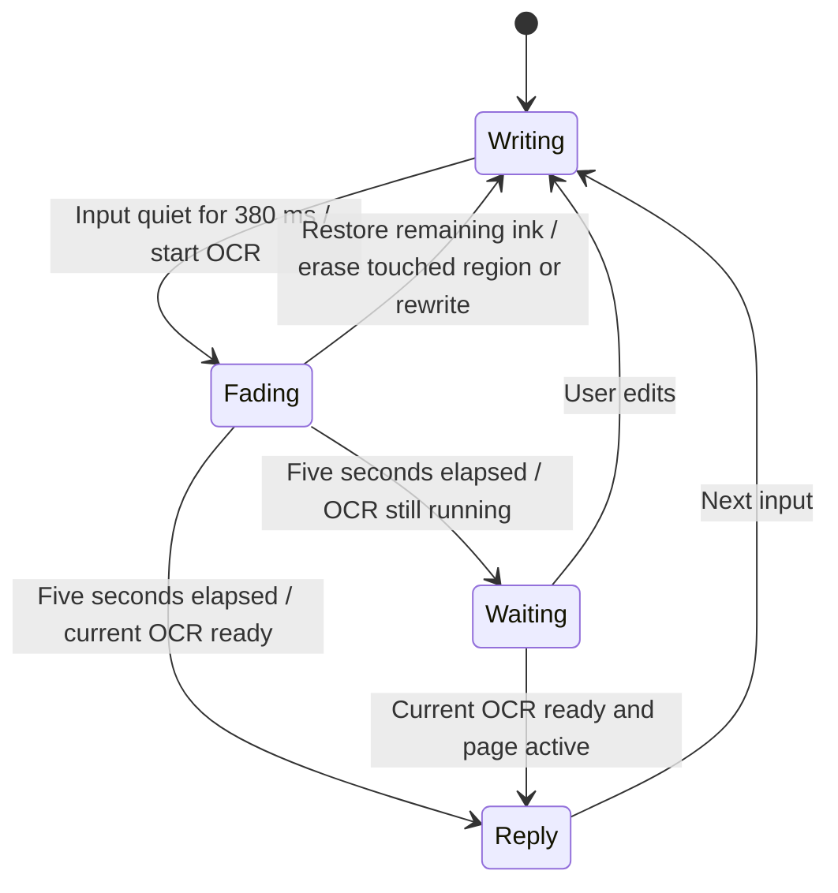

# Writing, storage and reveal states

Date: 2026-10-03. Implementation scope: device-journal persistence and diary presentation. Server operation deduplication and public/native identity are separate M0 work.

## Device operation format

`JournalEntry` contains schema version 1, a UUID operation ID, a scope derived from API origin and server-provided owner, the base server version, creation time and the complete notebook snapshot. The existing server remains the authoritative synchronized record. Browser storage holds only pending device operations.

Each completed editor mutation writes a new operation synchronously. The new entry is stored before removing the replaced entry. A quota or storage failure leaves earlier stored data and current in-memory writing available; the UI cannot acknowledge the failed edit. An acknowledgment removes only its operation ID. If more recent writing exists when an earlier request completes, its base server version advances before the next request.

The client serializes its own requests. The API still checks `X-Notebook-Version` against the stored version. A 409 pauses sync and retains recovery copies. Multiple pending copies or a changed remote version require reconciliation; the recovery export contains pending entries, current writing and the last retrieved server copy. The export does not automatically merge conflicting versions.

On reopening, the client obtains the server identity and version before reading the matching device entries. An identical remote snapshot accounts for a previously lost acknowledgment. A single matching-base pending snapshot reopens for continued sync. Different snapshots remain preserved. Fully offline startup and server idempotency are still required in MC-003/004 before their full acceptance.

## User-visible save states

| State | Meaning |
|---|---|
| Opening notebook | Identity/version and pending entries are being read |
| Saving on device | Current mutation has not yet received device acknowledgment |
| Saved on device · sync pending | Pending operation stored; server acknowledgment outstanding |
| Synced | Current queued operations acknowledged by the server |
| Save needs attention | Current writing lacks confirmed device persistence or loading failed |

“Saved on device” assumes the browser retains its origin storage on an intact device. Clearing storage, private browsing eviction and loss of an unsynced device are outside recovery. Native/browser retention behavior requires physical-device verification. Server-blind encryption is not established.

## Ink interaction

OCR continues when input changes. The revision and active-page checks prevent stale replies. Every new input-end event begins the next eligible cycle. The visual treatment reads the existing fade progress and does not change the activation timestamp. Local handwriting rendering remains editable. Streaming text appears as it arrives, with a short absorption/emergence animation.

## Source and measurement definitions for subsequent cards

Source references need owner, notebook, page/block ID, source revision and the exact excerpt version. Corrections and deletions must invalidate derived memories/index entries by those references. A future server operation acknowledgment must include operation ID, accepted source version and ownership binding. Retry deduplication belongs on the server.

A turn trace needs input-end, recognition start/end, fade completion, routing start/end, provider first token, screening completion and first visible reply, plus provider/model/configuration IDs, usage availability, retry/tool costs and final status. Notebook contents and provider credentials must not enter measurement records. These fields are design requirements for MC-008/012, not instrumentation implemented by this change.
