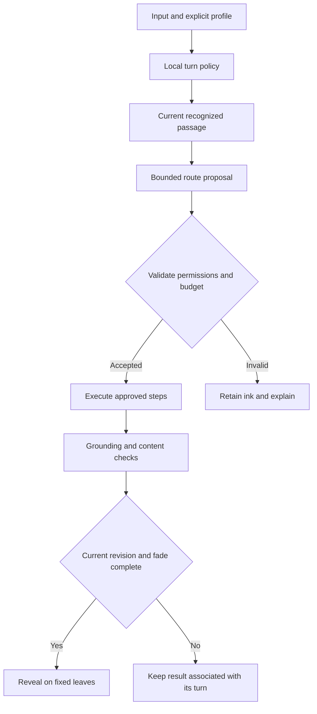

# Next sprint — conversation rhythm and controlled routing

Prepared 2026-10-03 America/Los_Angeles (2026-10-04 UTC). Status: ready for refinement; capacity, people and dates remain unassigned. The current implementation repair belongs to MC-006. The new policies below are planned work and are not enabled in the current release.

## Existing coverage and additional cards

| Requested outcome | Existing card | Additional work |
|---|---|---|
| Preserve input position, correction and drafts | MC-006 | Current placement repair; MC-031 covers a complete input turn spanning leaves |
| Device-specific interaction | MC-021 | MC-029 supplies timing policy; extend MC-021's actual-device matrix |
| LLM selection, lock and price constraints | MC-011 | MC-030 adds conversation profiles and a bounded planning step |
| Measured waiting time and cost | MC-012 | Add profile and input-method dimensions; count router, tool and screening time |
| Grounded and appropriate support | MC-018–020 | Research citations, reflective support and roleplay evaluated through existing safety/privacy gates |
| Immersive appearance and animation | MC-028 | Add truthful progress, stable text and opt-in sound/haptics to its next-sprint review |

Original MC-001–027 cards are preserved in [the initial planning archive](../../agile-baseline/02-PRIORITIZED-BACKLOG.MD). Current progress is maintained in [the evidence review](../01/AGILE-PROGRESS-2026-10-04.md). This preparation adds MC-029–031 without duplicating mobile, safety or routing acceptance work.

## Planned interaction policy

| Profile | Turn submission | Reply behavior | Default tool scope |
|---|---|---|---|
| Conversation | Composer: Enter/Send. Surface: optional pause mode, visible and adjustable | Short initial response, progressive ink, optional follow-up | Notebook context within selected scope |
| Research | Explicit Ask after collecting the passage or question | Immediate receipt indicator; real retrieval progress; cited sections on fixed leaves | Approved research/search/document plugins only |
| Reflection / self-talk | Explicit Respond, with Keep writing available | One reflective response and at most one question; no unsolicited action | Current notebook and explicitly permitted memories |
| Supportive reflection | Explicit Respond; no inferred diagnosis or covert profile activation | Respectful, non-diagnostic language; applicable urgent-safety handling remains available | Minimal selected context; external sharing requires the existing scope permission |
| Roleplay | Explicit end-turn; optional pause mode | Persistent persona, explicit fiction boundaries, locally animated reply | Only scenario-approved tools; factual claims use grounded sources |

One companion identity remains shared across notebooks. A profile changes conversation behavior for the current notebook/session and does not create a separate companion. The user can override or reset the profile. A model may suggest a profile after a submitted turn; it cannot silently assign a psychological label or alter stored instructions.

Device handling uses the current input method and viewport/keyboard state. Desktop keyboards, iPad keyboards and phone keyboards all retain explicit composer submission. Suggested surface quiet defaults for the next implementation are mouse 900 ms, stylus 1,200 ms and finger writing 1,800 ms, adjustable from 500–4,000 ms. Unknown input uses explicit submission. These values are product targets for evaluation, not measured optimal timings or medical recommendations. Detection updates when an iPad switches between Pencil and keyboard; device brand does not determine intent.

After a surface turn ends, recognition and the 5,000 ms fade share one timestamp. The companion appears only after the current recognition and fade complete. IME composition, active pointers and open editing dialogs prevent automatic turn completion. Erasing restores remaining text before regional removal; running recognition jobs continue. Later job results remain subject to revision checks. No recurring LLM call is made for every keystroke.

## Planned harness boundaries

The client controls turn timing and presentation. The server owns route validation, credentials, model lock, tool permissions, source access, retry limits and spending reservations. The route proposal contains a profile ID, task kind, requested model/capabilities, allowed tool IDs, bounded step count, evidence requirements and a reason code. It contains no executable code. A selected-model lock is enforced before execution. Provider failure is explicit; original ink and partial results stay available.

Set one optional routing decision per submitted turn, at most three external tool calls and a per-profile elapsed-time limit. Research may use a separately configured larger budget; the UI shows the limit before enabling it. Time spent waiting, routing, recognizing, screening and rendering is measured separately. Background work is linked to the original turn and never reveals on a different active leaf or consumes a new draft. Instruction improvements remain reviewable proposals; automatic useful-memory learning retains history and undo.

## Sequence and acceptance milestones

1. **Policy review:** agree the profile schema, explicit controls and event precedence in MC-029/030; record unresolved decisions. Owner roles: Product, Client and AI engineering.
2. **Local interaction slice:** implement MC-029 with real desktop browser journeys, followed by MC-021's physical keyboard/Pencil/touch matrix. Existing correction invariants are acceptance requirements.
3. **Provider slice:** implement MC-030 on the configured model/provider paths from MC-005/011, using actual traces. MC-012 records cost/latency; MC-018 validates screening before reveal. Missing provider access keeps this milestone blocked.
4. **Long-turn slice:** implement MC-031 with original-ink links, one logical submission across leaves, stable revisions and complete recovery.
5. **Integrated review:** use the matrix in BEHAVIOR-AUDIT.md, update every affected card by criterion, and retain failed/unmeasured cases as open. M0 still requires all existing baseline gates.

Dependencies may run concurrently after their interfaces are reviewed. Keep the existing work-in-progress limit of two engineering cards. No sprint-duration promise is made without accepted capacity and live-test prerequisites.

## Research basis

- [Anthropic, Building effective agents](https://www.anthropic.com/engineering/building-effective-agents): category routing and explicit workflow checks inform the proposed route validation. The article explains latency/cost tradeoffs and stopping conditions; it does not validate this product's timings.
- [W3C Pointer Events](https://www.w3.org/TR/pointerevents/): `pointerType` distinguishes mouse, pen and touch, supporting input-method adaptation. The currently retrieved document is a working draft; the plan uses established pointer-type behavior and does not depend on its new device identifiers.

All numeric rhythm defaults and scenario rules above are product design proposals. Provider, physical-device and user-study evidence is still required.
