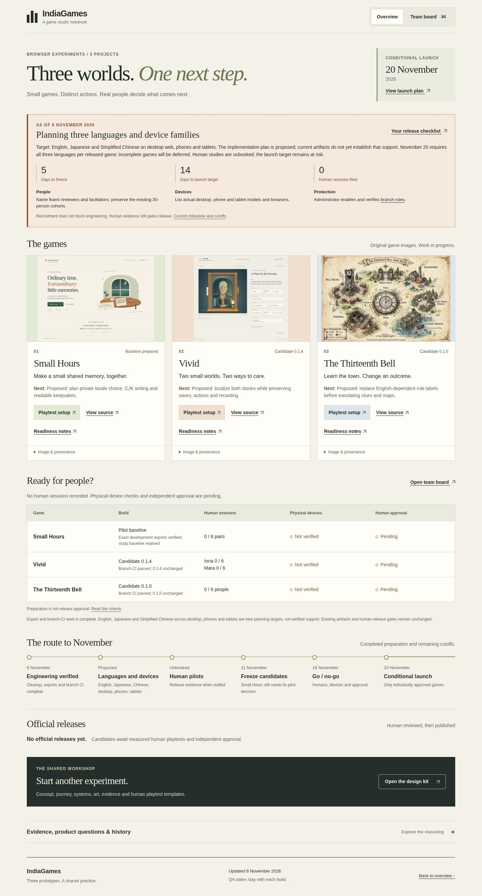
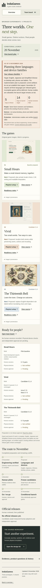

# Planning dashboard verification · November 6

**Passed:** local dashboard integration completed at **07:29:24 UTC**, after the owner required all three languages per November 20 release. This verifies the planning dashboard, not translated gameplay or real-device compatibility.

| Check | Observed result |
|---|---|
| Root and `/IndiaGames/`, desktop and narrow viewport | Four groups passed; all 84 task IDs reachable, filters/search/details and keyboard navigation checked |
| Additional layout/recovery | 768px viewport, doubled text at 390px, injected load failure and Retry passed |
| Destinations | 157 rendered destinations classified with local file/anchor and Git-object checks; not 157 remote HTTP tests |
| Original contracts | Original 75 task objects preserved; nine proposed cards, zero completion evidence; 47 completed cards |
| Release boundaries | Existing candidate inventories unchanged, zero human sessions, zero physical-device sessions, empty official-release registry |
| Unexpected errors | Zero |

[Portable results and 11 input hashes](dashboard-qa.json) identify the tested bytes. Screenshots below are automated dashboard captures, not physical-device observations. No new game playthrough, native-language review, translation or release approval was performed.

The independent PR review binds the input hashes to the final commit. CI and actual Pages deployment verification are recorded separately in [PR #14](https://github.com/PaperStrange/IndiaGames/pull/14) after those checks occur. [PR #13 verification](publication-pr13.json) is historical and does not prove this deployment.

## Desktop preview

## Narrow viewport preview

