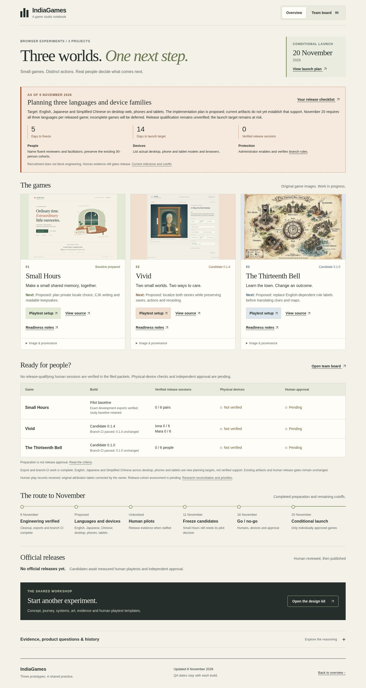
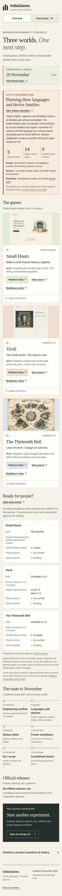

# Dashboard verification for the human-feedback reconciliation

**Final run passed:** 2026-11-06T07:57:48.284Z. Four root/project-mount desktop/narrow groups and three additional recovery/layout scenarios passed; 158 rendered destinations classified; zero unexpected browser/network errors. The board retains all 84 task objects and 47 completed cards. Existing candidate identities and release policy are unchanged.

The displayed count now means **verified release sessions**, separately from the received human gameplay records and the owner's attribution correction. No participant count is inferred from document count, and no new game test or release approval is supplied.

Two earlier attempts remain recorded: the first stopped before browser/static work because the output parent directory was missing; the next stopped on the old “unbooked” copy assertion. After preparing the directory and updating that existing assertion for the intentional release-qualification wording, the complete final run passed. These were runner/expectation corrections, not gameplay fixes.

[Portable result and all 11 input hashes](dashboard-qa.json). These hashes bind the tested bytes; independent final-head review and CI are filed in the delivery PR. Actual Pages verification is a separate post-merge check. The 158 destinations are local/Git-object classifications, not remote HTTP checks.

