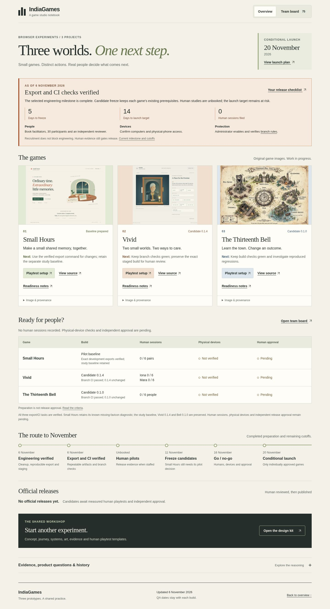

# Export/CI milestone dashboard verification

The final local browser run passed on the exact input hashes in [dashboard-qa.json](dashboard-qa.json). These checks validate the dashboard; game behavior, GitHub Actions results and human evidence have their own records.

| Check | Actual result |
|---|---|
| Mounts and viewports | Root and `/IndiaGames/`, desktop1440×1000 and narrow390×844: four groups passed |
| Board | All75 cards reachable,47 complete; filters, dependency search, pagination and keyboard details passed |
| Evidence and identity | Reviewed source heads, QA scopes, staged candidate trees and game-image provenance match pinned Git objects |
| Navigation |157 rendered destinations classified; local anchors/files and GitHub source targets resolve against repository objects; this is not an HTTP check of every external URL |
| Extra scenarios | Tablet, doubled CSS text, browser history/deep links and recovery from one injected503 passed |
| Diagnostics | Zero unexpected dashboard page, console, request or HTTP errors |
| Human/release boundary | Zero sessions, unverified physical devices, pending human approval and empty official registry |

The first integration run also passed. This final run binds the clarification that Vivid’s15-file comparison with staged0.1.4 was local, while GitHub CI ran the unit/build/version contracts. Small Hours’ four known favicon404 responses belong to its separate game-export run; they are preserved in that report and are not hidden by this dashboard result.

[Desktop preview](root-1440-overview.jpg) · [Narrow preview](root-390-overview.jpg)

The delivery PR records independent exact-head review, CI and subsequent actual Pages verification. [PR12’s deployment record](publication-pr12.json) applies to the earlier cleanup dashboard only.
