# Memorable Moments: Small Hours, 5 October 2026

A playable hypothesis: **two people can turn an ordinary five-minute break into an inside joke and a keepsake they both authored.** The product is a same-device browser game, with no account, daily obligation, scoring, generated partner, or camera. [Play locally](../play/index.html) through the HTTP server described in [README](../play/README.md).

This branch initially contained research and a report, not a playable game. The baseline walkthrough therefore ends at reading the report; it cannot establish how a previous game felt. [Baseline screenshot](evidence/00-before-research-only.png).

## Why might someone want to play?

These are hypotheses, not established audience facts:

- **Permission to start:** the game supplies a small, harmless activity when two people want time together but do not want to plan an outing.
- **Curiosity about another mind:** a private choice plus a prediction creates a reason to wait for the other person's reveal.
- **Joint authorship:** the pairing of choices changes the activity, and each participant adds a detail. The resulting artifact can refer to something neither would have made alone.

This day's automated/agent walkthroughs establish that those mechanisms execute. They do **not** establish enjoyment, closeness, memory improvement, willingness to pay, or demand. The asymmetric-motivation problem in the existing synthesis remains unresolved: this build explicitly invites two willing participants rather than claiming to turn a reluctant partner into a player. Blank writing is accepted, but required choices still need participation.

## The competitive choice

The research agent opened current primary sources on 5 October. [Paired's FAQ](https://www.paired.com/frequently-asked-questions) now advertises answer unlocking, Secret Missions, photos, and a Timeline. This **invalidates the old report's broad whitespace claim** that reveal + missions + archive is an unbuilt combination. That historical research remains preserved as a dated artifact; it should not be used as the launch claim.

An [independent review of Drawful 2 on Switch](https://www.nintendolife.com/reviews/switch-eshop/drawful_2) describes easy browser joining but also the practical constraints of a minimum group size and individual devices. That is one critic's version-specific experience, not a population finding. It suggests an occasion to test: just two people, one available screen.

The proposed distinction is a **short, co-located, single-sitting experience with an immediate two-author keepsake**. “Extremely unique” is not established by a finite competitor scan. The signature moment worth testing is concrete: *your color choice and my story choice turn a teaspoon and a sock into a lighthouse for ants; we independently choose what to remember about it, then see both details together.*

Start with a direct web link and an itch.io HTML5 page for recruited pairs. [itch.io's HTML5 documentation](https://itch.io/docs/creators/html5) supports a static browser package. This build has no SDK dependency and relative asset paths. Discovery, conversion, and commercial platform eligibility are untested. The scene-based invitation is an experiment positioning, not a claim that casual portals want relationship content. A narrow 821 × 462 browser viewport and a sandboxed iframe were exercised; the host's actual publishing/download policy was not.

## What was implemented

1. Choose one of three scenes together: **The pocket museum**, **An impossible postcard**, or **Weather for two**.
2. Person A privately chooses a prompt and predicts B's choice. A cannot submit a half-finished choice.
3. A curtain removes A's choices from the visible DOM. B gets a fresh choice and prediction.
4. A joint-ready curtain precedes a side-by-side reveal. Agreement and surprise receive neutral, non-scoring responses.
5. Both selected prompts shape a shared spoken/imagined activity. A gentle 45-second timer is optional and never ends the activity. Imaginary objects, seated participation, a scene change, and leaving are available.
6. Each person optionally writes one detail through another pair of handoffs. Blank text becomes “Some details are just for us.”
7. The ending combines both details into one keepsake. Players can download an SVG, replay with a different suggested scene, or End & forget.

A handoff curtain is a courtesy, **not authentication or secure storage**. The game says this before private choices. Both players must agree to the shared screen behavior. No server requests carry answers; active-tab module memory holds them. Reload/navigation/End & forget clears the active session. A downloaded file remains saved by the player. There is no synchronized archive, remote play, relationship assessment, telemetry, or retention system.

## Journey I actually walked

The route below was driven through Chromium using real UI clicks, text entry, one keyboard-start action, and download events. The agent supplied both people's choices and prose. The real-world spoken activity was **not performed by two people**. This is an interface rehearsal, not a human usability session.

```mermaid
flowchart LR
  A[Welcome: choose pair play] --> B[Pick pocket museum]
  B --> C[A curtain: ask B to look away]
  C --> D[A picks color; predicts shape]
  D --> E[Pass device: A answers absent from DOM]
  E --> F[B picks story; predicts color]
  F --> G[Both ready: explicit shared reveal]
  G --> H[One guess matches; one surprise]
  H --> I[Two object prompts + joint museum activity]
  I --> J[Optional timer ends without advancing]
  J --> K[A writes lighthouse detail]
  K --> L[Pass device: A text absent from DOM]
  L --> M[B writes keeper named Fern]
  M --> N[Both details in keepsake]
  N --> O[Download SVG]
  N --> P[Replay: different suggested scene]
  C -. any game stage .-> Q[End & forget, with cancel]
```



| Step | Observed interface behavior | Human question still open |
| --- | --- | --- |
| Entry | Pair play works with keyboard Enter; solo mode explicitly says rehearsal. | Does the invitation make the occasion clear without explanation? |
| Handoff | A's choice labels and authored sentence are absent from each curtain's DOM; B's controls start blank. | Does passing the device feel playful, or interrupt the interaction? Do people actually look away? |
| Reveal | Both selected choices display correctly, with one “wavelength” and one “surprise” in the recorded route. | Does guessing create curiosity, or feel like being assessed despite the copy? |
| Shared action | A's color and B's story prompts feed the museum scene; countdown never forces navigation. | Do both participants contribute away from the screen? Does either feel obligated? |
| Coauthorship | Both submitted details appear; empty text has a neutral fallback; literal markup never executes. | Is typing worth the effort? Is one person doing all the creative work? |
| Ending | SVG download contains the two lines; replay suggests another scene; reload clears session. | Do players want to save the artifact or voluntarily play again? |

[Action trace and assertions](evidence/browser-observations.json), [desktop reveal](evidence/03-shared-reveal.png), [shared action](evidence/04-shared-action.png), [desktop ending](evidence/05-desktop-keepsake.png), [mobile choices](evidence/07-mobile-choices.png), [mobile ending](evidence/08-mobile-keepsake.png), and [actual downloaded artifact](evidence/observed-keepsake.svg).

## Testing and changes caused by it

**33 behavioral checks passed** in headless Chromium. The recorded test includes the pair journey, solo route, all three scenes' action rules, optional writing, input escaping, SVG XML parsing, replay, changing scenes, ending/canceling, reload reset, and no uncaught browser errors. Desktop was 1440 × 1000; mobile was a simulated 390 × 844 touch viewport; compact portal was 821 × 462. A sandboxed iframe allowed scripts, same-origin storage context, and downloads and advanced to the A handoff. These are not physical iPhone/Android, Safari, screen-reader, or hosted-platform checks.

The first timer check advanced the virtual browser clock 46 seconds and observed **0:44**, not 0:00: decrementing per interval callback made the timer drift when ticks were delayed. The implementation now measures the elapsed deadline and clamps to zero. Re-running the same check observed 0:00 and a message permitting continued play, without navigation.

Independent coordinator playthrough caught contradictory copy on the joint reveal: it invited both people to sit side by side, then reused a private curtain’s look-away instruction. The shared invitation now omits that instruction and explains solo rehearsal separately. A new behavioral check protects that shared/private distinction.

Screenshot inspection also exposed unavailable arrow glyphs and inconsistent emoji rendering. Navigation arrows and pictograms are now authored inline SVG vectors. No external font or asset service is required. The desktop and mobile screenshots were regenerated after the fix.

Reproduction from the worktree root:

```sh
python3 -m http.server 8111 --bind 0.0.0.0
# In another terminal:
PLAYWRIGHT_PATH=/workspace/indiagames-env/toms-notebook-deps/node_modules/playwright \
CHROMIUM_PATH=/usr/bin/chromium \
node memorable-moments-game/tests/browser.mjs
```

The test can use a normally installed `playwright` package instead; the path above describes this environment. Outputs are regenerated in `docs/evidence/`. The runtime ships no test dependency. Screenshots of escaped `` text deliberately show a hostile-input test, not authored game content.

## One-day human gates: not yet run

Recruit **six willing pairs**, including friends and partners, as a qualitative pilot—not a representative sample. Do not use recorded agent answers as player feedback. Ask participants to omit personal details; do not collect keepsakes by default. A facilitator records only the route, times, stops, each person's contribution, and direct voluntary comments. One person may stop without explaining why.

| Gate | Observe | Provisional jam decision rule |
| --- | --- | --- |
| Can they start? | Give only the link; count facilitator rescues and time to both choices. | At least 5/6 pairs reach reveal without help. Otherwise simplify onboarding/handoff. |
| Does the action happen? | Observe whether both people invent or perform something after the reveal. | At least 4/6 pairs have both people contribute; stop positioning as mutual creation if one person usually carries it. |
| Does prediction help? | Counterbalance three pairs with predictions first and three with a facilitator version without prediction; ask which part they wanted to continue. | Directional notes only; six pairs cannot establish a causal effect. Remove the extra choices if they consistently feel like a test or slow the activity. |
| Is the ending earned? | Observe self-initiated save/replay, without prompting. Ask separately what they would tell a friend about the moment. | At least 3/6 pairs voluntarily save or replay is a provisional reason to iterate, not retention proof. If they like the action but skip writing, test spoken naming + one jointly approved line. |
| Can they comfortably leave? | Ask where they would stop; allow scene changes and blank writing. | Any pressure, privacy confusion, or inability to leave is a fix-before-expansion signal. |

Next device gate: repeat with one real iPhone/Safari and one Android/Chrome, including virtual keyboard, background/resume timer, a full reload, SVG saving, browser history, and the actual itch.io embed. Only after those checks should this be described as tested on those devices. A one-day slice cannot support a promise of long-term replay value: three scenes exhaust quickly, and the keepsake currently has no edit-before-export step.
