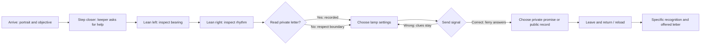

# Vivid GameJam notebook — 2026-10-05

## What we built and why

**The Keeper’s Frame** is an original illustrated portrait encounter with an objective, evidence, consequences, and a return visit. Iona’s job is to guard the lighthouse signal. The player can reach the marks outside her painted body; she can authorize the lamp. Neither can solve the immediate problem alone.

The research branch’s [revised novelty thesis](../research/08-revised-novelty-thesis.md) and [portrait rules](../research/06-hogwarts-portrait-concept.md) informed three choices: give the portrait a job, separate adjudication from dialogue, and make one remembered action verifiable. Historical research’s assertions that no competitor ships a particular combination remain hypotheses; this jam does not establish market uniqueness. Root-team market research supplies the broader competitor comparison.

The intended distinctive experience is **earning permission from a remembered promise**. On the first visit, the letter is private; opening it is possible and remembered. After the rescue, Iona gives permission to keep it private or publish it. On a return, she names that decision and offers the letter. “The portrait remembers me” becomes an action the player can verify in the same session.

This is a narrow test of that mechanism. The art is authored SVG with depth layers, not an inferred photograph. Dialogue is finite authored text, not free conversation. Local memory has no identity or cross-device continuity. The lamp puzzle is fixed; replay discovers a different relationship response, not new evidence or a procedurally varied case.

## Why might people want this?

These are **untested motivation hypotheses**, not findings about human players:

- **Agency through observation:** changing perspective reveals a useful clue rather than decorative motion. A player may feel observant and needed.
- **Recognition:** a specific saved decision changes the next encounter. A player may feel seen rather than presented with a generic affinity score.
- **Care with boundaries:** the keeper has a public duty and a private letter. The player can decide that understanding someone does not entitle them to everything.
- **A complete small ritual:** no account, no timer, and a contained rescue may suit a browser break. Returning for a person could motivate another visit after novelty fades.

The puzzle is easy and the two marks state the solution directly. That reduces onboarding friction but may disappoint deduction players. The portrait is an illustrated elderly keeper, without voice or open chat; that may appeal to a different audience than romantic companion games. Both are positioning choices to test, not proven advantages.

## First-hand journey

Method: the implementing agent used Chromium through Playwright, inspected screenshots, and exercised controls. The root agent independently played a wrong signal, recovery, private ending, real reload, and offered letter. This is agent-run functional and visual testing. It cannot establish emotional response, willingness to return, retention, or willingness to pay.

| Stage | Observed in this build | Possible feeling — requires human evidence |
| --- | --- | --- |
| Arrival | Objective and explicit start; mobile introduction now appears before the frame. | Curiosity, or impatience with introductory text. |
| Looking | Lean buttons and arrow keys expose clickable marks behind the shoulders. | “My point of view matters.” |
| Interpretation | Evidence log retains EAST and SHORT / LONG / SHORT. Correct guessing without inspection is rejected. | Competence; alternatively frustration at an inspection gate. |
| Error | Wrong signal reports no answer and permits correction without losing clues. | Safety to experiment, or low stakes. |
| Privacy | Opening the private letter triggers a distinct response and a persisted flag. | Accountability, guilt, curiosity, or annoyance. |
| Rescue | The lamp beam appears, ferry light changes, and Iona offers the memory decision. | Relief or connection; visual payoff may be too subtle. |
| Return | Actual reload names the saved promise; opening the offered letter omits the earlier rebuke. | Recognition, or predictable scripted repetition. |

The direct successful route takes nine button activations from first arrival to an ending; verifying the return and offered letter adds four. No human timing study was run. There is no timer.

## What the browser test changed

1. **Evidence was readable before leaning.** The initial illustration exposed EAST and the rhythm at the central view. Both implementing and root agents observed it. The final composition tucks the meaningful writing behind Iona’s shoulders; leaning reveals it. Text clues and solution agree.
2. **Mobile started with a long scroll to the invitation.** The final narrow-screen intro presents the objective and “Step closer” before the frame. Starting brings the frame into view. After discovery, the evidence and signal settings remain below it and require vertical scrolling.
3. **A validation message became stale.** After guessing early, “find both marks” remained even when both were collected. Clue collection and setting changes now clear obsolete feedback.
4. **A prior privacy violation could be lost on a later visit.** The initial state now carries that history forward even if the letter is not reopened. A rule test protects it.
5. **Nested quote marks and unsupported arrow glyphs distracted from the dialogue.** Removed duplicate outer quotes from letter content and used commonly supported horizontal arrow glyphs in controls.

## Verification and artifacts

- **Eight rule tests passed:** evidence cannot be skipped, correct viewpoint is required, clues deduplicate, wrong answers recover, endings cannot mutate, malformed memory is rejected, input state stays immutable, and privacy history survives repeat visits.
- **Thirteen recorded browser observations passed:** initial arrival, premature solve, failed signal recovery, successful rescue, both memory outcomes, actual reload recognition, offered-letter permission, early-letter consequence, keyboard-only completion with reduced motion, 390×844 emulated touch completion, 821×462 scrollable layout, and blocked-storage startup.
- No page errors were observed in the recorded desktop context.
- Desktop views: 1365×950; keyboard/reduced-motion: 1280×800; emulated touch: 390×844; compact browser viewport: 821×462. These are Chromium tests, not physical devices or a live platform iframe. Safari, Firefox, screen-reader output, network-constrained delivery, and itch.io embedding remain untested.

Evidence in [`../play/evidence/`](../play/evidence/): `browser-observations.json` contains action-labelled screen text and method labels; `desktop-trace.zip` is a replayable Playwright trace. Screenshots include `desktop-intro.png`, `desktop-left.png`, `desktop-evidence.png`, `desktop-ending.png`, `desktop-return.png`, `keyboard-reduced-motion.png`, `mobile-intro.png`, `mobile-evidence.png`, `mobile-ending.png`, and `compact-821x462.png`.

## Next human gate

Recruit six people who play short browser narrative/puzzle games. Let them play without explaining the memory mechanic. Record consented task completion, where they ask for help, privacy choice, whether they return without prompting, and what changed on return. Ask them to describe Iona’s job and quote or paraphrase the remembered action.

Counterbalance a version with exact choice recall against a version with a generic welcome-back line, keeping the portrait and puzzle identical. With six people, treat results as qualitative direction, not statistical proof. Do not ask only whether they “liked” it.

Proposed advance gate: at least four of six complete unaided; at least four can independently explain the permission change; no repeated confusion over whether the game is AI or whether a real person’s photo is used. If players value the recall, build one new evening whose puzzle rule actually depends on the earlier promise. If they mainly remember the depth, test a stronger relationship consequence before investing in photo inference.

Do not commit to photo uploads or open conversation until that human gate supports the core experience. A later photo experiment must preserve the portrait’s identity and clearly distinguish an authored representation from the real person.
